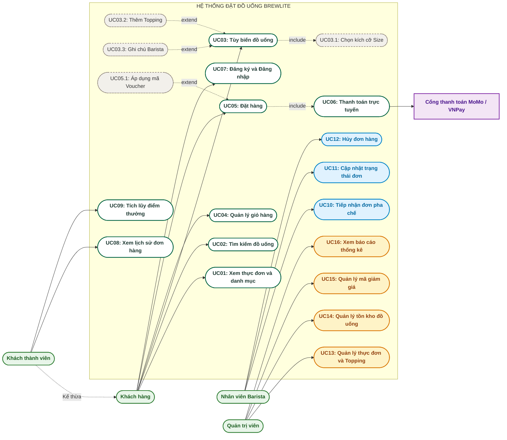
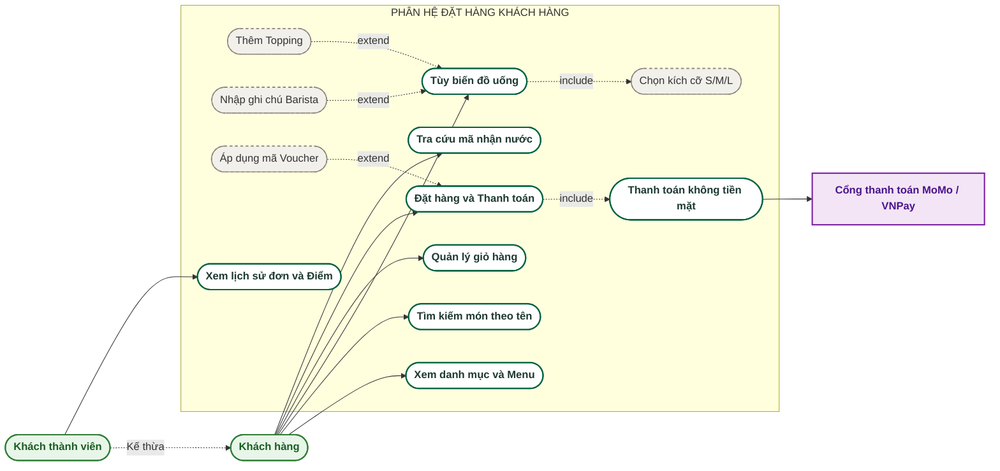

# 📌 SƠ ĐỒ USE CASE & ĐẶC TẢ USE CASE — DỰ ÁN BREWLITE
## Software Engineering — Use Case Analysis & Specification

> **Cơ sở đào tạo:** Trường Đại học Sài Gòn — Khoa Công nghệ Thông tin  
> **Môn học:** Công nghệ Phần mềm (Software Engineering)  
> **Dự án:** BrewLite — Hệ thống đặt đồ uống không dùng tiền mặt (Cashless Coffee Ordering System)  
> **Phiên bản:** v1.0  

---

## 1. DANH SÁCH TÁC NHÂN (ACTOR CATALOG)

| Tác nhân (Actor) | Phân loại | Vai trò & Trách nhiệm trong hệ thống |
| :--- | :--- | :--- |
| **Khách hàng (Customer)** | Primary Actor | Người dùng cuối truy cập ứng dụng web, xem thực đơn đồ uống, tìm kiếm, tùy biến món (chọn size, topping), quản lý giỏ hàng và tiến hành đặt hàng. |
| **Khách hàng thành viên (Member)** | Primary Actor *(Kế thừa từ Customer)* | Khách hàng đã đăng ký/đăng nhập tài khoản; có thêm quyền tích điểm thưởng (`loyaltyPoints`), xem lịch sử đơn hàng cá nhân và nhận ưu đãi riêng. |
| **Nhân viên quầy (Barista / Staff)** | Secondary Actor | Tiếp nhận các đơn hàng đã thanh toán thành công (`PAID`), chuyển trạng thái pha chế (`PREPARING` $\rightarrow$ `READY` $\rightarrow$ `COMPLETED`), và hủy đơn khi gặp sự cố nguyên liệu. |
| **Quản trị viên (Admin / Manager)** | Secondary Actor | Quản lý danh mục, đồ uống, size, topping, cấu hình tồn kho, quản lý mã voucher giảm giá, tài khoản người dùng và xem báo cáo doanh thu. |
| **Cổng thanh toán (Payment Gateway)** | Supporting / System Actor | Hệ thống bên ngoài (Mock MoMo / VNPay / Bank Card) tiếp nhận yêu cầu thanh toán không tiền mặt, xác thực giao dịch và phản hồi kết quả (Thành công / Thất bại). |

---

## 2. SƠ ĐỒ USE CASE TỔNG QUAN (OVERALL USE CASE DIAGRAM)

---

## 3. SƠ ĐỒ USE CASE PHÂN HỆ KHÁCH HÀNG (CUSTOMER SUBSYSTEM)

Tập trung chi tiết vào luồng trải nghiệm khách hàng từ lúc vào web đến khi hoàn tất đơn hàng không tiền mặt:

---

## 4. BẢNG DANH MỤC USE CASE (USE CASE CATALOG)

| Mã UC | Tên Use Case | Tác nhân chính | Phân hệ | Mức độ ưu tiên |
| :--- | :--- | :--- | :--- | :--- |
| **UC01** | Xem thực đơn & danh mục | Khách hàng | Menu & Danh mục | Bắt buộc (Must-Have) |
| **UC02** | Tìm kiếm đồ uống | Khách hàng | Menu & Danh mục | Bắt buộc (Must-Have) |
| **UC03** | Tùy biến đồ uống (Size, Topping, Ghi chú) | Khách hàng | Chi tiết sản phẩm | Bắt buộc (Must-Have) |
| **UC04** | Quản lý giỏ hàng (Cart) | Khách hàng | Giỏ hàng | Bắt buộc (Must-Have) |
| **UC05** | Đặt hàng (Checkout) | Khách hàng | Đơn hàng | Bắt buộc (Must-Have) |
| **UC06** | Thanh toán trực tuyến không tiền mặt | Khách hàng, Cổng thanh toán | Thanh toán | Bắt buộc (Must-Have) |
| **UC07** | Đăng ký & Đăng nhập (JWT) | Khách hàng | Xác thực | Bắt buộc (Must-Have) |
| **UC08** | Tra cứu lịch sử đơn hàng | Khách thành viên | Đơn hàng | Bắt buộc (Must-Have) |
| **UC09** | Tích lũy điểm thưởng | Khách thành viên | Khách hàng thân thiết | Nên có (Should-Have) |
| **UC10** | Tiếp nhận đơn hàng cần pha chế | Nhân viên Barista | Quầy pha chế | Bắt buộc (Must-Have) |
| **UC11** | Cập nhật trạng thái pha chế | Nhân viên Barista | Quầy pha chế | Bắt buộc (Must-Have) |
| **UC12** | Hủy đơn hàng | Nhân viên Barista / Admin | Vận hành | Nên có (Should-Have) |
| **UC13** | Quản lý thực đơn & Topping | Quản trị viên | Quản trị | Bắt buộc (Must-Have) |
| **UC14** | Quản lý tồn kho đồ uống | Quản trị viên | Quản trị | Bắt buộc (Must-Have) |
| **UC15** | Quản lý mã giảm giá (Voucher) | Quản trị viên | Khuyến mãi | Nên có (Should-Have) |
| **UC16** | Xem báo cáo thống kê doanh thu | Quản trị viên | Thống kê | Nên có (Should-Have) |

---

## 5. ĐẶC TẢ CHI TIẾT 2 USE CASE TRỌNG TÂM (DETAILED USE CASE SPECIFICATIONS)

### 📄 Đặc tả Use Case UC03: Tùy biến đồ uống
* **Mã Use Case:** UC03
* **Tên Use Case:** Tùy biến đồ uống (Customize Drink)
* **Tác nhân chính:** Khách hàng (Customer)
* **Mục đích:** Cho phép khách hàng chọn kích cỡ (S/M/L), chọn các loại topping thêm và ghi chú riêng cho Barista trước khi đưa vào giỏ hàng.
* **Tiền điều kiện (Preconditions):** Khách hàng đang ở trang Menu và đã nhấn chọn một món đồ uống cụ thể.
* **Hậu điều kiện (Postconditions):** Món đồ uống cùng cấu hình kích cỡ, topping, ghi chú và số lượng được thêm thành công vào giỏ hàng.
* **Luồng sự kiện chính (Main Success Scenario):**
  1. Khách hàng nhấn vào thẻ sản phẩm hoặc nút `+` trên giao diện Menu.
  2. Hệ thống hiển thị Modal chi tiết sản phẩm gồm: Hình ảnh tròn, Tên món, Mô tả, Giá gốc, danh sách Size, danh sách Topping, ô Ghi chú và bộ chọn Số lượng ly.
  3. Hệ thống tự động chọn sẵn kích cỡ mặc định (Size Nhỏ/Tiêu chuẩn với phụ thu 0đ).
  4. Khách hàng chọn kích cỡ mong muốn (Nhỏ +0đ, Vừa +6.000đ, Lớn +10.000đ).
  5. Khách hàng chọn 0 hoặc nhiều topping đi kèm.
  6. Hệ thống tự động cộng dồn giá: `Đơn giá = Giá gốc + Phụ thu Size + Tổng giá Topping` và hiển thị `Tổng tiền = Đơn giá × Số lượng` ngay trên nút CTA theo thời gian thực (Realtime).
  7. Khách hàng nhập ghi chú (nếu có) và nhấn nút *"Thêm vào đơn hàng"*.
  8. Hệ thống thêm món vào Giỏ hàng (State Management), hiển thị thông báo thành công (Toast notification) và tự động đóng modal.
* **Luồng sự kiện rẽ nhánh / Ngoại lệ (Extensions / Alternative Flows):**
  * `4a. Sản phẩm hết size hoặc hết hàng`: Hệ thống hiển thị nhãn vô hiệu hóa nút bấm và không cho phép chọn.
  * `7a. Khách hàng nhấn nút đóng (X) hoặc bấm ra ngoài màn hình`: Hệ thống hủy bỏ toàn bộ lựa chọn vừa thao tác và đóng modal, giữ nguyên trạng thái giỏ hàng trước đó.

---

### 📄 Đặc tả Use Case UC05 & UC06: Đặt hàng & Thanh toán trực tuyến
* **Mã Use Case:** UC05_06
* **Tên Use Case:** Đặt hàng và Thanh toán không tiền mặt (Checkout & Cashless Payment)
* **Tác nhân chính:** Khách hàng (Customer), Cổng thanh toán (Mock MoMo / VNPay)
* **Mục đích:** Xác nhận thông tin giỏ hàng, thông tin khách hàng và thanh toán trực tuyến để tạo đơn hàng hợp lệ trong hệ thống.
* **Tiền điều kiện (Preconditions):** Giỏ hàng có ít nhất 1 món đồ uống (`cartCount > 0`).
* **Hậu điều kiện (Postconditions):** 
  * Đơn hàng được tạo trong CSDL với trạng thái `PAID`.
  * Số lượng tồn kho (`stock`) của món được trừ an toàn.
  * Giỏ hàng phía client được dọn sạch.
  * Khách hàng nhận được Mã đơn hàng (`#1042`) và mã nhận nước tại quầy.
* **Luồng sự kiện chính (Main Success Scenario):**
  1. Khách hàng mở Giỏ hàng (Cart Drawer) và nhấn nút *"Tiến hành đặt hàng"*.
  2. Hệ thống hiển thị tóm tắt đơn hàng, yêu cầu nhập Tên và Số điện thoại nhận đồ uống.
  3. Khách hàng chọn phương thức thanh toán không dùng tiền mặt (Ví MoMo, ZaloPay, hoặc Thẻ ngân hàng).
  4. Khách hàng nhấn *"Xác nhận thanh toán"*.
  5. Hệ thống Frontend gửi request `POST /orders` kèm `Idempotency-Key` lên Backend.
  6. Backend kiểm tra tồn kho đồng thời (Optimistic Locking), tính lại tổng tiền từ CSDL Server-side, khởi tạo đơn hàng `PENDING`.
  7. Backend kích hoạt giao dịch với Cổng thanh toán Mock Gateway.
  8. Cổng thanh toán trừ tiền thành công và phản hồi trạng thái `SUCCESS`.
  9. Backend cập nhật đơn sang `PAID`, trừ tồn kho, cộng điểm thưởng (nếu là Khách thành viên) và trả về kết quả cho Frontend.
  10. Frontend dọn sạch giỏ hàng và chuyển hướng sang Màn hình xác nhận thành công hiển thị mã nhận nước.
* **Luồng ngoại lệ (Alternative / Exception Flows):**
  * `6a. Sản phẩm bị người khác mua hết trong lúc đặt`: Backend phát hiện tranh chấp tồn kho, hủy giao dịch và trả về thông báo lỗi: *"Sản phẩm đã hết hàng, vui lòng chọn món khác"*.
  * `8a. Thanh toán thất bại hoặc người dùng hủy giao dịch trên Ví`: Cổng thanh toán trả về `FAILED`. Backend chuyển trạng thái đơn sang `PAYMENT_FAILED`. Giỏ hàng của khách vẫn được giữ nguyên để thử lại hoặc chọn phương thức khác.
