# 📌 SƠ ĐỒ USE CASE & ĐẶC TẢ USE CASE — DỰ ÁN BREWLITE
## Software Engineering — Use Case Analysis & Specification

> **Cơ sở đào tạo:** Trường Đại học Sài Gòn — Khoa Công nghệ Thông tin  
> **Môn học:** Công nghệ Phần mềm (Software Engineering)  
> **Dự án:** BrewLite — Hệ thống đặt đồ uống không dùng tiền mặt (Cashless Coffee Ordering System)  
> **Phiên bản:** v1.0  

---

## 1. DANH SÁCH TÁC NHÂN (ACTOR CATALOG)

| Tác nhân (Actor) | Phân loại | Vai trò & Trách nhiệm trong hệ thống |
| :--- | :--- | :--- |
| **Khách hàng (Customer)** | Primary Actor | Người dùng cuối truy cập ứng dụng web, xem thực đơn đồ uống, tìm kiếm, tùy biến món (chọn size, topping), quản lý giỏ hàng và tiến hành đặt hàng. |
| **Khách hàng thành viên (Member)** | Primary Actor *(Kế thừa từ Customer)* | Khách hàng đã đăng ký/đăng nhập tài khoản; có thêm quyền tích điểm thưởng (`loyaltyPoints`), xem lịch sử đơn hàng cá nhân và nhận ưu đãi riêng. |
| **Nhân viên quầy (Barista / Staff)** | Secondary Actor | Tiếp nhận các đơn hàng đã thanh toán thành công (`PAID`), chuyển trạng thái pha chế (`PREPARING` $\rightarrow$ `READY` $\rightarrow$ `COMPLETED`), và hủy đơn khi gặp sự cố nguyên liệu. |
| **Quản trị viên (Admin / Manager)** | Secondary Actor | Quản lý danh mục, đồ uống, size, topping, cấu hình tồn kho, quản lý mã voucher giảm giá, tài khoản người dùng và xem báo cáo doanh thu. |
| **Cổng thanh toán (Payment Gateway)** | Supporting / System Actor | Hệ thống bên ngoài (Mock MoMo / VNPay / Bank Card) tiếp nhận yêu cầu thanh toán không tiền mặt, xác thực giao dịch và phản hồi kết quả (Thành công / Thất bại). |

---

## 2. SƠ ĐỒ USE CASE TỔNG QUAN (OVERALL USE CASE DIAGRAM)

---

## 3. SƠ ĐỒ USE CASE PHÂN HỆ KHÁCH HÀNG (CUSTOMER SUBSYSTEM)

Tập trung chi tiết vào luồng trải nghiệm khách hàng từ lúc vào web đến khi hoàn tất đơn hàng không tiền mặt:

```mermaid
flowchart LR
    Customer([Khách hàng]):::actorStyle
    Member([Khách thành viên]):::actorStyle
    PaymentGW[Cổng thanh toán MoMo / VNPay]:::systemActorStyle

    Member -.->|Kế thừa| Customer

    subgraph CustomerPortal [PHÂN HỆ ĐẶT HÀNG KHÁCH HÀNG]
        UC1([Xem danh mục và Menu]):::ucStyle
        UC2([Tìm kiếm món theo tên]):::ucStyle
        UC3([Tùy biến đồ uống]):::ucStyle
        UC3_1([Chọn kích cỡ S/M/L]):::subUcStyle
        UC3_2([Thêm Topping]):::subUcStyle
        UC3_3([Nhập ghi chú Barista]):::subUcStyle

        UC4([Quản lý giỏ hàng]):::ucStyle
        UC5([Đặt hàng và Thanh toán]):::ucStyle
        UC5_1([Áp dụng mã Voucher]):::subUcStyle
        UC6([Thanh toán không tiền mặt]):::ucStyle
        UC7([Tra cứu mã nhận nước]):::ucStyle
        UC8([Xem lịch sử đơn và Điểm]):::ucStyle
    end

    Customer --> UC1
    Customer --> UC2
    Customer --> UC3
    Customer --> UC4
    Customer --> UC5
    Customer --> UC7

    Member --> UC8

    UC3 -.->|include| UC3_1
    UC3_2 -.->|extend| UC3
    UC3_3 -.->|extend| UC3

    UC5 -.->|include| UC6
    UC5_1 -.->|extend| UC5

    UC6 --> PaymentGW

    classDef actorStyle fill:#e8f5e9,stroke:#2e7d32,stroke-width:2px,color:#1b5e20,font-weight:bold
    classDef systemActorStyle fill:#f3e5f5,stroke:#7b1fa2,stroke-width:2px,color:#4a148c,font-weight:bold
    classDef ucStyle fill:#ffffff,stroke:#006241,stroke-width:2px,color:#1e3932,font-weight:bold
    classDef subUcStyle fill:#f2f0eb,stroke:#8c827a,stroke-width:1.5px,stroke-dasharray: 4 4,color:#333
```

---

## 4. BẢNG DANH MỤC USE CASE (USE CASE CATALOG)

| Mã UC | Tên Use Case | Tác nhân chính | Phân hệ | Mức độ ưu tiên |
| :--- | :--- | :--- | :--- | :--- |
| **UC01** | Xem thực đơn & danh mục | Khách hàng | Menu & Danh mục | Bắt buộc (Must-Have) |
| **UC02** | Tìm kiếm đồ uống | Khách hàng | Menu & Danh mục | Bắt buộc (Must-Have) |
| **UC03** | Tùy biến đồ uống (Size, Topping, Ghi chú) | Khách hàng | Chi tiết sản phẩm | Bắt buộc (Must-Have) |
| **UC04** | Quản lý giỏ hàng (Cart) | Khách hàng | Giỏ hàng | Bắt buộc (Must-Have) |
| **UC05** | Đặt hàng (Checkout) | Khách hàng | Đơn hàng | Bắt buộc (Must-Have) |
| **UC06** | Thanh toán trực tuyến không tiền mặt | Khách hàng, Cổng thanh toán | Thanh toán | Bắt buộc (Must-Have) |
| **UC07** | Đăng ký & Đăng nhập (JWT) | Khách hàng | Xác thực | Bắt buộc (Must-Have) |
| **UC08** | Tra cứu lịch sử đơn hàng | Khách thành viên | Đơn hàng | Bắt buộc (Must-Have) |
| **UC09** | Tích lũy điểm thưởng | Khách thành viên | Khách hàng thân thiết | Nên có (Should-Have) |
| **UC10** | Tiếp nhận đơn hàng cần pha chế | Nhân viên Barista | Quầy pha chế | Bắt buộc (Must-Have) |
| **UC11** | Cập nhật trạng thái pha chế | Nhân viên Barista | Quầy pha chế | Bắt buộc (Must-Have) |
| **UC12** | Hủy đơn hàng | Nhân viên Barista / Admin | Vận hành | Nên có (Should-Have) |
| **UC13** | Quản lý thực đơn & Topping | Quản trị viên | Quản trị | Bắt buộc (Must-Have) |
| **UC14** | Quản lý tồn kho đồ uống | Quản trị viên | Quản trị | Bắt buộc (Must-Have) |
| **UC15** | Quản lý mã giảm giá (Voucher) | Quản trị viên | Khuyến mãi | Nên có (Should-Have) |
| **UC16** | Xem báo cáo thống kê doanh thu | Quản trị viên | Thống kê | Nên có (Should-Have) |

---

## 5. BẢNG MÔ TẢ ĐẶC TẢ USE CASE CHUẨN 7 Ô (7-FIELD USE CASE SPECIFICATIONS)

Dưới đây là các bảng đặc tả chi tiết theo định dạng chuẩn 7 thành phần của môn Công nghệ Phần mềm:
1. **Use Case Name** (Tên Use Case)
2. **Actor** (Tác nhân)
3. **Description** (Mô tả)
4. **Pre-condition** (Tiền điều kiện)
5. **Normal Flow** (Luồng sự kiện chính)
6. **Alternative Flow** (Luồng thay thế / Rẽ nhánh)
7. **Exception** (Luồng ngoại lệ / Xử lý lỗi)

---

### 📋 BẢNG 1: ĐẶC TẢ USE CASE UC03 — TÙY BIẾN ĐỒ UỐNG

| Trường thông tin | Chi tiết đặc tả |
| :--- | :--- |
| **1. Use Case Name** | **UC03: Tùy biến đồ uống (Customize Drink)** |
| **2. Actor** | Khách hàng (Customer) |
| **3. Description** | Cho phép khách hàng tùy chỉnh kích cỡ ly (S/M/L), chọn các loại topping thêm và nhập ghi chú riêng cho Barista trước khi đưa đồ uống vào giỏ hàng. |
| **4. Pre-condition** | Khách hàng đang ở giao diện Menu và đã nhấn chọn một món đồ uống cụ thể (hoặc nhấn nút `+`). |
| **5. Normal Flow** | **1.** Hệ thống hiển thị Modal chi tiết món gồm: Ảnh tròn đại diện, Tên món, Mô tả, Giá gốc, danh sách Kích cỡ (Size), danh sách Topping, ô Ghi chú và bộ chọn Số lượng ly. **2.** Hệ thống tự động chọn sẵn kích cỡ mặc định (Size Nhỏ S với phụ thu 0đ). **3.** Khách hàng chọn kích cỡ mong muốn (Nhỏ S +0đ, Vừa M +6.000đ, Lớn L +10.000đ). **4.** Khách hàng tích chọn một hoặc nhiều loại Topping (Trân châu hoàng kim, Kem phô mai, Thạch đào,...). **5.** Hệ thống tính toán và cập nhật giá Realtime: `Đơn giá = Giá gốc + Phụ thu Size + Tổng tiền Topping`. **6.** Khách hàng chọn số lượng ly mong muốn (mặc định là 1 ly). **7.** Khách hàng nhấn nút *"Thêm vào đơn hàng • [Tổng tiền]"*. **8.** Hệ thống thêm món đã cấu hình vào Giỏ hàng, hiển thị thông báo Toast thành công và tự động đóng modal. |
| **6. Alternative Flow** | **3a. Khách hàng thay đổi lựa chọn Size:** Hệ thống cập nhật lại phụ thu và làm mới tổng đơn giá tức thì. **4a. Khách hàng bỏ chọn Topping:** Hệ thống trừ tiền topping tương ứng ra khỏi tổng đơn giá. **6a. Khách hàng nhập thêm ghi chú:** Khách hàng gõ hướng dẫn pha chế vào ô *"Ghi chú cho Barista"* (ví dụ: *Ít đá, 50% đường*), hệ thống lưu ghi chú này kèm theo món. **8a. Khách hàng bấm nút đóng (X) hoặc bấm ra ngoài màn hình:** Hệ thống hủy bỏ toàn bộ lựa chọn vừa thao tác, đóng modal và giữ nguyên giỏ hàng hiện tại. |
| **7. Exception** | **E1. Món ăn hoặc kích cỡ đã hết hàng (Out of Stock):** Hệ thống hiển thị thông báo *"Món hiện tạm hết hàng"* hoặc vô hiệu hóa nút bấm của kích cỡ đó, không cho phép khách nhấn nút thêm vào giỏ. |

---

### 📋 BẢNG 2: ĐẶC TẢ USE CASE UC04 — QUẢN LÝ GIỎ HÀNG

| Trường thông tin | Chi tiết đặc tả |
| :--- | :--- |
| **1. Use Case Name** | **UC04: Quản lý giỏ hàng (Manage Shopping Cart)** |
| **2. Actor** | Khách hàng (Customer) |
| **3. Description** | Cho phép khách hàng xem danh sách các món đã chọn, điều chỉnh số lượng từng ly nước, xóa món hoặc kiểm tra tổng giá trị đơn hàng trước khi tiến hành thanh toán. |
| **4. Pre-condition** | Khách hàng nhấn vào biểu tượng Giỏ hàng trên thanh Header. |
| **5. Normal Flow** | **1.** Hệ thống mở khay trượt giỏ hàng (Cart Drawer) hiển thị danh sách các món đã chọn kèm thông tin chi tiết: Tên món, Size, danh sách Topping, Ghi chú, Số lượng và Thành tiền từng dòng. **2.** Hệ thống hiển thị tổng tiền tạm tính và tổng số lượng ly nước. **3.** Khách hàng nhấn nút tăng (`+`) hoặc giảm (`-`) để điều chỉnh số lượng của từng món. **4.** Hệ thống tự động tính lại tổng tiền đơn hàng ngay tức thì. **5.** Khách hàng nhấn nút *"Tiến hành đặt hàng"* để chuyển sang bước thanh toán. |
| **6. Alternative Flow** | **3a. Khách hàng giảm số lượng về 0 hoặc nhấn biểu tượng Xóa (Trash):** Hệ thống hiển thị xác nhận và xóa hẳn món đó khỏi danh sách giỏ hàng. **5a. Khách hàng muốn tiếp tục chọn thêm món:** Khách hàng nhấn nút đóng giỏ hàng hoặc bấm ra vùng mờ để quay lại duyệt menu, trạng thái giỏ hàng vẫn được lưu giữ nguyên vẹn trong `localStorage`. |
| **7. Exception** | **E1. Giỏ hàng trống rỗng (`cartCount === 0`):** Hệ thống hiển thị màn hình Empty State: *"Giỏ hàng của bạn đang trống"* kèm nút gợi ý *"Khám phá thực đơn ngay"*, đồng thời vô hiệu hóa nút Đặt hàng. |

---

### 📋 BẢNG 3: ĐẶC TẢ USE CASE UC05 — ĐẶT HÀNG

| Trường thông tin | Chi tiết đặc tả |
| :--- | :--- |
| **1. Use Case Name** | **UC05: Đặt hàng (Checkout Order)** |
| **2. Actor** | Khách hàng (Customer) |
| **3. Description** | Khách hàng xác nhận danh sách đồ uống trong giỏ hàng, điền thông tin người nhận đồ uống (Tên, Số điện thoại) và gửi yêu cầu khởi tạo đơn hàng lên hệ thống. |
| **4. Pre-condition** | Giỏ hàng có ít nhất 1 sản phẩm (`cartCount > 0`). |
| **5. Normal Flow** | **1.** Khách hàng nhấn nút *"Tiến hành đặt hàng"* từ giỏ hàng. **2.** Hệ thống hiển thị form thông tin đặt hàng: Tóm tắt danh sách món, ô nhập Họ tên, ô nhập Số điện thoại nhận nước và lựa chọn phương thức thanh toán không tiền mặt. **3.** Khách hàng nhập đầy đủ Họ tên và Số điện thoại hợp lệ. **4.** Khách hàng chọn phương thức thanh toán không tiền mặt (Ví MoMo, ZaloPay hoặc Thẻ ngân hàng). **5.** Khách hàng nhấn nút *"Xác nhận đặt hàng"*, kích hoạt Use Case **UC06: Thanh toán trực tuyến**. |
| **6. Alternative Flow** | **3a. Khách hàng đã đăng nhập tài khoản thành viên:** Hệ thống tự động điền sẵn Họ tên và Số điện thoại từ hồ sơ người dùng. **4a. Khách hàng áp dụng mã khuyến mãi:** Khách hàng nhập mã Voucher (ví dụ: `BREWNEW`), hệ thống xác thực mã và trừ số tiền giảm giá vào tổng đơn trước khi chốt thanh toán. |
| **7. Exception** | **E1. Khách hàng nhập thiếu thông tin hoặc sai định dạng:** Hệ thống hiển thị thông báo lỗi tại trường nhập liệu tương ứng (ví dụ: *"Số điện thoại không hợp lệ, phải gồm 10 chữ số"*), không cho phép gửi đơn. **E2. Món trong giỏ bị người khác mua hết trước khi đặt:** Backend phát hiện tồn kho không đủ (Optimistic Locking), báo lỗi *"Món [Tên món] vừa hết hàng, vui lòng cập nhật lại giỏ hàng"*. |

---

### 📋 BẢNG 4: ĐẶC TẢ USE CASE UC06 — THANH TOÁN TRỰC TUYẾN KHÔNG TIỀN MẶT

| Trường thông tin | Chi tiết đặc tả |
| :--- | :--- |
| **1. Use Case Name** | **UC06: Thanh toán trực tuyến (Cashless Payment Processing)** |
| **2. Actor** | Khách hàng (Customer), Cổng thanh toán (Mock MoMo / VNPay Gateway) |
| **3. Description** | Xử lý giao dịch trừ tiền trực tuyến không dùng tiền mặt, đảm bảo tính lũy thừa (Idempotency - không trừ tiền trùng lặp) và cập nhật trạng thái đơn hàng sang `PAID`. |
| **4. Pre-condition** | Đơn hàng đã được khởi tạo ở trạng thái `PENDING` và có mã định danh `orderId`. |
| **5. Normal Flow** | **1.** Hệ thống Client tạo mã định danh duy nhất `Idempotency-Key` và gửi yêu cầu thanh toán `POST /payments` lên Backend. **2.** Backend kết nối tới Cổng thanh toán (Mock Payment Gateway) để xử lý giao dịch trừ tiền. **3.** Cổng thanh toán phản hồi kết quả giao dịch thành công (`SUCCESS`). **4.** Backend áp dụng cỗ máy trạng thái (State Machine) chuyển đơn hàng từ `PENDING` $\rightarrow$ `PAID`. **5.** Backend thực hiện trừ số lượng tồn kho (`stock`) và cộng điểm thưởng tích lũy (nếu là Khách thành viên). **6.** Backend phản hồi thông báo thanh toán thành công về Client. **7.** Client dọn sạch giỏ hàng và chuyển hướng sang Màn hình xác nhận thành công hiển thị Mã đơn hàng (`#1042`) và hướng dẫn nhận đồ uống tại quầy. |
| **6. Alternative Flow** | **1a. Gửi lặp lại request thanh toán (mạng gián đoạn hoặc bấm nhiều lần):** Nhờ cơ chế `Idempotency-Key`, Backend phát hiện yêu cầu trùng lặp và chỉ xử lý giao dịch duy nhất 1 lần, không trừ tiền hai lần. |
| **7. Exception** | **E1. Thanh toán thất bại hoặc người dùng hủy giao dịch trên Ví điện tử:** Cổng thanh toán trả về `FAILED`. Backend chuyển trạng thái đơn hàng sang `PAYMENT_FAILED`. Giỏ hàng trên Client được giữ nguyên để khách hàng có thể chọn phương thức khác hoặc bấm *"Thử lại"*. **E2. Mất kết nối mạng / Cổng thanh toán không phản hồi (Timeout):** Hệ thống thông báo lỗi đường truyền và giữ nguyên trạng thái đơn chờ kiểm tra đối soát. |

---

### 📋 BẢNG 5: ĐẶC TẢ USE CASE UC07 — ĐĂNG KÝ VÀ ĐĂNG NHẬP

| Trường thông tin | Chi tiết đặc tả |
| :--- | :--- |
| **1. Use Case Name** | **UC07: Đăng ký và Đăng nhập (User Registration & Authentication)** |
| **2. Actor** | Khách hàng (Customer) |
| **3. Description** | Khách hàng tạo tài khoản thành viên mới hoặc đăng nhập vào hệ thống bằng Email và Mật khẩu để nhận JWT Token, kích hoạt quyền tích điểm và xem lịch sử mua hàng. |
| **4. Pre-condition** | Khách hàng nhấn vào nút Tài khoản trên Header ứng dụng. |
| **5. Normal Flow** | **1.** Khách hàng chọn tab *"Đăng nhập"* (hoặc *"Đăng ký"*). **2.** Khách hàng nhập địa chỉ Email và Mật khẩu (tối thiểu 6 ký tự). **3.** Khách hàng nhấn nút *"Xác nhận"*. **4.** Backend kiểm tra thông tin hợp lệ (đối chiếu hash mật khẩu bằng `bcrypt`). **5.** Backend tạo mã `accessToken` (chuỗi JWT có thời hạn) chứa thông tin `userId` và `role`. **6.** Client nhận và lưu trữ JWT Token, cập nhật giao diện người dùng sang trạng thái đã đăng nhập (hiển thị Tên người dùng và Điểm tích lũy). |
| **6. Alternative Flow** | **1a. Khách hàng chưa có tài khoản:** Khách hàng chuyển sang tab *"Đăng ký"*, nhập Họ tên, Email, Số điện thoại và Mật khẩu. Backend tạo bản ghi người dùng mới với vai trò mặc định là `CUSTOMER` và số điểm ban đầu là 0. |
| **7. Exception** | **E1. Đăng ký với Email đã tồn tại trong CSDL:** Backend từ chối và phản hồi lỗi `409 Conflict`: *"Email này đã được sử dụng, vui lòng chọn email khác hoặc đăng nhập"*. **E2. Đăng nhập sai Mật khẩu hoặc Email không tồn tại:** Backend trả về lỗi `401 Unauthorized`: *"Email hoặc mật khẩu không chính xác"*. |

---

### 📋 BẢNG 6: ĐẶC TẢ USE CASE UC11 — TIẾP NHẬN VÀ CẬP NHẬT TRẠNG THÁI PHA CHẾ

| Trường thông tin | Chi tiết đặc tả |
| :--- | :--- |
| **1. Use Case Name** | **UC11: Tiếp nhận và Cập nhật trạng thái pha chế (Barista Order Processing)** |
| **2. Actor** | Nhân viên quầy (Barista / Staff) |
| **3. Description** | Nhân viên quầy theo dõi danh sách các đơn hàng đã thanh toán thành công, tiến hành pha chế theo đúng công thức kích cỡ/topping/ghi chú và cập nhật trạng thái đơn hàng theo đúng vòng đời nghiệp vụ. |
| **4. Pre-condition** | Đơn hàng đã đạt trạng thái `PAID` (đã thanh toán thành công qua cổng thanh toán). |
| **5. Normal Flow** | **1.** Nhân viên Barista xem màn hình Quầy pha chế, thấy đơn hàng mới xuất hiện ở cột `PAID`. **2.** Barista kiểm tra chi tiết các món trong đơn (Tên đồ uống, Size S/M/L, các loại Topping và Ghi chú riêng). **3.** Barista nhấn nút *"Bắt đầu pha chế"*, hệ thống chuyển trạng thái đơn sang `PREPARING`. **4.** Sau khi hoàn tất đồ uống và đóng gói, Barista nhấn nút *"Sẵn sàng giao"*, hệ thống chuyển trạng thái đơn sang `READY` và hiển thị mã nhận nước lên bảng thông báo. **5.** Khách hàng đến quầy đối chiếu mã đơn, Barista giao nước và nhấn nút *"Hoàn tất đơn"*, hệ thống chuyển trạng thái đơn sang `COMPLETED`. |
| **6. Alternative Flow** | **3a. Khách hàng hủy đơn trước khi pha chế:** Nếu khách yêu cầu hủy và được chấp thuận, Barista chọn hủy đơn, hệ thống chuyển sang `CANCELLED` và kích hoạt luồng hoàn tiền. |
| **7. Exception** | **E1. Chuyển đổi trạng thái sai quy trình (Violation of State Machine):** Nếu Barista cố tình nhảy cóc trạng thái (ví dụ từ `PAID` nhảy thẳng sang `COMPLETED` mà chưa qua `PREPARING`/`READY`), hệ thống kích hoạt hàm kiểm soát `assertTransition` và chặn đứng thao tác, báo lỗi `400 Bad Request`. **E2. Hết nguyên liệu đột xuất tại quầy:** Barista không thể pha chế, chuyển trạng thái đơn sang `CANCELLED` kèm lý do hết nguyên liệu để hoàn tiền cho khách. |

