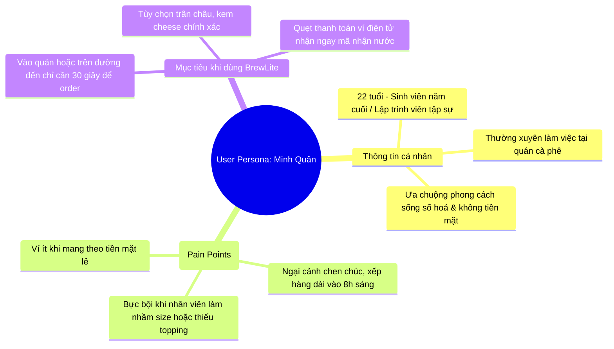
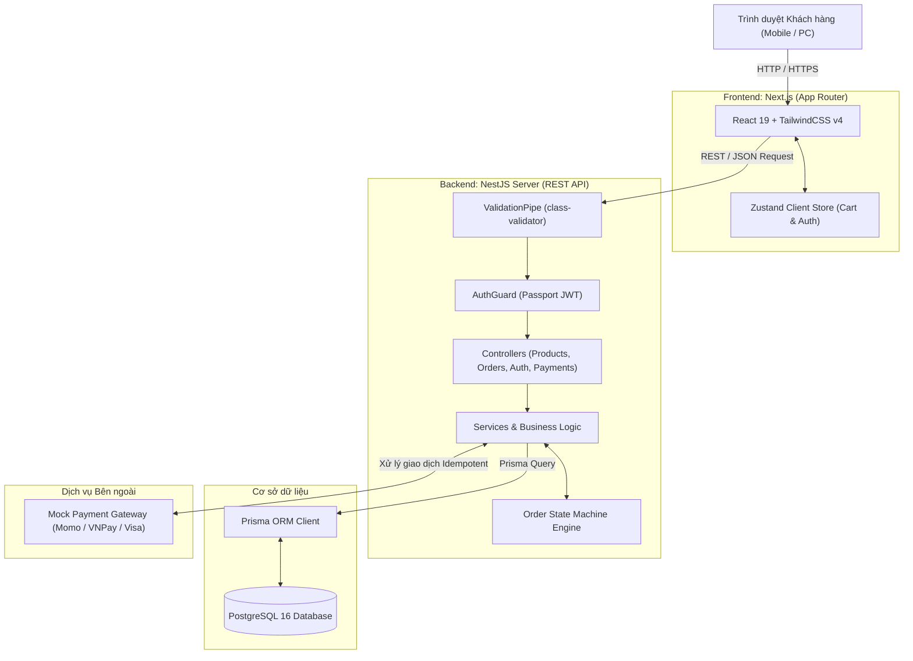
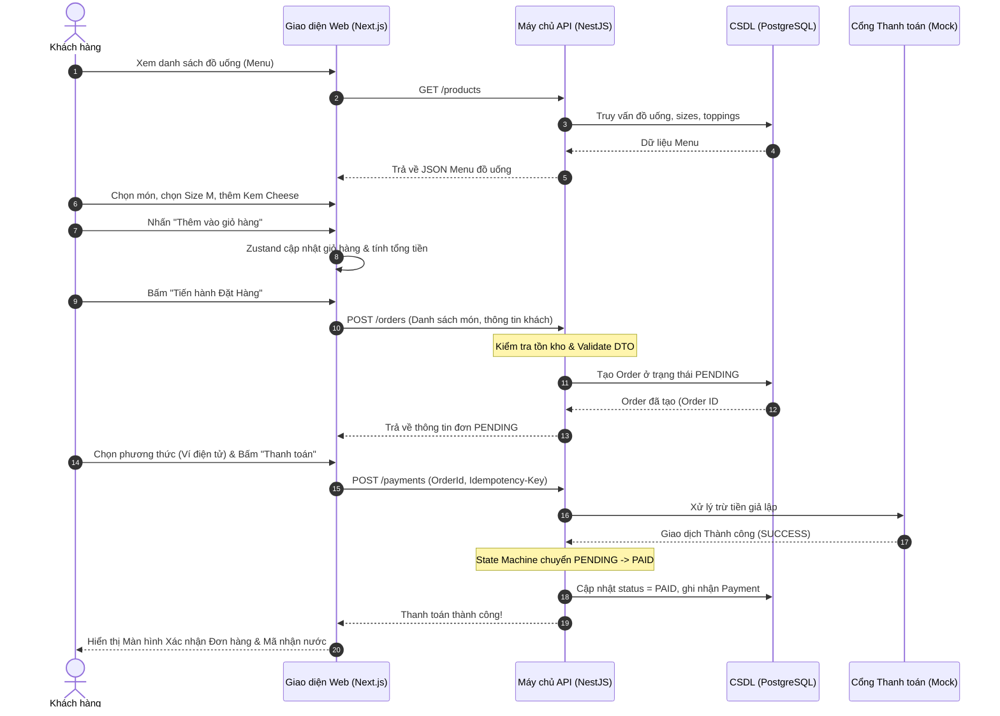
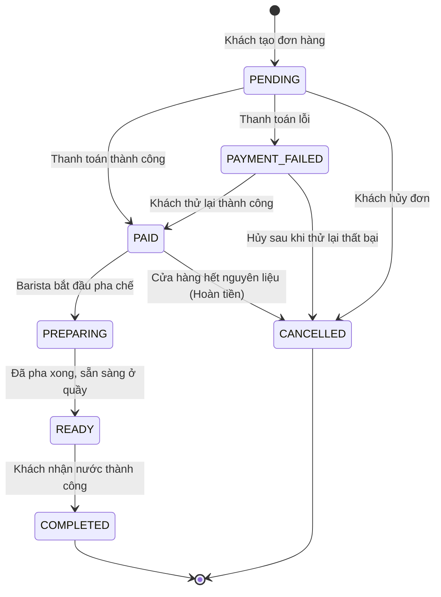

# ☕ TÀI LIỆU TRÌNH BÀY & BÁO CÁO SẢN PHẨM BREWLITE
## Cashless Coffee Ordering System — Hệ Thống Đặt Cà Phê Không Tiền Mặt

---

> **Trường Đại học Sài Gòn — Khoa Công nghệ Thông tin**  
> **Môn học:** Công nghệ Phần mềm (Software Engineering)  
> **Học kỳ:** I — Năm học 2026–2027  
> **Sản phẩm:** BrewLite (Ver 1.0)  
> **Mô hình quy trình:** Agile Scrum (3 Sprints — 10 Tasks)  
> **Kiến trúc:** Monorepo (Next.js App Router + NestJS REST API + PostgreSQL Prisma)

---

## 📑 MỤC LỤC
1. [Giới thiệu Dự án & Tuyên ngôn Sản phẩm (Product Pitch)](#1-giới-thiệu-dự-án--tuyên-ngôn-sản-phẩm)
2. [Các Bên Liên Quan (Stakeholders) & Chân Dung Người Dùng (Personas)](#2-các-bên-liên-quan-stakeholders--chân-dung-người-dùng)
3. [Phân Tích Yêu Cầu Phần Mềm (Requirements)](#3-phân-tích-yêu-cầu-phần-mềm-requirements)
4. [Kiến Trúc Kỹ Thuật & Công Nghệ (Technical Architecture)](#4-kiến-trúc-kỹ-thuật--công-nghệ)
5. [Luồng Nghiệp Vụ & Thiết Kế Giao Diện (User Journey & Wireframes)](#5-luồng-nghiệp-vụ--thiết-kế-giao-diện)
6. [Kế Hoạch Quản Lý Dự Án Theo Agile Scrum (Backlog & Sprints)](#6-kế-hoạch-quản-lý-dự-án-theo-agile-scrum)
7. [Các Điểm Sáng Kỹ Thuật Nổi Bật (Technical Highlights)](#7-các-điểm-sáng-kỹ-thuật-nổi-bật)
8. [Kịch Bản Thuyết Trình & Trình Diễn Sản Phẩm (Demo Script)](#8-kịch-bản-thuyết-trình--trình-diễn-sản-phẩm)
9. [Sprint Retrospective & Hướng Phát Triển Tương Lai](#9-sprint-retrospective--hướng-phát-triển-tương-lai)
10. [Hướng Dẫn Cài Đặt & Nghiệm Thu (Handover & Verification)](#10-hướng-dẫn-cài-đặt--nghiệm-thu)

---

## 1. GIỚI THIỆU DỰ ÁN & TUYÊN NGÔN SẢN PHẨM

### 1.1. Bối cảnh & Vấn đề thực tế (Problem Statement)
Tại các chuỗi cửa hàng cà phê và đồ uống trong khung giờ cao điểm (sáng sớm và giờ nghỉ trưa):
* **Xếp hàng kéo dài:** Khách hàng mất từ 10 - 20 phút chỉ để xếp hàng gọi món và chờ quẹt thẻ/trả tiền mặt.
* **Sai sót khi ghi nhận đơn:** Order bằng miệng dễ nhầm lẫn Size, mức đường/đá, hoặc loại topping giữa giờ bận rộn.
* **Rủi ro tiền mặt & tắc nghẽn quầy:** Nhân viên thu ngân vừa phải đếm tiền thối, vừa in hóa đơn, gây nghẽn cổ chai (bottleneck) nghiêm trọng tại quầy nhận món.

### 1.2. Giải pháp & Tuyên ngôn Sản phẩm (Product Vision)
> **“BrewLite giúp khách hàng đặt và thanh toán đồ uống không dùng tiền mặt chỉ trong vài chạm, giảm thời gian xếp hàng và nhận đơn nhanh tại quầy.”**

* **Giá trị cốt lõi mang lại:**
  * ⚡ **Nhanh chóng:** Khách chủ động chọn món, tùy chỉnh topping ngay trên điện thoại hoặc trình duyệt web.
  * 💳 **Không tiền mặt:** Tích hợp thanh toán trực tuyến tức thì (Momo, VNPay, thẻ nội địa / quốc tế).
  * 🎯 **Chính xác & Minh bạch:** Mã đơn điện tử kèm trạng thái trực quan, theo dõi đơn chuẩn xác từ lúc pha chế đến khi nhận nước.

---

## 2. CÁC BÊN LIÊN QUAN (STAKEHOLDERS) & CHÂN DUNG NGƯỜI DÙNG

### 2.1. Phân tích Các bên liên quan (Stakeholder Matrix)

| Bên liên quan | Vai trò & Trách nhiệm chính | Mối quan tâm cốt lõi |
| :--- | :--- | :--- |
| **Khách hàng (Customer)** | Người dùng cuối đặt đồ uống, tùy chọn size/topping, thanh toán trực tuyến. | Đặt món nhanh, giao diện mượt mà, thanh toán tiện lợi và an toàn. |
| **Barista / Nhân viên quầy** | Nhận đơn đặt hàng, cập nhật trạng thái pha chế và giao đồ uống. *(Phần mở rộng)* | Danh sách đơn rõ ràng, không bị sót đơn, thông tin topping/size chính xác. |
| **Product Owner (PO)** | Định hình chiến lược sản phẩm, ưu tiên Product Backlog, nghiệm thu Increment. | Sản phẩm giải quyết đúng bài toán thị trường, tối ưu trải nghiệm người dùng. |
| **Giảng viên nghiệm thu** | Đánh giá quy trình Scrum, cấu trúc code, khả năng đáp ứng tiêu chí đồ án. | Tuân thủ chuẩn CNPM, kiến trúc sạch, validation chặt chẽ, test đầy đủ. |
| **Development Team** | Phân tích, thiết kế CSDL, lập trình fullstack, kiểm thử và đóng gói Docker. | Codebase dễ bảo trì, CI/CD trơn tru, không có lỗi tiềm ẩn về race condition. |
| **Cổng thanh toán (Mock)** | Xử lý giao dịch trừ tiền không tiền mặt giả lập. | Tính idempotent (chống trừ tiền 2 lần), phản hồi kết quả tức thì. |

### 2.2. Chân dung Người dùng Tiêu biểu (User Persona)



---

## 3. PHÂN TÍCH YÊU CẦU PHẦN MỀM (REQUIREMENTS)

### 3.1. Yêu cầu chức năng (Functional Requirements - FR)
1. **FR1 — Menu Đồ Uống:** Hiển thị danh mục đồ uống phân loại rõ ràng (Cà phê, Trà hoa quả, Đá xay, Bánh ngọt), kèm hình ảnh chất lượng cao, mô tả và giá gốc.
2. **FR2 — Tùy biến Món:** Xem chi tiết từng món; cho phép chọn Size (S / M / L) và nhiều loại Topping (Trân châu trắng, Thạch nha đam, Kem Cheese,...); tự động tính giá phụ trội theo thời gian thực.
3. **FR3 — Quản lý Giỏ hàng:** Thêm sản phẩm, thay đổi số lượng, xóa từng món hoặc xóa trắng giỏ; cập nhật tức thì tổng tiền và số lượng trên biểu tượng giỏ hàng.
4. **FR4 — Xác thực & Người dùng:** Đăng ký tài khoản mới, Đăng nhập hệ thống bảo mật bằng JSON Web Token (JWT).
5. **FR5 — Tạo Đơn & Thanh toán không tiền mặt:** Đặt hàng, chọn phương thức thanh toán (Ví điện tử Momo/ZaloPay, Thẻ ngân hàng), xử lý giao dịch qua cổng Mock Payment Gateway.
6. **FR6 — Xác nhận & Lịch sử Đơn:** Cấp mã đơn duy nhất (Order Code), theo dõi trạng thái đơn hàng (PAID, PREPARING, READY, COMPLETED) và tra cứu lịch sử mua hàng cá nhân.

### 3.2. Yêu cầu phi chức năng (Non-Functional Requirements - NFR)
* **Hiệu năng (Performance):** Thời gian phản hồi API trung bình `< 500ms` với dữ liệu thử nghiệm; thời gian tải trang ban đầu (FCP) `< 1.2s`.
* **Bảo mật (Security):**
  * Mật khẩu người dùng được băm an toàn bằng thuật toán `bcrypt` với muối (salt rounds = 10).
  * Xác thực qua JWT có thời hạn hết hạn, lưu trữ an toàn.
  * Validation Pipe kích hoạt chế độ `whitelist` và `forbidNonWhitelisted` ngăn chặn triệt để tấn công Mass Assignment.
* **Khả năng mở rộng & Bảo trì (Maintainability):** Áp dụng Dependency Injection chuẩn mực của NestJS, tách biệt 3 tầng Controller - Service - Data Access (Prisma).
* **Tính tương thích (Compatibility):** Tương thích hoàn toàn trên tất cả các trình duyệt hiện đại (Chrome, Edge, Firefox, Safari) và giao diện co giãn Responsive tối ưu cho cả Mobile lẫn Desktop.

### 3.3. User Story Tiêu Biểu & Tiêu Chí Chấp Nhận (Acceptance Criteria)

#### 📌 US-05: Thanh toán không dùng tiền mặt (Thanh toán trực tuyến)
> **Là một** khách hàng bận rộn,  
> **Tôi muốn** thanh toán đơn hàng bằng ví điện tử hoặc thẻ ngân hàng trực tuyến trên hệ thống,  
> **Để** tôi có thể hoàn tất mua đồ uống nhanh chóng mà không cần bận tâm về tiền mặt.

* **Tiêu chí chấp nhận (Acceptance Criteria):**
  * ✅ Khi giỏ hàng có tối thiểu 1 món, nút *"Thanh toán"* hiển thị rõ ràng tổng tiền chính xác.
  * ✅ Người dùng có thể chọn giữa các phương thức: `Ví điện tử` hoặc `Thẻ thanh toán`.
  * ✅ Khi xác nhận thanh toán thành công: Đơn hàng lập tức chuyển sang trạng thái `PAID`, giỏ hàng được làm sạch và chuyển hướng đến trang xác nhận kèm Mã đơn hàng.
  * ✅ Nếu thanh toán thất bại (mô phỏng tài khoản không đủ số dư hoặc từ chối): Trạng thái đơn chuyển sang `PAYMENT_FAILED`, hệ thống giữ nguyên giỏ hàng để khách có thể thao tác lại.

---

## 4. KIẾN TRÚC KỸ THUẬT & CÔNG NGHỆ

### 4.1. Kiến trúc Tổng thể Monorepo

Dự án sử dụng mô hình **Monorepo** chuẩn mực, kết hợp sức mạnh của Fullstack TypeScript:



### 4.2. Bảng Công nghệ Lựa chọn & Lý do Lựa chọn

| Tầng hệ thống | Công nghệ | Phiên bản | Lý do kỹ thuật được chọn |
| :--- | :--- | :--- | :--- |
| **Frontend Web** | Next.js (React) | 19.x / Next 15 | App Router với kiến trúc Server Components + Client Components, SEO tối ưu, thời gian render siêu nhanh. |
| **Styling** | TailwindCSS | v4.x | Utility-first CSS hiện đại, cấu hình tinh gọn, tối ưu kích thước bundle khi build production. |
| **State Manager** | Zustand | v5.x | Quản lý state giỏ hàng nhẹ, không bị boilerplate như Redux, đồng bộ tức thì LocalStorage. |
| **Backend REST** | NestJS | v10.x | Kiến trúc phân lớp chuẩn doanh nghiệp (Enterprise-grade), tích hợp Dependency Injection và TypeScript chặt chẽ. |
| **ORM & DB** | Prisma + PostgreSQL | 6.x / PG 16 | Type-safe Database Client, Schema trực quan, Migration tự động, hiệu năng câu lệnh cao. |
| **Authentication** | Passport JWT | v10.x | Tiêu chuẩn mã hóa không trạng thái (stateless), an toàn cho REST API. |
| **Containerization** | Docker & Compose | v2.x | Đảm bảo môi trường chạy đồng nhất 100% giữa các thành viên và máy chấm của giảng viên. |

---

## 5. LUỒNG NGHIỆP VỤ & THIẾT KẾ GIAO DIỆN

### 5.1. Luồng Nghiệp Vụ Cốt Lõi (Order & Payment Happy Path)



### 5.2. Thiết Kế 5 Màn Hình MVP Cốt Lõi

```
+--------------------+   +--------------------+   +--------------------+
| ☕ BrewLite      ≡ |   | ← Chi tiết đồ uống |   | 🛒 Giỏ hàng của bạn|
| [Tất cả] [Cà phê]  |   | Cappuccino Nóng    |   |                    |
| +----------------+ |   | 45.000đ            |   | Cappuccino (M) x1  |
| | Cà phê sữa     | |   | Chọn Size:         |   | + Kem Cheese       |
| | 35.000đ  [+Thêm]| |   | ( ) S  (*) M  ( )L |   | Trà Đào Cam Sả x2  |
| +----------------+ |   | Thêm Topping:      |   | ------------------ |
| | Bạc Xỉu Đá     | |   | [x] Trân châu      |   | Tạm tính: 123.000đ |
| | 38.000đ  [+Thêm]| |   | [x] Kem Cheese     |   | Giảm giá: -15.000đ |
|                    |   |                    |   | Tổng cộng:108.000đ |
| [Giỏ hàng: 3 món]  |   | [Thêm vào giỏ]     |   | [Thanh toán ngay]  |
+--------------------+   +--------------------+   +--------------------+
     (1) Trang Menu         (2) Modal Tùy chọn       (3) Xem Giỏ hàng

                                     │
                                     ▼
                   +--------------------+   +--------------------+
                   | 💳 Thanh toán đơn  |   |  🎉 ĐẶT THÀNH CÔNG |
                   | Đơn hàng: #1042    |   |                    |
                   | Tổng tiền: 108.000đ|   |   Mã đơn: #1042    |
                   | Phương thức:       |   | Trạng thái: ĐÃ TRẢ |
                   | (*) Ví Momo        |   |                    |
                   | ( ) Thẻ ATM/Visa   |   |   Mời bạn đến quầy |
                   |                    |   |    nhận nước sau   |
                   | [Xác nhận trả]     |   |      5-7 phút      |
                   +--------------------+   | [Về Trang Chủ]     |
                    (4) Màn Thanh toán      +--------------------+
                                             (5) Màn hình Xác nhận
```

---

## 6. KẾ HOẠCH QUẢN LÝ DỰ ÁN THEO AGILE SCRUM

### 6.1. Tổ Chức 3 Sprints — 10 Tasks Backlog

| Sprint | Task | Hạng mục công việc (User Story) | Trọng số (Điểm) | Kết quả bàn giao (Artifacts) |
| :---: | :---: | :--- | :---: | :--- |
| **Sprint 1** | **Task 1** | Khởi tạo dự án & Cấu trúc Monorepo (Next.js + NestJS) | 1.0 | Monorepo cấu trúc chuẩn, Docker Compose, README.md, CI scripts. |
| | **Task 2** | Thiết kế CSDL Prisma & Xây dựng API Danh sách Sản phẩm | 1.0 | Migration CSDL, Seed dữ liệu menu thực tế, API `GET /products`, Swagger docs. |
| | **Task 3** | Xây dựng Giao diện Trang Menu Đồ Uống (Frontend) | 1.0 | Menu Next.js responsive, lọc danh mục, search món, Skeleton loading state. |
| | **Task 4** | Modal Chi tiết Sản phẩm & Tùy biến Size, Topping | 1.0 | Dialog tùy biến size/topping, tính toán giá động theo thời gian thực. |
| **Sprint 2** | **Task 5** | Quản lý Giỏ hàng (Cart) với Zustand Store | 1.0 | Thêm/sửa/xóa giỏ, lưu LocalStorage, badge giỏ hàng tự động cập nhật. |
| | **Task 6** | Xây dựng API Tạo Đơn Hàng (`POST /orders`) | 1.0 | Validation DTO chặt chẽ, sinh mã đơn hàng, lưu trữ trạng thái `PENDING`. |
| | **Task 7** | Đăng ký & Đăng nhập Người Dùng (JWT Authentication) | 1.0 | Mã hóa bcrypt, cấp phát JWT, Auth Guard bảo vệ tài nguyên đơn cá nhân. |
| **Sprint 3** | **Task 8** | Tích hợp Thanh Toán Không Tiền Mặt (Mock Payment) | 1.0 | API thanh toán, cập nhật trạng thái đơn sang `PAID` hoặc `PAYMENT_FAILED`. |
| | **Task 9** | Màn hình Xác Nhận, Lịch Sử Đơn & Đóng Gói Docker | 1.0 | Màn xác nhận có QR/Mã nhận nước, API `GET /orders/me`, Dockerfile hoàn chỉnh. |
| | **Task 10**| Nghiệp Vụ Chuyên Sâu: State Machine, Idempotent, Concurrency & Test | 1.0 | Cỗ máy trạng thái, kiểm soát trừ kho đồng thời, chống lặp đơn, bộ test tự động. |
| **TỔNG** | **10** | **Toàn bộ 3 Sprint hoàn thiện theo chuẩn Scrum** | **10.0** | **Bản phát hành Release v1.0 chạy ổn định** |

### 6.2. Tiêu Chuẩn Hoàn Thành (Definition of Done - DoD)
Một task chỉ được đánh dấu là hoàn thành khi đáp ứng đủ 5 tiêu chí DoD:
1. ✅ **Chạy thực tế:** Mã nguồn biên dịch thành công, không phát sinh lỗi Typescript / Linter.
2. ✅ **Kiểm thử đầy đủ:** Các API được kiểm tra dữ liệu đầu vào (Validation) và xử lý ngoại lệ đầy đủ.
3. ✅ **Đồng bộ mã nguồn:** Thực hiện commit chuẩn Conventional Commits (`feat:`, `fix:`, `docs:`) và `git push` ngay lập tức lên remote repository.
4. ✅ **Tài liệu rõ ràng:** Có ghi chép hướng dẫn sử dụng và cập nhật file `README.md`.
5. ✅ **Kiểm tra giao diện:** Đảm bảo UI có đủ 3 trạng thái: Đang tải (Loading), Dữ liệu rỗng (Empty), và Lỗi (Error).

---

## 7. CÁC ĐIỂM SÁNG KỸ THUẬT NỔI BẬT

### 7.1. Cỗ Máy Trạng Thái Đơn Hàng (Order State Machine)
Ngăn chặn tuyệt đối việc chuyển trạng thái bất hợp pháp (ví dụ: đơn chưa thanh toán mà nhảy sang đã hoàn thành).



* **Cơ chế triển khai:** Hàm `assertTransition(currentStatus, nextStatus)` kiểm tra ma trận hợp lệ trước khi `UPDATE` CSDL. Nếu sai quy tắc, lập tức ném lỗi `BadRequestException(400)`.

### 7.2. Thanh Toán An Toàn Chống Lặp (Idempotent Payment)
* Khi mạng của khách hàng bị lag hoặc khách bấm nút *"Xác nhận trả"* liên tiếp 2 lần:
* Client tự động sinh một `Idempotency-Key` (UUIDv4) gửi trong Header.
* Server lưu vết `Idempotency-Key` cùng giao dịch. Nếu nhận được request thứ 2 có cùng Key, hệ thống trả về kết quả giao dịch trước đó thay vì thực hiện trừ tiền 2 lần.

### 7.3. Kiểm Soát Tồn Kho Đồng Thời (Optimistic Concurrency Control)
* **Tình huống:** Quán chỉ còn duy nhất 1 ly Bạc Xỉu phiên bản giới hạn, 2 khách hàng bấm thanh toán tại cùng một mili-giây.
* **Giải pháp:** Sử dụng trường số hiệu phiên bản `version` kết hợp Prisma Database Transaction:
  ```typescript
  // Cập nhật tồn kho có điều kiện phiên bản
  const affected = await prisma.product.updateMany({
    where: { id: productId, version: currentVersion, stock: { gte: quantity } },
    data: { stock: { decrement: quantity }, version: { increment: 1 } }
  });
  if (affected.count === 0) {
    throw new ConflictException("Sản phẩm đã hết hàng trong khi bạn đang thanh toán!");
  }
  ```

---

## 8. KỊCH BẢN THUYẾT TRÌNH & TRÌNH DIỄN SẢN PHẨM (DEMO SCRIPT)

Kịch bản 10 phút trình bày dành cho nhóm sinh viên trong buổi **Sprint Review / Báo cáo Đồ án môn CNPM**:

### ⏱️ Phần 1: Mở Đầu & Đặt Vấn Đề (00:00 – 02:00)
* **Người trình bày:** Trưởng nhóm / Product Owner.
* **Nội dung:**
  * Giới thiệu tên đề tài: **BrewLite — Cashless Coffee Ordering System**.
  * Trình chiếu slide Vấn đề: Nạn xếp hàng dài chờ thanh toán tại các quán đồ uống giờ cao điểm.
  * Tuyên ngôn sản phẩm (Product Vision) & 3 giá trị khác biệt: Tốc độ, Không tiền mặt, Tùy biến chính xác.

### ⏱️ Phần 2: Kiến Trúc & Quy Trình Agile Scrum (02:00 – 04:00)
* **Người trình bày:** Scrum Master / Kỹ sư Hệ thống.
* **Nội dung:**
  * Giới thiệu mô hình Monorepo: `frontend/` (Next.js 15) và `backend/` (NestJS) đồng bộ trong 1 repo duy nhất.
  * Trình bày kết quả 3 Sprint với 10 Task Backlog bám sát kế hoạch, đạt đủ Definition of Done (DoD).
  * Minh họa sơ đồ máy trạng thái (Order State Machine) kiểm soát đơn hàng.

### ⏱️ Phần 3: Trình Diễn Luồng Thực Tế End-to-End (Live Demo) (04:00 – 08:00)
* **Người trình bày:** Lập trình viên chính (Dev Lead).
* **Các bước thao tác trực tiếp trên màn hình:**
  1. **Bước 1 — Xem Menu:** Truy cập trang web, xem danh sách đồ uống phân chia theo danh mục (Cà phê, Trà hoa quả).
  2. **Bước 2 — Tùy biến món:** Bấm vào ly *Cappuccino*, đổi sang Size L (+10.000đ), tích chọn thêm *Kem Cheese* (+10.000đ). Giá hiển thị tự động cập nhật từ 45.000đ lên 65.000đ.
  3. **Bước 3 — Thêm giỏ & Quản lý:** Bấm *Thêm vào giỏ*, số badge trên Header nhảy lên `1`. Mở giỏ hàng kiểm tra danh sách món.
  4. **Bước 4 — Đăng nhập & Tạo đơn:** Bấm tiến hành thanh toán, hệ thống yêu cầu xác thực JWT. Đăng nhập tài khoản mẫu.
  5. **Bước 5 — Thanh toán Mock:** Chọn phương thức thanh toán *Ví điện tử*, bấm xác nhận. Hệ thống xử lý trong 500ms và chuyển sang màn hình **Thành Công**.
  6. **Bước 6 — Xác nhận nhận nước:** Màn hình hiển thị rõ ràng: `Mã đơn hàng: #1042`, `Trạng thái: PAID`, dòng chữ *"Mời bạn đến quầy nhận nước sau 5 phút"*.
  7. **Bước 7 — Kiểm tra Lịch sử:** Vào mục Lịch sử đơn (`/orders`), chứng minh đơn vừa đặt đã được ghi nhận trong cơ sở dữ liệu.

### ⏱️ Phần 4: Điểm Nhấn Kỹ Thuật & Trả Lời Câu Hỏi (08:00 – 10:00)
* **Người trình bày:** Toàn nhóm.
* **Nội dung:**
  * Giới thiệu cơ chế chống thanh toán trùng lặp (Idempotency Key) và kiểm soát tồn kho (Optimistic Locking).
  * Tổng kết Sprint Retrospective: Những gì nhóm làm tốt và kinh nghiệm thực tế rút ra.
  * Sẵn sàng giải đáp câu hỏi vấn đáp của Giảng viên.

---

## 9. SPRINT RETROSPECTIVE & HƯỚNG PHÁT TRIỂN TƯƠNG LAI

### 9.1. Sprint Retrospective (Nhìn nhận sau 3 Sprint)
* **Những điều làm tốt (What went well):**
  * Áp dụng thành công Monorepo giúp việc phát triển giao diện và API diễn ra song song nhịp nhàng.
  * Tuân thủ quy định Git nghiêm ngặt: làm xong task nào commit và push ngay lập tức lên GitHub.
  * Áp dụng TypeScript xuyên suốt từ Frontend đến Backend giúp triệt tiêu 90% lỗi sai kiểu dữ liệu.
* **Những điều cần cải thiện (What could be improved):**
  * Cần tối ưu thêm việc tự động sinh mock token khi kiểm thử API bằng Postman.
  * Bổ sung thêm nhiều hình ảnh minh họa menu sắc nét và hấp dẫn hơn.

### 9.2. Kế hoạch Phiên Bản Tiếp Theo (Future Roadmap v2.0)
* 📱 **Màn hình Barista Realtime:** Tích hợp WebSockets / SSE để quầy pha chế nhận thông báo đơn mới ngay khi khách thanh toán mà không cần F5 trình duyệt.
* 📍 **Định vị & Hẹn giờ nhận món:** Cho phép khách hàng chọn hẹn giờ nhận nước (Ví dụ: đúng 8h15 có mặt tại quán).
* 🎁 **Tích hợp Cổng thanh toán thực:** Kết nối trực tiếp API Production của MoMo / VNPay QR Code.

---

## 10. HƯỚNG DẪN CÀI ĐẶT & NGHIỆM THU

### 10.1. Yêu cầu Môi trường
* **Node.js:** Phiên bản `>= 20.x` (LTS khuyến nghị: Node 22)
* **NPM:** Phiên bản `>= 10.x`
* **Docker & Docker Compose:** Đã cài đặt và đang chạy dịch vụ Docker daemon.

### 10.2. Lệnh Khởi Chạy Nhanh Toàn Bộ Hệ Thống
```bash
# 1. Khởi động PostgreSQL trong Docker
docker compose up -d postgres

# 2. Cài đặt dependencies cho cả Backend và Frontend
npm install

# 3. Đồng bộ Database Schema & Nạp dữ liệu mẫu
npm run prisma:migrate
npm run prisma:seed

# 4. Chạy đồng thời cả Frontend và Backend (Chỉ 1 lệnh duy nhất)
npm run dev
```

* **Frontend Web:** Mở trình duyệt tại `http://localhost:3000`
* **Backend API:** Hoạt động tại `http://localhost:3001`
* **Health Check API:** `http://localhost:3001` trả về `"Hello World!"`

---
*Tài liệu được biên soạn phục vụ công tác báo cáo, bảo vệ và nghiệm thu sản phẩm đồ án môn Công nghệ Phần mềm — Khóa 2026.*
