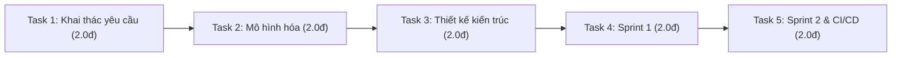

# 📋 BẢN CHUYỂN HÓA ĐẶC TẢ YÊU CẦU ASSIGNMENT 2 — DỰ ÁN BREWLITE
## Software Engineering: Requirements to Deployment (VER 1.0)
### Trường Đại học Sài Gòn — Khoa Công nghệ Thông tin

---

> **Môn học:** Công nghệ Phần mềm (Software Engineering)  
> **Dự án:** BrewLite — Hệ thống đặt đồ uống không dùng tiền mặt (Cashless Coffee Ordering System)  
> **Công nghệ quy định:** Next.js, NestJS, PostgreSQL, Docker  
> **Học kỳ:** I — Năm học 2026–2027  
> **Tổng điểm đánh giá:** 10.0 Điểm (5 Tasks x 2.0 Điểm)  
> **Mục đích tài liệu:** Chuyển hóa toàn bộ nội dung từ file đề bài gốc `Assignment2-BrewLite.pdf` thành đặc tả kỹ thuật chi tiết, chuẩn hóa tiêu chí nghiệm thu và định hướng triển khai cho nhóm phát triển.

---

## 1. TỔNG QUAN & NGUYÊN TẮC CỐT LÕI CỦA ASSIGNMENT 2

### 1.1. Phạm vi nghiệp vụ sản phẩm tối thiểu (Core Business Flow)
Hệ thống **BrewLite** giải quyết bài toán đặt món và thanh toán không tiền mặt tại quầy quán cà phê nhằm giảm thời gian xếp hàng trong giờ cao điểm. Luồng nghiệp vụ tối thiểu bắt buộc chạy xuyên suốt từ đầu đến cuối (End-to-End):

$$\text{Xem menu} \longrightarrow \text{Chọn tùy chọn (Size/Topping)} \longrightarrow \text{Giỏ hàng} \longrightarrow \text{Đặt đơn} \longrightarrow \text{Thanh toán} \longrightarrow \text{Theo dõi đơn}$$

* **Frontend:** Next.js phát triển theo hướng **Mobile-First / PWA**, tối ưu giao diện trên thiết bị di động.
* **Backend:** NestJS kiến trúc phân tầng (Layered/Modular Architecture), cung cấp REST API.
* **Database:** PostgreSQL quản lý cấu trúc dữ liệu quan hệ, tích hợp Prisma ORM.

### 1.2. Quy tắc thực hiện tuần tự (Sequential Execution Rule)
> [!IMPORTANT]
> **Quy tắc bắt buộc từ Giảng viên:** 5 Task lớn phải được hoàn thành theo đúng thứ tự (Task 1 $\rightarrow$ Task 2 $\rightarrow$ Task 3 $\rightarrow$ Task 4 $\rightarrow$ Task 5).  
> **Task sau chỉ được nghiệm thu khi các tạo phẩm bắt buộc của task trước đã có đầy đủ trên kho mã nguồn (GitHub) và có lịch sử commit (Git history) rõ ràng.**  
> Nếu task trước thiếu tạo phẩm bắt buộc, task sau sẽ **không được tính điểm phần truy vết**.

---

## 2. MA TRẬN 5 TASK & PHÂN BỔ ĐIỂM SỐ (RUBRIC)

| Task | Giai đoạn thực hiện | Tạo phẩm chính bắt buộc | Điểm | Thư mục lưu trữ quy định |
| :---: | :--- | :--- | :---: | :--- |
| **Task 1** | Khai thác và đặc tả yêu cầu | Stakeholder, Phạm vi, Bảng mã FR/NFR, Use Case tổng quát, Đặc tả Use Case trọng tâm | **2.0** | `docs/requirements/` |
| **Task 2** | Mô hình hóa hệ thống | Activity Diagram, Sequence Diagram, Domain Class Diagram | **2.0** | `docs/diagrams/` |
| **Task 3** | Thiết kế kiến trúc | Mô tả kiến trúc C4/Phân lớp, các bản ghi ADR, Deployment Diagram | **2.0** | `docs/architecture/`, `docs/deployment.md` |
| **Task 4** | Triển khai Sprint 1 | Repository chuẩn, quản lý tài liệu, MVP Menu chạy được, Pipeline CI | **2.0** | `frontend/`, `backend/`, `.github/workflows/ci.yml` |
| **Task 5** | Triển khai Sprint 2, CI/CD và Delivery | MVP hoàn chỉnh End-to-End, Bộ kiểm thử (Unit, Integration, E2E), Pipeline CD, Triển khai Production & Bàn giao | **2.0** | `.github/workflows/cd.yml`, `tests/`, Release `v1.0.0` |
| **TỔNG** | **Toàn bộ đề tài** | **Hệ thống chạy thực tế, mã nguồn, tài liệu và pipeline** | **10.0** | **Kho mã nguồn GitHub** |

---

## 3. ĐẶC TẢ CHI TIẾT TỪNG TASK (TASK BREAKDOWN)

---

### 📝 TASK 1 — KHAI THÁC VÀ ĐẶC TẢ YÊU CẦU (2.0 Điểm)

#### 3.1. Task 1.1 – Bối cảnh, Stakeholder và Phạm vi
* **Tệp bắt buộc:** `docs/requirements/context-and-scope.md`
* **Nội dung yêu cầu:**
  1. **Vấn đề nghiệp vụ BrewLite cần giải quyết:** Giảm tắc nghẽn quầy giờ cao điểm, xóa bỏ nhầm lẫn khi order bằng miệng, tối ưu hóa quy trình không tiền mặt.
  2. **Phân tích 6 nhóm Stakeholder chính:**
     * *Khách hàng (Customer):* Đặt món nhanh, thanh toán tiện lợi.
     * *Nhân viên quầy (Barista/Staff):* Tiếp nhận đơn rõ ràng, không sai công thức.
     * *Quản lý cửa hàng (Manager):* Kiểm soát menu, tồn kho và doanh thu.
     * *Giảng viên / Khách hàng nghiệm thu:* Đánh giá chất lượng kỹ thuật, tính đúng đắn và quy trình.
     * *Nhóm phát triển (Dev Team):* Hệ thống kiến trúc rõ ràng, dễ bảo trì, CI/CD tự động.
     * *Đơn vị thanh toán (Payment Gateway Provider):* Giao dịch trừ tiền chính xác, bảo mật, idempotent.
  3. **Mục tiêu & kỳ vọng** của từng bên liên quan.
  4. **Phân định phạm vi rõ ràng:**
     * *Trong MVP (In-Scope):* Menu, Tùy biến món, Giỏ hàng, Đặt đơn, Thanh toán ví giả lập, Lịch sử đơn, Tồn kho đồng thời, State Machine.
     * *Phạm vi mở rộng (Future Scope):* Màn hình Barista KDS realtime, Cổng thanh toán thực tế, App di động React Native.
     * *Các nội dung không thực hiện (Out-of-Scope):* Giao hàng tận nhà (Delivery), Thanh toán tiền mặt, Kế toán tính lương (ERP).
  5. **Bảng giả định (Assumptions), ràng buộc (Constraints) và rủi ro ban đầu (Initial Risks) kèm phương án giảm thiểu.**

#### 3.2. Task 1.2 – Yêu cầu chức năng và phi chức năng
* **Tệp bắt buộc:** `docs/requirements/system-requirements-matrix.md`
* **Nội dung yêu cầu:**
  1. Yêu cầu chức năng có mã định danh: `FR-01`, `FR-02`,...
  2. Yêu cầu phi chức năng có mã định danh: `NFR-01`, `NFR-02`,...
  3. Mức ưu tiên theo chuẩn **MoSCoW**: *Must have*, *Should have*, *Could have*, *Won't have*.
  4. Tiêu chí chấp nhận (Acceptance Criteria - AC) có thể kiểm chứng định lượng cho từng yêu cầu.
  5. **Sơ đồ Use Case tổng quát của toàn hệ thống:** Phân ranh giới giữa 5 phân hệ (Menu, Giỏ hàng & Đơn, Tài khoản, Barista, Admin) và 5 tác nhân (Khách hàng, Khách thành viên, Barista, Admin, Cổng thanh toán).

#### 3.3. Task 1.3 – Đặc tả một Use Case trọng tâm
* **Tệp bắt buộc:** `docs/requirements/core-use-case-specification.md`
* **Nội dung yêu cầu:**
  * Chọn Use Case trọng tâm: **Đặt và thanh toán đơn hàng** (`UC05: Đặt hàng` + `UC06: Thanh toán trực tuyến`).
  * Vẽ sơ đồ Use Case cho phạm vi trọng tâm: `docs/diagrams/use-case/use-case-checkout.mmd`.
  * Mô tả đầy đủ: Tác nhân (Actor), Trigger, Tiền điều kiện (Pre-conditions), Hậu điều kiện (Post-conditions).
  * Mô tả tuần tự Luồng chính (Normal Flow), Luồng thay thế (Alternative Flows) và Luồng ngoại lệ (Exception Flows).
  * Liên kết trực tiếp Use Case với các mã định danh `FR-xx` tương ứng.
* **Tiêu chí nghiệm thu Task 1:** Người đọc có thể xác định rõ hệ thống làm gì, không làm gì và dùng tiêu chí chấp nhận để viết test ở các task sau.

---

### 🎨 TASK 2 — MÔ HÌNH HÓA HỆ THỐNG (2.0 Điểm)

> [!NOTE]
> Bắt buộc lưu cả **tệp nguồn sơ đồ** và **ảnh kết xuất trực quan** (SVG hoặc PNG) trong thư mục `docs/diagrams/`.

#### 4.1. Task 2.1 – Activity Diagram (Sơ đồ hoạt động)
* **Tệp bắt buộc:** `docs/diagrams/activity/activity-flow.puml` và `activity-flow.svg` (hoặc Mermaid tương đương).
* **Nội dung yêu cầu:**
  * Thể hiện trọn vẹn luồng End-to-End từ Duyệt Menu $\rightarrow$ Đặt đơn $\rightarrow$ Thanh toán $\rightarrow$ Nhận đồ uống.
  * Có điểm bắt đầu (Initial Node) và điểm kết thúc (Final Node).
  * Thể hiện hành động của người dùng và phản hồi của hệ thống.
  * **Điều kiện rẽ nhánh (Decision / Merge):** **Tuyệt đối không dùng Yes/No**, phải thể hiện hành động / trạng thái cụ thể (ví dụ: `[Còn hàng trong kho]`, `[Món ăn hết hàng]`, `[Đã đăng nhập]`, `[Khách vãng lai]`, `[Thanh toán thành công]`, `[Thanh toán thất bại]`).
  * **Phân chia Swimlane** rõ ràng giữa các thành phần: Khách hàng (Customer), Giao diện Web (Next.js UI), Backend Server (NestJS API), Cổng thanh toán (Payment Gateway).
  * Sử dụng **Fork** (tách luồng song song) và **Join** (đồng bộ luồng).
  * Xử lý 3 trường hợp ngoại lệ bắt buộc: **Hết hàng**, **Chưa đăng nhập**, **Thanh toán thất bại**.

#### 4.2. Task 2.2 – Sequence Diagram (Sơ đồ tuần tự)
* **Tệp bắt buộc:** `docs/diagrams/sequence/sequence-checkout.puml` và `sequence-checkout.svg`.
* **Nội dung yêu cầu:**
  * Đặc tả cho Use Case trọng tâm ở Task 1.3 (Đặt và thanh toán đơn hàng).
  * 5 Lifeline tối thiểu bắt buộc:
    $$\text{Customer} \longrightarrow \text{Next.js UI} \longrightarrow \text{NestJS API} \longrightarrow \text{Database} \longrightarrow \text{Payment Service}$$
  * Thể hiện request/response và thứ tự gọi API tuần tự.
  * Kiểm tra JWT Token và validate dữ liệu DTO.
  * Mở Database Transaction khi tạo đơn hàng (`PENDING`) và cập nhật kiểm tra tồn kho.
  * Nhánh rẽ `alt` cho thanh toán thành công và thanh toán thất bại.
  * Xử lý tính lũy thừa `Idempotency-Key` khi client bấm lặp lại request thanh toán.
  * Thông báo kết quả cuối cùng cho người dùng.

#### 4.3. Task 2.3 – Class Diagram (Sơ đồ lớp mức Domain)
* **Tệp bắt buộc:** `docs/diagrams/class/class-domain.puml` và `class-domain.svg`.
* **Nội dung yêu cầu:**
  * Xây dựng ở mức Domain dựa trên các thực thể tham gia trong Sequence Diagram.
  * Tối thiểu 7 lớp cốt lõi: `User`, `Product`, `Order`, `OrderItem`, `Payment`, `Promotion`, `LoyaltyTransaction`.
  * Mỗi lớp mô tả chi tiết: **Tên class**, **Tên thuộc tính (Attributes kèm kiểu dữ liệu)**, **Tên phương thức (Methods kèm tham số/kiểu trả về)**.
  * Thể hiện quan hệ chính xác: Association, Composition, Generalization và Multiplicity (`1`, `0..*`, `1..*`).
  * Thể hiện các enum trạng thái: `Role`, `OrderStatus`, `PaymentStatus`.
* **Tiêu chí nghiệm thu Task 2:** Cả 3 sơ đồ không mâu thuẫn với SRS, Use Case hoặc mô hình CSDL.

---

### 🏗️ TASK 3 — THIẾT KẾ KIẾN TRÚC (2.0 Điểm)

#### 5.1. Task 3.1 – Phương pháp và Quyết định kiến trúc
* **Tệp bắt buộc:** `docs/architecture/architecture-description.md` và thư mục `docs/architecture/adr/`
* **Nội dung yêu cầu:**
  * Trình bày kiến trúc theo mô hình C4 hoặc Kiến trúc phân lớp (Layered Architecture):
    * Frontend: Next.js App Router (Server Components + Client Components, PWA).
    * Backend: NestJS tổ chức theo Module/Domain (`ProductsModule`, `OrdersModule`, `PaymentsModule`, `AuthModule`).
    * Database: PostgreSQL kết hợp Prisma ORM và cơ chế Migration an toàn.
    * Dịch vụ thanh toán mô phỏng (Mock Payment Gateway).
    * Logging, Health Check endpoint (`GET /health`) và Quản lý biến môi trường.
    * Lý do lựa chọn kiến trúc, ưu điểm, hạn chế và trade-offs.
  * **Các bản ghi quyết định kiến trúc (ADR):** Tối thiểu các file ADR quan trọng:
    * `docs/architecture/adr/001-monorepo-structure.md`: Kiến trúc Monorepo frontend/backend.
    * `docs/architecture/adr/002-order-state-machine.md`: Cỗ máy trạng thái đơn hàng.
    * `docs/architecture/adr/003-optimistic-locking.md`: Kiểm soát đồng thời tồn kho bằng version.
    * `docs/architecture/adr/004-idempotent-payments.md`: Cơ chế khóa Idempotency thanh toán.
    * `docs/architecture/adr/005-cloud-platform-selection.md`: Quyết định hạ tầng triển khai.

#### 5.2. Task 3.2 – Deployment Diagram (Sơ đồ triển khai)
* **Tệp bắt buộc:** `docs/deployment.md`, `docs/diagrams/deployment/deployment-diagram.puml` và `.svg`.
* **Nội dung yêu cầu:**
  * Vẽ sơ đồ UML Deployment Diagram cho môi trường Production thực tế.
  * Các node và thành phần tối thiểu:
    * Thiết bị người dùng (Browser / Mobile PWA).
    * Dịch vụ / CDN phục vụ Next.js (Vercel / AWS CloudFront).
    * Container hoặc dịch vụ chạy NestJS API (Render / Railway / AWS ECS / Azure Container Apps).
    * PostgreSQL có Persistent Storage (Neon Serverless PostgreSQL / AWS RDS).
    * Container Registry và nền tảng CI/CD.
    * Giao thức HTTPS, cổng mạng, kết nối nội bộ.
    * Secrets, Environment Variables, Health Check và Logging.
    * Phân định rõ 3 ranh giới: **Local Development**, **CI Environment**, **Production Environment**.
* **Tiêu chí nghiệm thu Task 3:** Có thể truy vết mỗi container/dịch vụ trong deployment diagram đến một thành phần trong mô tả kiến trúc và mã nguồn.

---

### 💻 TASK 4 — TRIỂN KHAI SPRINT 1 (2.0 Điểm)

> **Sprint Goal:** Tạo nền tảng kỹ thuật, tài liệu có kiểm soát phiên bản và một MVP đầu tiên chạy được cho luồng xem menu.

#### 6.1. Task 4.1 – Thiết lập Repository & Quy trình Agile
* Cấu trúc thư mục Monorepo: `frontend/` (Next.js), `backend/` (NestJS), `docs/`, `tests/`.
* Chiến lược phân nhánh Git: `main` (Production release), `develop` (Integration), `feature/*`.
* `README.md`, `.gitignore` (chặt chẽ), `.env.example`.
* Bảng theo dõi Product Backlog / Sprint Backlog cho Sprint 1 và Sprint 2.
* Quy ước commit (Conventional Commits: `feat:`, `fix:`, `docs:`, `chore:`,...) và Định nghĩa hoàn thành (Definition of Done - DoD).

#### 6.2. Task 4.2 – Quản lý Tài liệu
* Đưa toàn bộ tạo phẩm của Task 1–3 vào đúng thư mục `docs/`.
* Mọi thay đổi yêu cầu, sơ đồ hoặc kiến trúc phải đi qua Git commit/pull request và ghi rõ lý do.

#### 6.3. Task 4.3 – MVP Sprint 1 (Menu Browsing Flow)
* Hiện thực phiên bản đầu tiên chạy thực tế:
  * Backend API: `GET /products` (lọc theo danh mục), `GET /products/:id`, `GET /products/categories`.
  * Frontend Web: Màn hình Menu Mobile-first bằng Next.js, hiển thị danh mục dạng Tabs, lưới sản phẩm sắc nét, định dạng tiền VND (`35.000đ`).
  * Xử lý 3 trạng thái UX: Đang tải (**Skeleton Loading**), Trống (**Empty State**) và Báo lỗi (**Error State** có nút Thử lại).
  * Dữ liệu mẫu seed vào CSDL phong phú và sát thực tế.
  * Kiểm thử tối thiểu: Unit tests cho API và Component tests cho danh sách menu.

#### 6.4. Task 4.4 – Continuous Integration (CI Pipeline)
* **Tệp cấu hình:** `.github/workflows/ci.yml`.
* Tự động chạy khi mở Pull Request hoặc Push code:
  $$\text{Install} \longrightarrow \text{Lint} \longrightarrow \text{Unit Test} \longrightarrow \text{Build}$$
* **Bắt buộc:** Pull Request không được merge nếu lint, test hoặc build thất bại (Quality Gate).
* **Minh chứng:** Lưu link PR, ảnh chụp hoặc log của một lần pipeline thành công và một lần pipeline phát hiện lỗi có chủ đích.

---

### 🚀 TASK 5 — TRIỂN KHAI SPRINT 2, CI/CD VÀ DELIVERY (2.0 Điểm)

> **Sprint Goal:** Hoàn thành luồng End-to-End, tự động hóa đóng gói và triển khai một phiên bản production có thể truy cập được.

#### 7.1. Task 5.1 – Hoàn thiện MVP End-to-End
* Chi tiết sản phẩm: Modal tùy biến Size (S/M/L) và Topping, tính giá realtime.
* Giỏ hàng (Cart): Quản lý state bằng Zustand, lưu `localStorage`, tăng giảm số lượng, tính tổng tiền.
* Đăng ký, đăng nhập và xác thực JWT: Mật khẩu băm bằng `bcrypt`, cấp token, bảo vệ endpoint bằng `AuthGuard`.
* Tạo đơn hàng: API `POST /orders`, validate DTO, tính lại giá trên server, tạo đơn `PENDING`.
* Thanh toán giả lập: API `POST /payments`, chọn phương thức Ví/Thẻ, cập nhật `PAID` hoặc `PAYMENT_FAILED`.
* Xác nhận đơn & Lịch sử: Màn hình nhận nước kèm mã đơn `#1042`, trang `GET /orders/me` tra cứu đơn cá nhân.
* Bốn nghiệp vụ lõi: **Order State Machine** (`assertTransition`), **Idempotent Payment**, **Optimistic Locking** tồn kho (`version`), **Loyalty Points**.

#### 7.2. Task 5.2 – Tích hợp và Kiểm thử toàn diện
* **Unit Tests:** Kiểm thử các nghiệp vụ quan trọng (State Machine, Idempotency, Concurrency, Tính điểm).
* **Integration Tests:** Luồng gọi API tạo đơn và thanh toán `POST /orders` + `POST /payments`.
* **End-to-End (E2E) Test:** Ít nhất 1 kịch bản kiểm thử trọn vẹn từ duyệt menu đến xác nhận đơn.
* **Database Migration & Seed:** Có thể tái tạo CSDL hoàn chỉnh chỉ bằng một câu lệnh (`npx prisma migrate reset` / seed script).
* **Docker Compose:** Tệp `docker-compose.yml` khởi động hoàn chỉnh cả web, api và database ở môi trường local.
* **Health Check:** Endpoint `GET /health` kiểm tra kết nối API và CSDL.

#### 7.3. Task 5.3 – Continuous Delivery/Deployment (CD Pipeline)
* **Tệp cấu hình:** `.github/workflows/cd.yml`.
* Chu trình CD tự động:
  $$\text{Push/Tag} \longrightarrow \text{Lint \& Test} \longrightarrow \text{Build} \longrightarrow \text{Docker Image} \longrightarrow \text{Push Registry} \longrightarrow \text{Deploy} \longrightarrow \text{Smoke Test}$$
* Đóng gói Docker Image có gắn tag Commit SHA hoặc Semantic Version (`v1.0.0`).
* Triển khai vào Production sử dụng secret an toàn của CI (GitHub Secrets).
* Chạy migration CSDL theo cách an toàn trước khi phục vụ người dùng.
* Smoke Test tự động gọi endpoint `/health` sau khi deploy.
* Kế hoạch rollback khi triển khai gặp sự cố.

#### 7.4. Task 5.4 – Triển khai Production & Hồ sơ bàn giao
* **URL Production hoạt động thực tế:**
  * URL Frontend Production truy cập được qua HTTPS.
  * URL API Backend và Health Check (`/health`).
* Cơ sở dữ liệu Production bảo mật (không public cổng trực tiếp).
* Secrets/Environment Variables được bảo vệ, tuyệt đối không commit file `.env`.
* Release Tag `v1.0.0` trên GitHub kèm Release Notes chi tiết.
* `README.md` hướng dẫn toàn diện: Chạy local, test, build, deploy và rollback.
* Video hoặc demo trực tiếp luồng End-to-End.
* Tài liệu **Sprint Review** và **Sprint Retrospective** đúc kết sau 2 Sprint.

---

## 4. MA TRẬN TRUY VẾT BẮT BUỘC (TRACEABILITY MATRIX)

Theo Mục 8.1 của Assignment 2, nhóm phải tạo file `docs/traceability-matrix.md` liên kết 5 cột xuyên suốt từ đầu đến cuối:

| Mã yêu cầu | Use-case / User Story | Thiết kế / Sơ đồ | Code / API | Mã Kiểm thử (Test ID) |
| :---: | :--- | :--- | :--- | :---: |
| **FR-01** | UC01: Xem menu & danh mục | Activity-01, Class-Product | `GET /products`, `page.tsx` | API-T01, UI-T01 |
| **FR-02** | UC03: Tùy biến Size & Topping | Activity-01, Class-OrderItem | `GET /products/:id`, `ProductDetailModal.tsx` | UI-T02 |
| **FR-03** | UC04: Quản lý giỏ hàng | Activity-01, Class-Order | `useCartStore.ts`, `CartDrawer.tsx` | UNIT-CART01 |
| **FR-04** | UC07: Đăng ký & Đăng nhập JWT | Sequence-01, Class-User | `POST /auth/login`, `JwtAuthGuard` | API-AUTH01 |
| **FR-05** | UC05: Khởi tạo đơn hàng | Sequence-01, Class-Order | `POST /orders`, `OrdersService.createOrder` | INT-ORD01 |
| **FR-06** | UC06: Thanh toán trực tuyến | Sequence-01, Class-Payment | `POST /payments`, `PaymentsService` | INT-PAY01 |
| **FR-07** | UC11: Vòng đời đơn (State Machine) | Sequence-01, Class-Order | `OrdersService.assertTransition` | UNIT-STATE01 |
| **FR-08** | UC14: Kiểm soát tồn kho đồng thời | Sequence-01, Class-Product | Prisma Optimistic Lock (`version`) | UNIT-CONCUR01 |
| **FR-09** | UC09: Tích lũy điểm thưởng | Sequence-01, Class-Loyalty | `LoyaltyService.awardPoints` | UNIT-LOYAL01 |
| **FR-10** | UC08: Lịch sử đơn hàng & Mã nhận | Activity-01, Class-Order | `GET /orders/me`, `OrderSuccessModal.tsx` | E2E-FLOW01 |
| **FR-11** | UC05.1: Áp dụng mã Voucher | Sequence-01, Class-Promotion | `POST /vouchers/apply` | INT-VOUCH01 |
| **NFR-01** | Hiệu năng phản hồi API $\le 500\text{ms}$ | Deployment-01 | NestJS + Connection Pool | PERF-01 |
| **NFR-02** | Bảo mật HTTPS & An toàn bí mật | Deployment-01 | SSL/TLS, GitHub Secrets | SEC-01 |
| **NFR-03** | Kiểm tra sức khỏe tự động | Deployment-01 | `GET /health`, Smoke Test | HEALTH-01 |

---

## 5. CHECKLIST NGHIỆM THU NỘP BÀI (MỤC 9.1 CHECKLIST)

Bảng kiểm kê 9 hạng mục bắt buộc trước khi nộp bài nghiệm thu với Giảng viên:

- [ ] **1. Quyền truy cập & Repository:** Link repository GitHub hợp lệ và đã cấp quyền (Invite) cho Giảng viên.
- [ ] **2. Tài liệu Yêu cầu:** Đầy đủ SRS rút gọn, bảng đặc tả use-case 7 ô và ma trận truy vết (`docs/traceability-matrix.md`).
- [ ] **3. Bộ Sơ đồ Mô hình hóa:** Activity, Sequence, Class và Deployment Diagram (đầy đủ cả file nguồn `.mmd`/`.puml` và ảnh xuất `.png`/`.svg`).
- [ ] **4. Mã nguồn hoàn thiện:** Source code Frontend (Next.js), Backend (NestJS) và migration CSDL sạch sẽ, không có comment rác (Tuân thủ `AGENTS.md`).
- [ ] **5. Bộ Kiểm thử tự động:** Đầy đủ Unit test, Integration test và ít nhất 1 kịch bản End-to-End test chạy thông suốt.
- [ ] **6. Pipeline CI/CD:** Pipeline GitHub Actions chạy tự động, có minh chứng lần chạy thành công và lần phát hiện lỗi.
- [ ] **7. Triển khai Production:** URL Frontend Production truy cập được qua HTTPS, URL API Backend và Health Check endpoint `/health`.
- [ ] **8. Tài liệu Bàn giao:** Release tag `v1.0.0`, Release Notes, file `README.md` hướng dẫn chạy local, test, build, deploy và rollback.
- [ ] **9. Báo cáo & Video Demo:** Video demo trực tiếp luồng End-to-End và biên bản Sprint Review & Sprint Retrospective.

---
*Tài liệu này được lập căn cứ nguyên bản theo `Assignment2-BrewLite.pdf` ngày 23/10/2026.*
