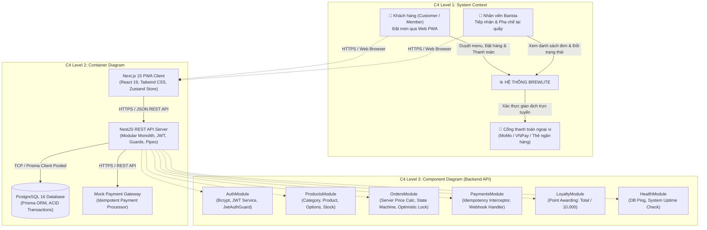

# 🏛️ TÀI LIỆU THIẾT KẾ KIẾN TRÚC HỆ THỐNG (ARCHITECTURE DESCRIPTION) — BREWLITE

> **Căn cứ đề bài:** Mục 5.1 (Task 3.1 - 1.0 điểm) trong tệp đặc tả gốc [`docs/DE_BAI_ASSIGNMENT_2_GOC.md`](../DE_BAI_ASSIGNMENT_2_GOC.md).  
> **Dự án:** BrewLite — Hệ thống đặt đồ uống không dùng tiền mặt (Cashless Coffee Ordering System).  
> **Phiên bản:** v1.0 (Master Release).  
> **Phương pháp mô hình hóa:** C4 Model (Context, Container, Component) kết hợp Kiến trúc phân lớp hướng Module (Modular Monolith Layered Architecture).  
> **Thư mục quyết định kiến trúc:** [`docs/architecture/adr/`](adr/) (Gồm 6 bản ghi ADR chi tiết).

---

## 1. TỔNG QUAN PHƯƠNG PHÁP & MÔ HÌNH KIẾN TRÚC

Hệ thống **BrewLite** được thiết kế theo mô hình **Kiến trúc phân lớp hướng Module (Modular Monolith Layered Architecture)** kết hợp mô hình trực quan **C4 Model** (Context $\rightarrow$ Container $\rightarrow$ Component).

### 1.1. Lý do lựa chọn mô hình Modular Monolith
1. **Phù hợp với quy mô & bối cảnh dự án:** Với phạm vi đặt đồ uống tại quầy và nhận món trong 5–7 phút, mô hình Microservices phân tán sẽ gây ra chi phí vận hành (operational overhead), trễ mạng (network latency) và phức tạp hóa phân tán giao dịch không cần thiết.
2. **Đảm bảo tính toàn vẹn tài chính (ACID Transactions):** Đơn hàng, thanh toán và trừ kho tồn kho cần tính nguyên tố tuyệt đối trong một CSDL PostgreSQL duy nhất thông qua Prisma ACID `$transaction`.
3. **Dễ kiểm thử và triển khai:** Toàn bộ hệ thống được kiểm thử tự động (Unit, Integration, E2E) và đóng gói trong một cụm Docker Compose thống nhất.
4. **Sẵn sàng tiến hóa (Evolutionary Architecture):** Từng module nghiệp vụ (`AuthModule`, `ProductsModule`, `OrdersModule`, `PaymentsModule`) được đóng gói độc lập với ranh giới rõ ràng, dễ dàng tách thành Microservices độc lập trong tương lai nếu quy mô chuỗi cửa hàng mở rộng.

---

## 2. BIỂU DIỄN KIẾN TRÚC THEO MÔ HÌNH C4

---

## 3. CHI TIẾT CÁC TẦNG KIẾN TRÚC (ARCHITECTURAL LAYERS)

### 3.1. Lớp Trình diễn (Presentation Layer — Next.js PWA Client)
* **Công nghệ cốt lõi:** Next.js 15 (App Router), React 19, TypeScript, Tailwind CSS.
* **Định hướng Mobile-First & PWA:**
  - Khách hàng có thể quét mã QR tại bàn để truy cập tức thì hoặc cài đặt ứng dụng vào màn hình chính (Add to Home Screen - A2HS) thông qua tệp `manifest.json`.
  - Service Worker hỗ trợ lưu trữ bộ nhớ đệm tài nguyên tĩnh (caching), giúp tăng tốc độ tải trang ban đầu (FCP $\le 1.8\text{s}$ đáp ứng `NFR-01`).
* **Quản lý trạng thái (Client State Management):**
  - Sử dụng **Zustand** kết hợp `localStorage` đồng bộ tức thì cho giỏ hàng (`useCartStore`).
  - Đảm bảo khi khách hàng chưa đăng nhập hoặc gặp lỗi thanh toán/hết hàng, hệ thống giữ nguyên giỏ hàng để khách thử lại mà không phải chọn món lại từ đầu.
* **Chuẩn hóa trải nghiệm người dùng (UX Guidelines):**
  - Đảm bảo 3 trạng thái giao diện bắt buộc theo `NFR-03`: Skeleton Loading khi tải dữ liệu, Empty State khi không có món, và Error State kèm nút Thử lại tự động.

### 3.2. Lớp Dịch vụ & Điều phối (Application & API Layer — NestJS Server)
Backend tổ chức theo các Domain Module độc lập, tuân thủ nguyên lý Dependency Injection (DI) và Single Responsibility Principle (SRP):

1. **`AuthModule`:**
   - Cung cấp luồng Đăng ký (`POST /auth/register`) và Đăng nhập (`POST /auth/login`).
   - Mật khẩu được băm an toàn bằng thư viện `bcrypt` với Salt Round $\ge 10$ (`NFR-02`).
   - Cấp phát JSON Web Token (JWT) có hạn sử dụng và phân quyền vai trò (`Role: CUSTOMER | BARISTA | ADMIN`).
   - `JwtAuthGuard` bảo vệ các endpoint nhạy cảm (Tạo đơn hàng, tra cứu lịch sử, đổi trạng thái).
2. **`ProductsModule`:**
   - Cung cấp danh mục đồ uống (`Category`), danh sách sản phẩm (`Product`), tùy chọn kích cỡ (`Size: SMALL | MEDIUM | LARGE`) và Topping kèm theo.
   - Quản lý trạng thái khả dụng (`isAvailable`) và số lượng tồn kho khả dụng (`stock`).
3. **`OrdersModule` (Trọng tâm nghiệp vụ):**
   - **Thẩm định giá Server-side:** Bỏ qua hoàn toàn đơn giá do Client gửi lên; hệ thống truy vấn giá gốc từ CSDL và tự động tính lại tổng tiền an toàn trên máy chủ (`NFR-04`).
   - **Khóa lạc quan (Optimistic Locking):** Sử dụng trường số nguyên `version` trên bảng `Product` trong một Prisma ACID `$transaction`. Ngăn chặn triệt để tình trạng bán vượt tồn kho khi nhiều khách cùng tranh chấp món cuối cùng (`FR-08`).
   - **Cỗ máy trạng thái (Order State Machine):** Quản lý vòng đời đơn hàng nghiêm ngặt qua hàm `assertTransition()`:
     $$\text{PENDING} \longrightarrow \text{PAID} \longrightarrow \text{PREPARING} \longrightarrow \text{READY} \longrightarrow \text{COMPLETED}$$
     (với các nhánh ngoại lệ: `PAYMENT_FAILED`, `CANCELLED`).
4. **`PaymentsModule`:**
   - Xử lý thanh toán số tích hợp cơ chế chống trừ tiền trùng lặp qua Header bắt buộc: `Idempotency-Key: <UUID-v4>` (`FR-06`).
   - Kiểm tra khóa lũy đẳng: Nếu khóa đã tồn tại trong CSDL, trả về ngay kết quả giao dịch trước đó.
5. **`LoyaltyModule`:**
   - Tự động cộng điểm thưởng cho Khách thành viên (`Member`) sau khi đơn hàng chuyển sang `PAID` theo tỷ lệ: $\text{Điểm} = \lfloor\text{Tổng tiền} / 10.000\rfloor$ (`FR-09`).
6. **`HealthModule`:**
   - Cung cấp endpoint công khai `GET /health` kiểm tra tình trạng sống của API và ping kết nối tới CSDL PostgreSQL (`NFR-09`).

### 3.3. Lớp Dữ liệu & Lưu trữ (Persistence Layer — PostgreSQL & Prisma ORM)
* **Hệ quản trị CSDL:** PostgreSQL 16 (Relational Database) đảm bảo các đặc tính ACID nghiêm ngặt cho dữ liệu tài chính, thanh toán và tồn kho.
* **Prisma ORM:**
  - `schema.prisma`: Khai báo Declarative Schema tập trung cho 7 thực thể cốt lõi (`User`, `Product`, `Order`, `OrderItem`, `Payment`, `Promotion`, `LoyaltyTransaction`).
  - **Quy trình di chuyển lược đồ (Migration Workflow):**
    - Môi trường phát triển cục bộ: `npx prisma migrate dev --name <migration_name>` tự động sinh các file SQL có phiên bản trong `prisma/migrations/`.
    - Môi trường CI/CD & Production: Chạy lệnh `npx prisma migrate deploy` không làm mất dữ liệu hiện có.
  - **Khởi tạo dữ liệu mẫu (Seeding):** Tệp `prisma/seed.ts` nạp sẵn thực đơn đồ uống, các loại topping, tài khoản kiểm thử và mã giảm giá ban đầu.

### 3.4. Lớp Tích hợp Ngoại vi (External Integration Layer — Mock Payment Gateway)
* Được đóng gói dưới dạng dịch vụ giả lập tích hợp sẵn trong backend với đầy đủ 2 kịch bản thực tế:
  - **Thanh toán thành công (90%):** Sinh mã giao dịch `transactionId` ngẫu nhiên, chuyển trạng thái đơn hàng sang `PAID`, kích hoạt trừ tồn kho và tích lũy điểm thưởng.
  - **Thanh toán thất bại / Người dùng hủy (10%):** Trả về mã lỗi từ chối, cập nhật trạng thái đơn sang `PAYMENT_FAILED`, tuyệt đối không trừ tồn kho, giữ nguyên giỏ hàng để khách thử lại.

---

## 4. BẢNG PHÂN TÍCH ĐÁNH ĐỔI KIẾN TRÚC (TRADE-OFF ANALYSIS)

| Quyết định kiến trúc | Ưu điểm (Pros) | Hạn chế (Cons) | Giải pháp bù đắp / Trade-off |
| :--- | :--- | :--- | :--- |
| **Monorepo (`frontend/`, `backend/`, `docs/`)** | • Đồng bộ mã nguồn, dùng chung TypeScript Types (DTO, Enums). • Quản lý 1 kho GitHub duy nhất, 1 quy trình CI/CD tích hợp. | • Repository phình to theo thời gian. • Cấu hình build tooling phức tạp hơn. | Sử dụng cấu trúc Monorepo tối giản (npm workspaces), phân định rõ thư mục ứng dụng và tài liệu. |
| **Next.js App Router (PWA)** | • SSR tăng tốc tải trang ban đầu (FCP thấp). • Tối ưu SEO cho menu. • PWA giúp khách đặt món không cần tải App từ Store. | • Khái niệm Server/Client Component dễ gây nhầm lẫn khi mới bắt đầu. | Quy ước rõ ràng: Server Component cho fetch dữ liệu menu, Client Component cho Modal, Cart và Checkout. |
| **NestJS Modular Architecture** | • Cấu trúc chặt chẽ, Dependency Injection mạnh mẽ. • Dễ dàng viết Unit/Integration test độc lập cho từng Module. • Tự động sinh Swagger OpenAPI docs. | • Đường cong học tập cao hơn Express thuần. • Cần viết nhiều boilerplate (Module, Controller, Service). | Đảm bảo tính mở rộng bền vững (Scalability) và chuẩn mực kỹ thuật công nghiệp cho dự án CNPM. |
| **PostgreSQL + Prisma ORM** | • Đảm bảo toàn vẹn dữ liệu tài chính (ACID). • Type-safe Database Client chống lỗi cú pháp SQL. • Migration tự động, có lịch sử rõ ràng. | • Tốn RAM hơn SQLite khi chạy cục bộ. • Prisma có chi phí trừu tượng hóa (overhead) nhỏ hơn SQL thuần. | Sử dụng Docker Compose để đóng gói PostgreSQL cục bộ; dùng Neon Serverless Postgres cho môi trường Cloud Production. |
| **Khóa lạc quan (Optimistic Locking)** | • Không khóa cứng bảng CSDL (non-blocking). • Cho phép hàng trăm khách xem menu đồng thời mà không nghẽn. | • Giao dịch bị từ chối khi có xung đột (409 Conflict) tại thời điểm mua món cuối cùng. | Bắt lỗi 409 ở Client, giữ nguyên giỏ hàng và thông báo khách đổi món hoặc chọn lại topping. |

---

## 5. DANH MỤC 6 BẢN GHI QUYẾT ĐỊNH KIẾN TRÚC (ADR)

Hệ thống lưu trữ 6 bản ghi quyết định kiến trúc chính thức theo định dạng chuẩn MADR trong thư mục [`docs/architecture/adr/`](adr/):

1. **[`ADR-001: Monorepo Structure`](adr/001-monorepo-structure.md):** Lựa chọn cấu trúc Monorepo quản lý mã nguồn tập trung.
2. **[`ADR-002: Frontend Next.js PWA`](adr/002-frontend-nextjs-pwa.md):** Lựa chọn Next.js App Router kết hợp PWA và Zustand Store.
3. **[`ADR-003: Backend NestJS Modular`](adr/003-backend-nestjs-modular.md):** Lựa chọn NestJS Modular & Domain-Driven Design.
4. **[`ADR-004: PostgreSQL & Prisma ORM`](adr/004-postgresql-and-prisma-orm.md):** Lựa chọn PostgreSQL và Prisma Migration Workflow.
5. **[`ADR-005: Payment Idempotency & Mock Gateway`](adr/005-payment-idempotency-and-mock-gateway.md):** Cơ chế Idempotency Key và Mock Payment Gateway.
6. **[`ADR-006: Logging & Health Monitoring`](adr/006-logging-and-health-monitoring.md):** Thiết kế Logging có cấu trúc và Endpoint `/health`.
