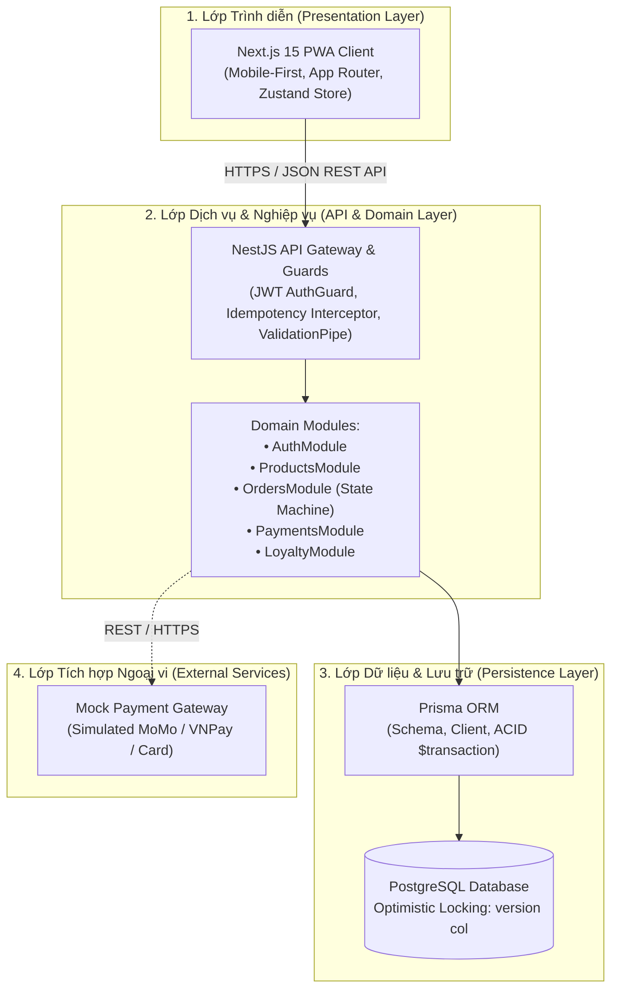

# 🏛️ TÀI LIỆU THIẾT KẾ KIẾN TRÚC HỆ THỐNG (SYSTEM ARCHITECTURE DESIGN) — BREWLITE

> **Căn cứ đề bài:** Mục 5.1 (Task 3.1) trong tệp đặc tả gốc [`docs/DE_BAI_ASSIGNMENT_2_GOC.md`](../DE_BAI_ASSIGNMENT_2_GOC.md).  
> **Dự án:** Hệ thống đặt đồ uống không dùng tiền mặt BrewLite (Cashless Coffee Ordering System).  
> **Phiên bản:** v1.0  
> **Phương pháp mô hình hóa:** C4 Model (Context, Container, Component) & Kiến trúc phân lớp (Layered Architecture).

---

## 1. TỔNG QUAN PHƯƠNG PHÁP KIẾN TRÚC (C4 MODEL)

Kiến trúc hệ thống BrewLite được thiết kế theo mô hình **C4 Model** (Context, Container, Component) kết hợp **Kiến trúc phân lớp (Layered Architecture)** nhằm đảm bảo tính phân tách trách nhiệm (Separation of Concerns), độ tin cậy giao dịch cao và khả năng mở rộng trong tương lai.



---

## 2. CHI TIẾT CÁC THÀNH PHẦN KIẾN TRÚC

### 2.1. Frontend: Next.js PWA (Client Layer)
* **Framework:** Next.js (App Router) với React Server Components (RSC) kết hợp Client Components.
* **Định hướng trải nghiệm:** **Mobile-First / PWA** (Progressive Web App):
  - Hỗ trợ cài đặt lên màn hình chính điện thoại (A2HS - Add to Home Screen) qua `manifest.json`.
  - Service Worker hỗ trợ caching tĩnh, giảm tải mạng và tăng tốc độ tải trang bước đầu (FCP $\le 1.8\text{s}$ theo `NFR-01`).
* **Quản lý trạng thái:** **Zustand Store**:
  - Lưu trữ giỏ hàng phía Client (`useCartStore`) đồng bộ tức thì với `localStorage`.
  - Giữ nguyên vẹn giỏ hàng khi người dùng chưa đăng nhập hoặc gặp lỗi tồn kho / thanh toán thất bại, không bắt khách chọn lại từ đầu.
* **Giao diện & UX:**
  - Tailwind CSS với thiết kế tối ưu chạm ngón tay (Touch targets $\ge 48\text{px}$).
  - Đảm bảo 3 trạng thái bắt buộc theo `NFR-03`: Skeleton Loading, Empty State, Error Feedback.

### 2.2. Backend: NestJS Modular / Domain-Driven Architecture
Backend được tổ chức thành các Domain Modules độc lập, tuân thủ nguyên lý Dependency Injection (DI) chặt chẽ:

1. **`AuthModule`:**
   - Xử lý Đăng ký, Đăng nhập, cấp phát JWT Bearer Token.
   - Băm mật khẩu an toàn bằng thư viện `bcrypt` (Salt round $\ge 10$) theo chuẩn `NFR-02`.
   - `JwtAuthGuard` bảo vệ các endpoint nhạy cảm (Tạo đơn, xem lịch sử, tích điểm).
2. **`ProductsModule`:**
   - Cung cấp danh mục đồ uống (`Category`), danh sách sản phẩm (`Product`), tùy chọn Size (S/M/L) và Topping kèm theo.
   - Quản lý trạng thái món (`isAvailable`) và số lượng tồn kho khả dụng (`stock`).
3. **`OrdersModule` (Trọng tâm nghiệp vụ):**
   - **Thẩm định giá Server-side:** Bỏ qua toàn bộ giá tiền gửi lên từ Client; truy vấn giá gốc từ CSDL và tự động tính lại tổng tiền an toàn trên máy chủ (`NFR-04`).
   - **Khóa lạc quan (Optimistic Locking):** Sử dụng trường `version` trên bảng `Product` trong một Prisma ACID `$transaction`. Ngăn chặn triệt để tình trạng bán vượt tồn kho (Race condition / Overselling).
   - **Cỗ máy trạng thái (Order State Machine):** Kiểm soát chu kỳ đơn nghiêm ngặt:  
     $$\text{PENDING} \longrightarrow \text{PAID} \longrightarrow \text{PREPARING} \longrightarrow \text{READY} \longrightarrow \text{COMPLETED}$$
     (với các nhánh ngoại lệ: `PAYMENT_FAILED`, `CANCELLED`).
4. **`PaymentsModule`:**
   - Xử lý thanh toán số tích hợp cơ chế chống trùng lặp **Idempotency Key**.
   - Ghi nhận trạng thái thanh toán và liên kết trực tiếp với mã giao dịch `transactionId`.
5. **`LoyaltyModule`:**
   - Tự động cộng điểm thưởng cho Khách thành viên (`Member`) sau khi đơn hàng chuyển sang `PAID` theo tỷ lệ: $\text{Điểm} = \lfloor\text{Tổng tiền} / 10.000\rfloor$ (`FR-09`).
6. **`HealthModule`:**
   - Cung cấp endpoint `GET /health` kiểm tra tình trạng sống của API và ping kết nối tới CSDL PostgreSQL (`NFR-09`).

### 2.3. Lớp CSDL: PostgreSQL & Cơ chế Migration (Prisma ORM)
* **Hệ quản trị CSDL:** PostgreSQL (Relational Database) đảm bảo các đặc tính ACID nghiêm ngặt cho dữ liệu tài chính và tồn kho.
* **Công cụ ORM:** **Prisma ORM**:
  - `schema.prisma`: Khai báo Declarative Schema tập trung cho toàn bộ thực thể (`User`, `Product`, `Order`, `OrderItem`, `Payment`, `Promotion`, `LoyaltyTransaction`).
  - **Migration Workflow:**
    - Môi trường phát triển: `npx prisma migrate dev --name <migration_name>` tự động sinh các file SQL có phiên bản trong `prisma/migrations/`.
    - Môi trường Production / CI/CD: Chạy lệnh `npx prisma migrate deploy` không làm mất dữ liệu hiện có.
  - **Seeding:** Tệp `prisma/seed.ts` nạp sẵn dữ liệu mẫu thực đơn đồ uống, topping, tài khoản kiểm thử và voucher khởi tạo.
  - **Connection Pooling:** Tích hợp connection pooler (hỗ trợ Neon Serverless Postgres / PgBouncer) để xử lý lượng kết nối đồng thời mà không nghẽn tài nguyên.

### 2.4. Dịch vụ Thanh toán Mô phỏng (Mock Payment Service)
* Được đóng gói dưới dạng dịch vụ giả lập tích hợp sẵn trong backend hoặc mock service độc lập.
* **Cơ chế Idempotency:**
  - Bắt buộc Client gửi kèm Header `Idempotency-Key: <UUID-v4>` cho mỗi lần nhấn thanh toán (`FR-06`, `NFR-02`).
  - Backend kiểm tra khóa: Nếu khóa đã tồn tại trong bảng `Payment`, hệ thống trả về ngay kết quả giao dịch trước đó, ngăn chặn việc tài khoản bị trừ tiền 2 lần do mạng chập chờn hoặc bấm đúp.
* **Kịch bản mô phỏng:**
  - Thanh toán thành công (90%): Sinh mã `transactionId` ngẫu nhiên, chuyển đơn sang `PAID`.
  - Thanh toán thất bại / Người dùng hủy (10%): Trả về mã lỗi từ chối, cập nhật đơn sang `PAYMENT_FAILED`, giữ nguyên tồn kho sản phẩm.

### 2.5. Logging, Health Check & Quản lý Cấu hình
* **Quản lý cấu hình (Configuration Management):**
  - Sử dụng `@nestjs/config` nạp biến môi trường từ tệp `.env`.
  - Bắt buộc kiểm tra định dạng và tồn tại của biến môi trường thông qua schema validation (Joi/Zod) ngay lúc ứng dụng khởi động (`bootstrap`), ngăn chặn runtime crash do thiếu cấu hình.
  - Tệp `.env.example` cung cấp đầy đủ danh mục biến mẫu (không chứa secret).
* **Kiểm tra sức khỏe (Health Check):**
  - Cung cấp endpoint công khai `GET /health` trả về JSON:
    ```json
    {
      "status": "ok",
      "timestamp": "2026-10-24T15:50:00.000Z",
      "uptime": 1245.8,
      "database": { "status": "up", "latencyMs": 14 }
    }
    ```
  - Được cấu hình trực tiếp vào Docker Healthcheck và Cloud Orchestrator (Render/Railway/Kubernetes) để tự động restart container khi treo.
* **Logging:**
  - Structured Logging có ghi rõ timestamp, log level (`INFO`, `WARN`, `ERROR`), `context` module và `correlationId` gắn theo từng Request HTTP để phục vụ truy vết lỗi phân tán.

---

## 3. LÝ DO CHỌN KIẾN TRÚC & PHÂN TÍCH ĐÁNH ĐỔI (TRADE-OFF ANALYSIS)

| Quyết định kiến trúc | Ưu điểm (Pros) | Hạn chế (Cons) | Giải pháp bù đắp / Trade-off |
| :--- | :--- | :--- | :--- |
| **Monorepo (`apps/web`, `apps/api`)** | • Đồng bộ mã nguồn, dùng chung TypeScript Types (DTO, Enums).<br/>• Quản lý 1 kho GitHub duy nhất, 1 quy trình CI/CD tích hợp. | • Repository phình to theo thời gian.<br/>• Cấu hình build tooling phức tạp hơn. | Sử dụng cấu trúc Monorepo tối giản (npm workspaces), phân định rõ thư mục `apps/` và `docs/`. |
| **Next.js App Router (PWA)** | • SSR tăng tốc tải trang ban đầu (FCP thấp).<br/>• Tối ưu SEO cho menu.<br/>• PWA giúp khách đặt món không cần tải App từ Store. | • Khái niệm Server/Client Component dễ gây nhầm lẫn khi mới bắt đầu. | Quy ước rõ ràng: Server Component cho fetch dữ liệu menu, Client Component cho Modal, Cart và Checkout. |
| **NestJS Modular Architecture** | • Cấu trúc chặt chẽ, Dependency Injection mạnh mẽ.<br/>• Dễ dàng viết Unit/Integration test độc lập cho từng Module.<br/>• Tự động sinh Swagger OpenAPI docs. | • Đường cong học tập cao hơn Express thuần.<br/>• Cần viết nhiều boilerplate (Module, Controller, Service). | Đảm bảo tính mở rộng bền vững (Scalability) và chuẩn mực kỹ thuật công nghiệp cho dự án CNPM. |
| **PostgreSQL + Prisma ORM** | • Đảm bảo toàn vẹn dữ liệu tài chính (ACID).<br/>• Type-safe Database Client chống lỗi cú pháp SQL.<br/>• Migration tự động, có lịch sử rõ ràng. | • Tốn RAM hơn SQLite khi chạy cục bộ.<br/>• Prisma có chi phí trừu tượng hóa (overhead) nhỏ hơn SQL thuần. | Sử dụng Docker Compose để đóng gói PostgreSQL cục bộ; dùng Neon Serverless Postgres cho môi trường Cloud Production. |
| **Khóa lạc quan (Optimistic Locking)** | • Không khóa cứng bảng CSDL (non-blocking).<br/>• Cho phép hàng trăm khách xem menu đồng thời mà không nghẽn. | • Giao dịch bị từ chối khi có xung đột (409 Conflict) tại thời điểm mua món cuối cùng. | Bắt lỗi 409 ở Client, giữ nguyên giỏ hàng và thông báo khách đổi món hoặc chọn lại topping. |

---

## 4. DANH MỤC CÁC QUYẾT ĐỊNH KIẾN TRÚC (ARCHITECTURAL DECISION RECORDS - ADR)

Toàn bộ các quyết định công nghệ quan trọng được lưu trữ và theo dõi độc lập tại thư mục [`docs/architecture/adr/`](adr/):

1. [`001-monorepo-structure.md`](adr/001-monorepo-structure.md): Lựa chọn cấu trúc Monorepo thống nhất.
2. [`002-frontend-nextjs-pwa.md`](adr/002-frontend-nextjs-pwa.md): Lựa chọn Next.js App Router kết hợp PWA và Zustand Store.
3. [`003-backend-nestjs-modular.md`](adr/003-backend-nestjs-modular.md): Lựa chọn NestJS Modular & Domain-Driven Design.
4. [`004-postgresql-and-prisma-orm.md`](adr/004-postgresql-and-prisma-orm.md): Lựa chọn PostgreSQL và Prisma Migration Workflow.
5. [`005-payment-idempotency-and-mock-gateway.md`](adr/005-payment-idempotency-and-mock-gateway.md): Cơ chế Idempotency Key và Mock Payment Gateway.
6. [`006-logging-and-health-monitoring.md`](adr/006-logging-and-health-monitoring.md): Thiết kế Logging có cấu trúc và Endpoint `/health`.
