# 🔄 SƠ ĐỒ HOẠT ĐỘNG TOÀN DIỆN END-TO-END (ACTIVITY DIAGRAM)
## Dự án: BrewLite — Hệ thống đặt đồ uống không dùng tiền mặt (Cashless Coffee Ordering System)

---

> **Cơ sở đào tạo:** Trường Đại học Sài Gòn — Khoa Công nghệ Thông tin  
> **Môn học:** Công nghệ Phần mềm (Software Engineering)  
> **Hạng mục:** Assignment 2 — Task 2.1: Activity Diagram cho luồng end-to-end  
> **Phiên bản:** v1.0  
> **Quy chuẩn kỹ thuật:** Đáp ứng đầy đủ 5 tiêu chuẩn bắt buộc tại Mục 4.1 — [DE_BAI_ASSIGNMENT_2_GOC.md](../../DE_BAI_ASSIGNMENT_2_GOC.md).

---

## 1. MÔ TẢ TỔNG QUAN & PHẠM VI NGHIỆP VỤ

Sơ đồ hoạt động (Activity Diagram) mô tả chi tiết luồng nghiệp vụ xuyên suốt (**End-to-End Flow**) của hệ thống BrewLite theo đúng quy chuẩn Mục 1.1 đề bài:
$$\text{Xem menu} \longrightarrow \text{Chọn tùy chọn} \longrightarrow \text{Giỏ hàng} \longrightarrow \text{Đặt đơn} \longrightarrow \text{Thanh toán} \longrightarrow \text{Theo dõi & Nhận đồ uống}$$

Hệ thống phân định ranh giới trách nhiệm rõ ràng qua **5 làn bơi (Swimlanes / Partitions)**:
1. **👤 Khách hàng (Customer / Member):** Tác nhân khởi tạo và tương tác trực tiếp trên giao diện di động.
2. **💻 Giao diện Web (Next.js Client):** Ứng dụng PWA Mobile-first, quản lý client state (Zustand), lưu cache và điều hướng giao diện.
3. **⚙️ Backend API & CSDL (NestJS & PostgreSQL):** Máy chủ ứng dụng xử lý xác thực JWT, tính toán giá an toàn trên Server, kiểm soát tồn kho tranh chấp bằng Khóa lạc quan (Optimistic Locking) và điều phối Cỗ máy trạng thái (Order State Machine).
4. **💳 Cổng thanh toán (Payment Gateway Mock):** Cổng trung gian thanh toán trực tuyến xử lý trừ tiền ví điện tử / thẻ ngân hàng.
5. **☕ Quầy pha chế (Nhân viên Barista):** Phân hệ vận hành tại quầy tiếp nhận đơn pha chế theo đúng kích cỡ (Size) và Topping, gọi mã nhận nước khi hoàn tất.

---

## 2. SƠ ĐỒ HOẠT ĐỘNG CHI TIẾT (5 SWIMLANES ACTIVITY DIAGRAM)

* **Tệp mã nguồn:** [`docs/diagrams/activity/activity-flow.mmd`](activity-flow.mmd)

```mermaid
flowchart TD
    subgraph LaneCustomer ["👤 KHÁCH HÀNG (CUSTOMER / MEMBER)"]
        C_Start(["● Bắt đầu"])
        C_Browse["Duyệt menu & lọc danh mục đồ uống"]
        C_Customize["Chọn món & Tùy biến: Size, Topping, Ghi chú"]
        C_AddToCart["Nhấn 'Thêm vào giỏ hàng'"]
        C_ClickCheckout["Nhấn 'Tiến hành đặt hàng' từ giỏ"]
        C_InputLogin["Nhập tài khoản & bấm Đăng nhập"]
        C_AdjustCart["Điều chỉnh giỏ hàng: Chọn món khác / Đổi số lượng"]
        C_SelectPayment["Chọn phương thức: Ví MoMo / VNPay / Thẻ"]
        C_ClickPay["Nhấn 'Xác nhận thanh toán'"]
        C_RetryPayment["Chọn phương thức thanh toán khác để thử lại"]
        C_ReceiveCode["Nhận mã lấy nước #1042 & Thời gian chờ 5-7 phút"]
        C_GoToCounter["Di chuyển đến quầy nhận đồ uống"]
        C_MatchCode["Đối chiếu mã đơn #1042 với nhân viên Barista"]
        C_EndSuccess(["◎ Hoàn tất: Nhận nước & Thưởng thức"])
    end

    subgraph LaneFrontend ["💻 GIAO DIỆN WEB (NEXT.JS CLIENT)"]
        FE_ShowMenu["Hiển thị danh sách món & Tabs danh mục"]
        FE_ShowModal["Mở Modal tùy biến & tính giá tạm tính realtime"]
        FE_UpdateCart["Cập nhật Zustand Store & đồng bộ LocalStorage"]
        FE_CheckAuth{"Kiểm tra JWT trong LocalStorage"}
        FE_PromptLogin["Hiển thị Modal Đăng nhập / Đăng ký (UC05)"]
        FE_SaveJWT["Lưu accessToken JWT & Giữ nguyên giỏ hàng"]
        FE_SubmitOrder["Gửi POST /orders (Items, Size, Topping; Bearer JWT)"]
        FE_HandleStockError["Hiển thị lỗi: 'Món đã hết hàng' & Giữ giỏ hàng"]
        FE_ShowCheckout["Hiển thị Form Checkout, tổng tiền & các cổng Ví/Thẻ"]
        FE_SubmitPayment["Sinh UUID Idempotency-Key & Gửi POST /payments"]
        FE_HandlePayError["Hiển thị cảnh báo lỗi thanh toán & Giữ nguyên giỏ hàng"]
        FE_HandleSuccess["Nhận 200 OK & Hiển thị màn hình thành công"]
        FE_ClearCart["Dọn sạch giỏ hàng & Lưu đơn vào Lịch sử đơn hàng"]
    end

    subgraph LaneBackend ["⚙️ BACKEND API & CSDL (NESTJS & POSTGRESQL)"]
        BE_AuthGuard{"JwtAuthGuard: Xác thực JWT hợp lệ?"}
        BE_AuthFail["Trả lỗi 401 Unauthorized"]
        BE_AuthLogin["Xác thực mật khẩu Bcrypt & Ký chuỗi JWT"]
        BE_ValidatePrice["Truy vấn CSDL & Tự tính lại tổng tiền trên Server"]
        BE_CheckStock{"Kiểm tra tồn kho & Optimistic Locking"}
        BE_StockFail["Rollback Transaction & Trả lỗi 409 Conflict"]
        BE_CreateOrder["Tạo bản ghi Order: PENDING gắn với userId"]
        BE_CheckIdempotent{"IdempotencyInterceptor: Khóa đã xử lý?"}
        BE_ReturnCached["Trả về ngay kết quả giao dịch đã lưu trước đó"]
        BE_CallGateway["Chuyển tiếp yêu cầu trừ tiền sang Payment Gateway"]
        BE_TxSuccess["Database Transaction: Order sang PAID & Trừ tồn kho"]
        BE_AwardPoints["Tự động tích lũy điểm thưởng thành viên: total / 10000"]
        BE_TxFail["Cập nhật Order: PAYMENT_FAILED & Không trừ tồn kho"]
        BE_Complete["Cập nhật cỗ máy trạng thái Order: COMPLETED"]
    end

    subgraph LaneGateway ["💳 CỔNG THANH TOÁN (PAYMENT GATEWAY MOCK)"]
        GW_Process["Tiếp nhận & Xử lý trừ tiền giả lập"]
        GW_Result{"Kết quả thanh toán?"}
        GW_Success["Phản hồi SUCCESS kèm transactionId"]
        GW_Fail["Phản hồi FAILED: Thiếu số dư / OTP sai / Người dùng hủy"]
    end

    subgraph LaneBarista ["☕ QUẦY PHA CHẾ (NHÂN VIÊN BARISTA)"]
        BA_Receive["Màn hình quầy nhận thông báo đơn mới #1042"]
        BA_Preparing["Barista bấm nhận đơn: Trạng thái sang PREPARING"]
        BA_Making["Pha chế đồ uống theo đúng Size, Topping & Ghi chú"]
        BA_Ready["Pha chế xong: Trạng thái sang READY & Gọi mã #1042"]
        BA_Deliver["Đối chiếu mã & Trao đồ uống cho khách"]
    end

    %% Điều hướng liên phân hệ
    C_Start --> C_Browse
    C_Browse --> FE_ShowMenu
    FE_ShowMenu --> C_Customize
    C_Customize --> FE_ShowModal
    FE_ShowModal --> C_AddToCart
    C_AddToCart --> FE_UpdateCart
    FE_UpdateCart --> C_ClickCheckout
    C_ClickCheckout --> FE_CheckAuth

    %% Phân nhánh 1: Xác thực
    FE_CheckAuth -->|Chưa có JWT| FE_PromptLogin
    FE_PromptLogin --> C_InputLogin
    C_InputLogin --> BE_AuthLogin
    BE_AuthLogin --> FE_SaveJWT
    FE_SaveJWT --> FE_SubmitOrder

    FE_CheckAuth -->|Đã có JWT| FE_SubmitOrder

    %% Phân nhánh 2: Kiểm soát tồn kho
    FE_SubmitOrder --> BE_AuthGuard
    BE_AuthGuard -->|Hết hạn / Không hợp lệ| BE_AuthFail
    BE_AuthFail --> FE_PromptLogin

    BE_AuthGuard -->|Hợp lệ| BE_ValidatePrice
    BE_ValidatePrice --> BE_CheckStock

    BE_CheckStock -->|Hết hàng / Xung đột version| BE_StockFail
    BE_StockFail --> FE_HandleStockError
    FE_HandleStockError --> C_AdjustCart
    C_AdjustCart --> C_Customize

    BE_CheckStock -->|Đủ hàng & Hợp lệ| BE_CreateOrder
    BE_CreateOrder --> FE_ShowCheckout

    %% Phân nhánh 3: Thanh toán
    FE_ShowCheckout --> C_SelectPayment
    C_SelectPayment --> C_ClickPay
    C_ClickPay --> FE_SubmitPayment
    FE_SubmitPayment --> BE_CheckIdempotent

    BE_CheckIdempotent -->|Khóa đã tồn tại| BE_ReturnCached
    BE_ReturnCached --> FE_HandleSuccess

    BE_CheckIdempotent -->|Khóa mới| BE_CallGateway
    BE_CallGateway --> GW_Process
    GW_Process --> GW_Result

    GW_Result -->|Thất bại / Hủy| GW_Fail
    GW_Fail --> BE_TxFail
    BE_TxFail --> FE_HandlePayError
    FE_HandlePayError --> C_RetryPayment
    C_RetryPayment --> C_SelectPayment

    GW_Result -->|Thành công| GW_Success
    GW_Success --> BE_TxSuccess
    BE_TxSuccess --> BE_AwardPoints

    %% Xử lý song song (Fork)
    BE_AwardPoints --> ForkPostPay((Fork))

    ForkPostPay --> FE_HandleSuccess
    FE_HandleSuccess --> FE_ClearCart
    FE_ClearCart --> C_ReceiveCode
    C_ReceiveCode --> C_GoToCounter
    C_GoToCounter --> JoinCounter((Join))

    ForkPostPay --> BA_Receive
    BA_Receive --> BA_Preparing
    BA_Preparing --> BA_Making
    BA_Making --> BA_Ready
    BA_Ready --> JoinCounter

    %% Đồng bộ hoàn tất (Join)
    JoinCounter --> C_MatchCode
    C_MatchCode --> BA_Deliver
    BA_Deliver --> BE_Complete
    BE_Complete --> C_EndSuccess
```

---

## 3. PHÂN TÍCH CÁC ĐIỂM QUYẾT ĐỊNH (DECISION POINTS) & 3 TRƯỜNG HỢP ĐẶC THÙ

Theo yêu cầu bắt buộc của Mục 4.1 trong tệp đề bài gốc, sơ đồ thể hiện tường minh 3 trường hợp nghiệp vụ nhạy cảm:

### 3.1. Trường hợp 1: Người dùng chưa đăng nhập (Unauthenticated Flow)
* **Vị trí kiểm tra:** Node `FE_CheckAuth` trên Giao diện Web.
* **Xử lý:**
  1. Khi khách hàng nhấn nút *"Tiến hành đặt hàng"* từ giỏ hàng, nếu hệ thống phát hiện trong `localStorage` chưa có token JWT (hoặc token đã hết hạn), hệ thống **không xóa giỏ hàng**.
  2. Kích hoạt Modal Đăng nhập / Đăng ký (`UC05`).
  3. Khách hàng nhập thông tin tài khoản, Backend thẩm định mật khẩu băm `bcrypt` và cấp lại `accessToken`.
  4. Sau khi đăng nhập thành công, hệ thống tự động lưu token và chuyển tiếp thẳng sang bước gửi đơn `POST /orders`, đảm bảo trải nghiệm người dùng liền mạch.

### 3.2. Trường hợp 2: Hết hàng / Tranh chấp tồn kho đồng thời (Concurrency / Out of Stock)
* **Vị trí kiểm tra:** Node `BE_CheckStock` tại Backend NestJS trong Database Transaction.
* **Xử lý:**
  1. Hệ thống áp dụng kỹ thuật Khóa lạc quan (**Optimistic Locking**) dựa trên trường `version` trong bảng `Product`.
  2. Nếu nhiều người cùng mua món cuối cùng tại cùng một thời điểm: người đến trước sẽ cập nhật thành công (`version = version + 1`, `stock = 0`), người đến sau phát hiện `version` đã thay đổi hoặc `stock < quantity`.
  3. Transaction tự động bị **Rollback**, Backend ném lỗi HTTP `409 Conflict`.
  4. Giao diện Client bắt lỗi và hiển thị thông báo: *"Món [Tên món] vừa hết hàng do có nhiều người cùng đặt. Vui lòng kiểm tra lại giỏ hàng"*. Giỏ hàng được giữ nguyên vẹn để khách hàng đổi sang món khác.

### 3.3. Trường hợp 3: Thanh toán thất bại (Payment Failed Flow)
* **Vị trí kiểm tra:** Node `GW_Result` từ phản hồi của Cổng thanh toán giả lập.
* **Xử lý:**
  1. Khi cổng thanh toán phản hồi `FAILED` (do thẻ không đủ số dư, nhập sai OTP, hoặc khách hủy giao dịch), Backend lập tức kích hoạt Cỗ máy trạng thái chuyển đơn hàng sang `PAYMENT_FAILED`.
  2. Số lượng tồn kho **không bị trừ** (hoặc được hoàn lại nguyên vẹn).
  3. Giao diện hiển thị Modal cảnh báo lỗi thanh toán và **tuyệt đối không xóa giỏ hàng**, đồng thời cung cấp nút *"Thử lại"* để khách hàng chọn ví điện tử hoặc thẻ khác mà không cần chọn món lại từ đầu.

---

## 4. CƠ CHẾ XỬ LÝ SONG SONG (FORK / JOIN) & CỖ MÁY TRẠNG THÁI ĐƠN HÀNG

Sau khi thanh toán thành công (`PAID`), sơ đồ kích hoạt nút phân nhánh song song **Fork (`ForkPostPay`)** chia thành 2 luồng đồng thời:
* **Luồng Khách hàng:** Client dọn sạch giỏ hàng, hiển thị Modal xác nhận với Mã lấy nước to rõ (ví dụ: `#1042`), điểm thưởng vừa tích lũy và thời gian chờ dự kiến (5–7 phút). Khách hàng di chuyển đến quầy.
* **Luồng Quầy Barista:** Màn hình vận hành của nhân viên Barista tức thì hiển thị đơn hàng mới `#1042`. Barista bấm nhận đơn (chuyển sang `PREPARING`), tiến hành pha chế đúng định lượng Size và Topping. Khi xong, Barista bấm chuyển sang `READY` và hệ thống thông báo gọi mã tại quầy.

Tại nút hợp nhất **Join (`JoinCounter`)**, hai luồng gặp nhau: Khách hàng đối chiếu mã đơn `#1042`, Barista trao nước và xác nhận hoàn tất $\rightarrow$ Đơn hàng chuyển sang trạng thái cuối cùng `COMPLETED`.

---

## 5. MA TRẬN TRUY VẾT LIÊN KẾT YÊU CẦU (TRACEABILITY)

| Thành phần sơ đồ | Mã Use Case liên quan | Mã Yêu cầu chức năng (FR) | Mã Yêu cầu phi chức năng (NFR) |
| :--- | :---: | :---: | :---: |
| Duyệt menu & Lọc danh mục | `UC01`, `UC02` | `FR-01` | `NFR-01`, `NFR-03` |
| Tùy biến Size & Topping | `UC03` (`UC03.1`, `UC03.2`, `UC03.3`) | `FR-02` | `NFR-03` |
| Quản lý giỏ hàng | `UC04` | `FR-03` | `NFR-03` |
| Xác thực JWT / Modal Đăng nhập | `UC05` | `FR-04` | `NFR-02` |
| Khởi tạo đơn & Khóa lạc quan | `UC06` | `FR-05`, `FR-08` | `NFR-04` |
| Thanh toán trực tuyến & Idempotent | `UC07` (`UC07.1`, `UC07.2`) | `FR-06` | `NFR-02`, `NFR-04` |
| Tích lũy điểm thưởng thành viên | `UC08` | `FR-09` | `NFR-04` |
| Tiếp nhận & Pha chế tại quầy | `UC10`, `UC11`, `UC12` | `FR-07`, `FR-12` | `NFR-03` |
