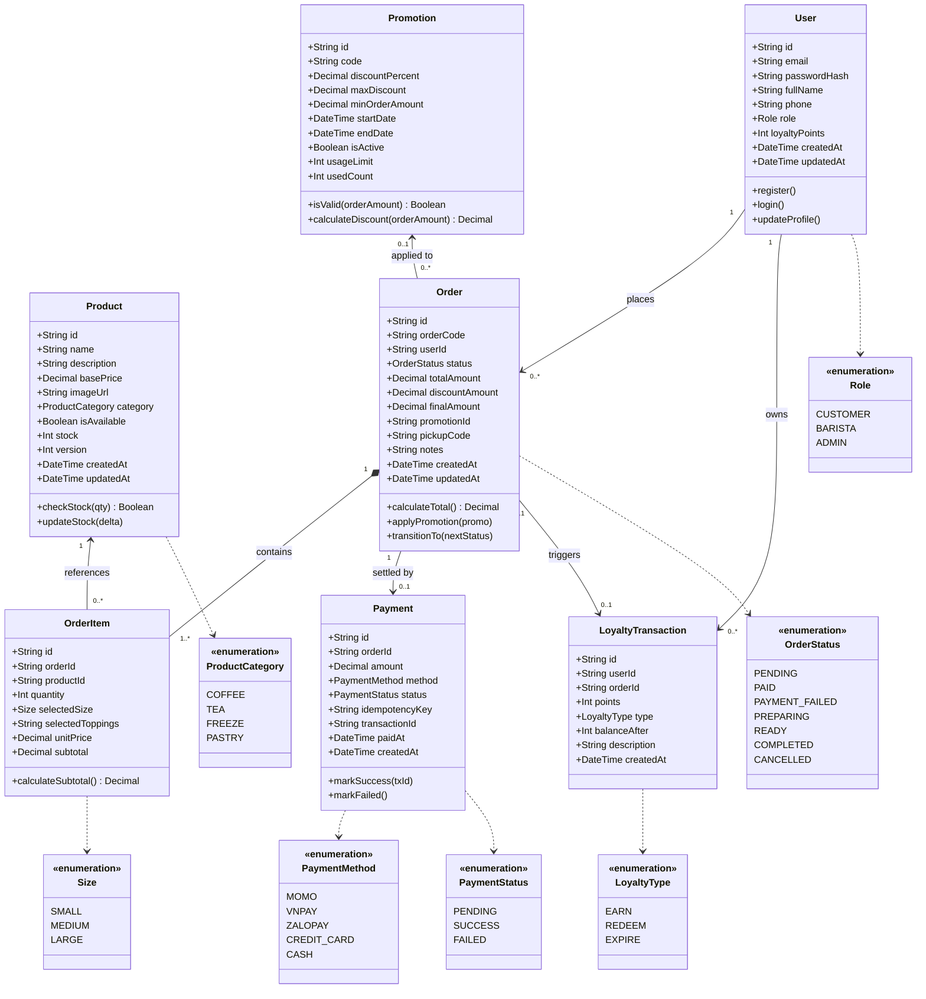

# SƠ ĐỒ LỚP MỨC DOMAIN (CLASS DIAGRAM) — HỆ THỐNG BREWLITE

> **Căn cứ đề bài:** Mục 4.3 (Task 2.3 - 2.0 điểm) trong tệp đặc tả gốc [`docs/DE_BAI_ASSIGNMENT_2_GOC.md`](../../docs/DE_BAI_ASSIGNMENT_2_GOC.md).  
> **Tiêu chí nghiệm thu:** Sơ đồ mức domain mô hình hóa tối thiểu 7 thực thể: `User`, `Product`, `Order`, `OrderItem`, `Payment`, `Promotion`, `LoyaltyTransaction` cùng đầy đủ thuộc tính, kiểu dữ liệu, quan hệ, multiplicity và enum trạng thái; đảm bảo không mâu thuẫn với SRS và Sequence Diagram.  
> **Tệp mã nguồn Mermaid:** [`class-domain.mmd`](class-domain.mmd)  
> **Tệp xuất đồ họa vector (SVG):** [`class-domain.svg`](class-domain.svg) | [`ClassDiagram.drawio.svg`](ClassDiagram.drawio.svg)  
> **Tệp ảnh chất lượng cao (PNG):** [`class-domain.png`](class-domain.png) | [`ClassDiagram.drawio.png`](ClassDiagram.drawio.png)

---

## 1. DANH SÁCH 7 THỰC THỂ CỐT LÕI (CORE DOMAIN ENTITIES)

| Tên lớp (Class) | Trách nhiệm nghiệp vụ | Thuộc tính chính | Phương thức nghiệp vụ tiêu biểu |
| :--- | :--- | :--- | :--- |
| **`User`** | Tài khoản khách hàng thành viên, nhân viên barista, quản trị viên. | `id`, `email`, `passwordHash`, `fullName`, `phone`, `role`, `loyaltyPoints` | `register()`, `login()`, `updateProfile()` |
| **`Product`** | Sản phẩm đồ uống / bánh ngọt trong thực đơn kèm quản lý tồn kho và phiên bản. | `id`, `name`, `description`, `basePrice`, `imageUrl`, `category`, `isAvailable`, `stock`, `version` | `checkStock(qty)`, `updateStock(delta)` |
| **`Order`** | Thực thể trung tâm quản lý đơn đặt hàng, trạng thái vòng đời, đơn giá và chiết khấu. | `id`, `orderCode`, `userId`, `status`, `totalAmount`, `discountAmount`, `finalAmount`, `pickupCode` | `calculateTotal()`, `applyPromotion()`, `transitionTo()` |
| **`OrderItem`** | Chi tiết từng món trong đơn, lưu size tùy chọn, topping và đơn giá tại thời điểm mua. | `id`, `orderId`, `productId`, `quantity`, `selectedSize`, `selectedToppings`, `unitPrice`, `subtotal` | `calculateSubtotal()` |
| **`Payment`** | Giao dịch thanh toán trực tuyến, quản lý khóa chống trừ tiền lặp và phản hồi từ Gateway. | `id`, `orderId`, `amount`, `method`, `status`, `idempotencyKey`, `transactionId`, `paidAt` | `markSuccess(txId)`, `markFailed()` |
| **`Promotion`** | Chương trình khuyến mãi, mã giảm giá voucher, giới hạn sử dụng và điều kiện áp dụng. | `id`, `code`, `discountPercent`, `maxDiscount`, `minOrderAmount`, `startDate`, `endDate`, `isActive` | `isValid(orderAmount)`, `calculateDiscount()` |
| **`LoyaltyTransaction`** | Nhật ký biến động điểm thưởng thành viên (tích lũy sau khi thanh toán hoặc đổi quà). | `id`, `userId`, `orderId`, `points`, `type`, `balanceAfter`, `description`, `createdAt` | — |

---

## 2. QUAN HỆ & MULTIPLICITY GIỮA CÁC LỚP

```
[User] 1 -------- 0..* [Order] (places)
[User] 1 -------- 0..* [LoyaltyTransaction] (owns)
[Order] 1 *====== 1..* [OrderItem] (contains - Composition)
[Product] 1 <---- 0..* [OrderItem] (references)
[Order] 1 ------- 0..1 [Payment] (settled by)
[Promotion] 0..1  0..* [Order] (applied to)
[Order] 0..1 ---- 0..1 [LoyaltyTransaction] (triggers)
```

1. **`User` (1) $\longrightarrow$ `Order` (0..*):** Một người dùng có thể chưa đặt đơn nào hoặc có nhiều đơn hàng trong lịch sử; mỗi đơn hàng thuộc về đúng 1 tài khoản khách hàng.
2. **`Order` (1) $* \longrightarrow$ `OrderItem` (1..*):** Quan hệ **Composition** (Sở hữu mạnh). Một đơn hàng hợp lệ bắt buộc phải có từ 1 đến nhiều món. Nếu `Order` bị hủy xóa thì các `OrderItem` con cũng bị hủy theo.
3. **`Product` (1) $\longleftarrow$ `OrderItem` (0..*):** Quan hệ tham chiếu. Mỗi dòng món hàng tham chiếu đến đúng 1 sản phẩm gốc để truy vết giá và tồn kho.
4. **`Order` (1) $\longrightarrow$ `Payment` (0..1):** Mỗi đơn hàng gắn liền với tối đa 1 giao dịch thanh toán trực tuyến thành công.
5. **`Promotion` (0..1) $\longleftarrow$ `Order` (0..*):** Mỗi đơn hàng có thể áp dụng tối đa 1 mã giảm giá (hoặc không dùng); một mã giảm giá có thể được áp dụng cho nhiều đơn hàng khác nhau.
6. **`Order` (0..1) $\longrightarrow$ `LoyaltyTransaction` (0..1):** Mỗi đơn hàng khi đạt trạng thái `PAID` sẽ kích hoạt tạo đúng 1 bản ghi tích lũy điểm thưởng tương ứng.

---

## 3. DANH SÁCH CÁC ENUM TRẠNG THÁI (STATUS ENUMS)

* **`Role`:** `CUSTOMER` (Khách hàng), `BARISTA` (Nhân viên quầy pha chế), `ADMIN` (Quản trị viên).
* **`ProductCategory`:** `COFFEE` (Cà phê), `TEA` (Trà trái cây / Trà sữa), `FREEZE` (Đá xay), `PASTRY` (Bánh ngọt).
* **`Size`:** `SMALL`, `MEDIUM`, `LARGE`.
* **`OrderStatus`:** `PENDING` (Chờ thanh toán) $\rightarrow$ `PAID` (Đã thanh toán) $\rightarrow$ `PREPARING` (Đang pha chế) $\rightarrow$ `READY` (Sẵn sàng lấy nước) $\rightarrow$ `COMPLETED` (Hoàn tất) / `PAYMENT_FAILED` (Thanh toán lỗi) / `CANCELLED` (Đã hủy).
* **`PaymentMethod`:** `MOMO`, `VNPAY`, `ZALOPAY`, `CREDIT_CARD`, `CASH`.
* **`PaymentStatus`:** `PENDING`, `SUCCESS`, `FAILED`.
* **`LoyaltyType`:** `EARN` (Cộng điểm từ đơn hàng), `REDEEM` (Tiêu điểm đổi voucher), `EXPIRE` (Điểm hết hạn).

---

## 4. CƠ CHẾ KỸ THUẬT PHỤC VỤ SPRINT 1 & 2

### 4.1. Khóa lạc quan (Optimistic Locking) trên `Product.version`
* Trường `Product.version: Int` được thiết kế nhằm đồng bộ chặt chẽ với Sequence Diagram (`Task 2.2`).
* Khi nhiều khách hàng cùng tranh chấp mua ly cà phê cuối cùng, truy vấn cập nhật sẽ kiểm tra điều kiện `WHERE id = ? AND version = ?`. Giao dịch nào đến trước sẽ cập nhật thành công và tăng `version = version + 1`, giao dịch đến sau gặp mismatch version sẽ bị rollback để tránh lỗi âm kho.

### 4.2. Khóa lũy đẳng (Idempotency Key) trên `Payment.idempotencyKey`
* Thuộc tính `Payment.idempotencyKey: String` có ràng buộc duy nhất (`UNIQUE`).
* Đảm bảo khi Client gặp sự cố mạng gửi lại yêu cầu `POST /payments`, hệ thống sẽ tra cứu bản ghi thanh toán đã tồn tại và trả về kết quả ngay lập tức, tuyệt đối không trừ tiền lần hai.

---

## 5. NỘI DUNG SƠ ĐỒ MERMAID


