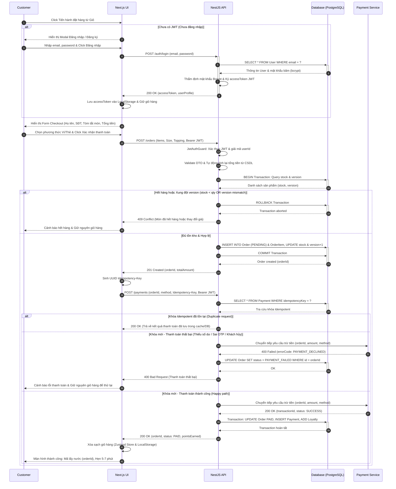

# SƠ ĐỒ TUẦN TỰ (SEQUENCE DIAGRAM) - USE CASE ĐẶT VÀ THANH TOÁN ĐƠN HÀNG

> **Căn cứ đề bài:** Mục 4.2 (Task 2.2 - 2.0 điểm) trong tệp đặc tả gốc [`docs/DE_BAI_ASSIGNMENT_2_GOC.md`](../../docs/DE_BAI_ASSIGNMENT_2_GOC.md).  
> **Use Case trọng tâm:** `UC06 - Đặt hàng (Checkout)` & `UC07 - Thanh toán trực tuyến` (Task 1.3).  
> **Tệp mã nguồn Mermaid:** [`sequence-checkout.mmd`](sequence-checkout.mmd)  
> **Tệp xuất đồ họa vector (SVG đã xóa logo):** [`SWE - Sequence Diagram.svg`](SWE%20-%20Sequence%20Diagram.svg)  
> **Tệp ảnh chất lượng cao (PNG):** [`SWE - Sequence Diagram.png`](SWE%20-%20Sequence%20Diagram.png)

---

## 1. MỤC TIÊU & CÁC LIFELINE BẮT BUỘC

Sơ đồ mô tả chi tiết thứ tự trao đổi thông điệp (Request/Response) giữa các thực thể tham gia vào chu trình đặt món và thanh toán trực tuyến:

$$\text{Customer} \longrightarrow \text{Next.js UI} \longrightarrow \text{NestJS API} \longrightarrow \text{Database (PostgreSQL)} \longrightarrow \text{Payment Service}$$

| Lifeline | Thành phần công nghệ | Trách nhiệm chính |
| :--- | :--- | :--- |
| **`Customer`** | Người dùng cuối | Tương tác UI, chọn món, điền thông tin và xác nhận thanh toán. |
| **`Next.js UI`** | Frontend Next.js Client | Điều phối giao diện, lưu trữ trạng thái giỏ hàng (Zustand), sinh UUID `Idempotency-Key` và hiển thị kết quả. |
| **`NestJS API`** | Backend API Gateway | Xác thực JWT (`JwtAuthGuard`), thẩm định DTO, tính lại đơn giá, điều phối Transaction và quản lý State Machine. |
| **`Database`** | PostgreSQL + Prisma ORM | Lưu trữ dữ liệu an toàn, thực thi ACID Transaction và kiểm soát đồng thời qua Khóa lạc quan (**Optimistic Locking**). |
| **`Payment Service`** | Mock Payment Gateway | Giả lập xử lý thanh toán ví MoMo/VNPay/Thẻ, phản hồi mã giao dịch `transactionId` hoặc mã lỗi từ chối. |

---

## 2. NỘI DUNG SƠ ĐỒ MERMAID (THEO CHUẨN ĐẶC TẢ)

---

## 3. PHÂN TÍCH KỸ THUẬT CÁC CƠ CHẾ CỐT LÕI

### 3.1. Xác thực JWT & Kiểm tra phiên làm việc (Auth & JWT Guard)
- Khi người dùng gửi yêu cầu tạo đơn `POST /orders`, hệ thống Backend dùng `JwtAuthGuard` để giải mã `Bearer Token`.
- Nếu token hợp lệ, `userId` của Member được trích xuất an toàn từ payload token và gán trực tiếp vào đơn hàng, ngăn chặn việc giả mạo danh tính khách hàng.

### 3.2. Quản lý Transaction & Khóa lạc quan (Optimistic Locking)
- Nhằm giải quyết triệt để bài toán tranh chấp tồn kho khi có nhiều khách hàng cùng mua ly nước cuối cùng:
  - Backend mở một Database Transaction (`$transaction`).
  - Đọc trường `version` và số lượng tồn kho `stock` hiện tại.
  - Khi cập nhật tồn kho: `UPDATE "Product" SET stock = stock - qty, version = version + 1 WHERE id = ? AND version = currentVersion`.
  - Nếu số hàng bị cập nhật là 0 (do phiên khác đã cập nhật trước làm tăng version), Transaction tự động **ROLLBACK** và trả về lỗi **HTTP 409 Conflict**.
  - Client bắt mã 409, giữ nguyên giỏ hàng để người dùng không phải chọn lại các món khác.

### 3.3. Tính bất biến khi gọi lại (Idempotency Key Mechanism)
- Để tránh việc mạng chập chờn khiến Client vô tình gửi 2 lần yêu cầu thanh toán (Double-spending):
  - Client Next.js tự sinh một chuỗi UUID duy nhất gán vào Header `Idempotency-Key` (hoặc body).
  - Backend kiểm tra bảng `Payment` với `idempotencyKey`:
    - Nếu đã có bản ghi thanh toán trước đó, lập tức trả về kết quả đã lưu mà **không gọi lại Payment Gateway**.
    - Nếu là khóa mới, Backend mới tiến hành chuyển tiếp sang cổng thanh toán.

### 3.4. Cỗ máy trạng thái & Hậu điều kiện (State Machine & Post-conditions)
- Trạng thái đơn hàng chuyển đổi chặt chẽ: `PENDING` $\longrightarrow$ `PAID` $\longrightarrow$ `PREPARING` $\longrightarrow$ `READY` $\longrightarrow$ `COMPLETED`.
- Nếu thanh toán thất bại, đơn chuyển sang `PAYMENT_FAILED` (không trừ tồn kho).
- Khi thanh toán thành công, hệ thống tự động tích điểm thưởng thành viên (`LoyaltyTransaction`: 10.000đ = 1 điểm) và gửi mã lấy nước (`orderId`) kèm thời gian dự kiến (5-7 phút) cho khách hàng.

---

## 4. MA TRẬN TRUY VẾT YÊU CẦU (TRACEABILITY)

| Thành phần trong sơ đồ tuần tự | Mã Use Case | Mã Yêu cầu chức năng (FR) | Mã Yêu cầu phi chức năng (NFR) |
| :--- | :---: | :---: | :---: |
| Xác thực JWT / Đăng nhập | `UC05` | `FR-04` | `NFR-02` (Bảo mật) |
| Khởi tạo đơn hàng & Tính giá | `UC06` | `FR-05` | `NFR-01`, `NFR-04` |
| Quản lý Transaction & Khóa lạc quan | `UC06`, `UC14` | `FR-08` | `NFR-04` (Toàn vẹn dữ liệu) |
| Kiểm tra Idempotency thanh toán | `UC07.2` | `FR-06` | `NFR-02`, `NFR-04` |
| Xử lý thanh toán Cổng Mock | `UC07` | `FR-06` | `NFR-03` |
| Tích lũy điểm thành viên | `UC08` | `FR-09` | `NFR-04` |
| Thông báo kết quả & Mã lấy nước | `UC06`, `UC07` | `FR-05`, `FR-06` | `NFR-03` (Trải nghiệm người dùng) |
