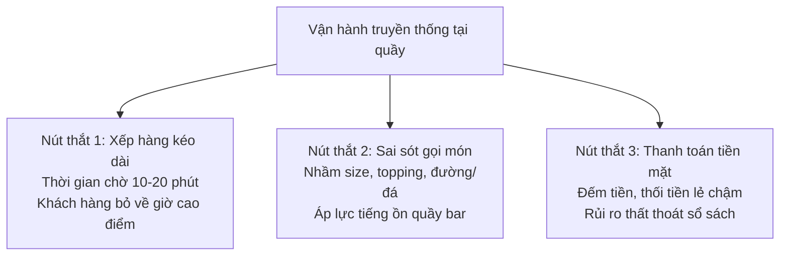
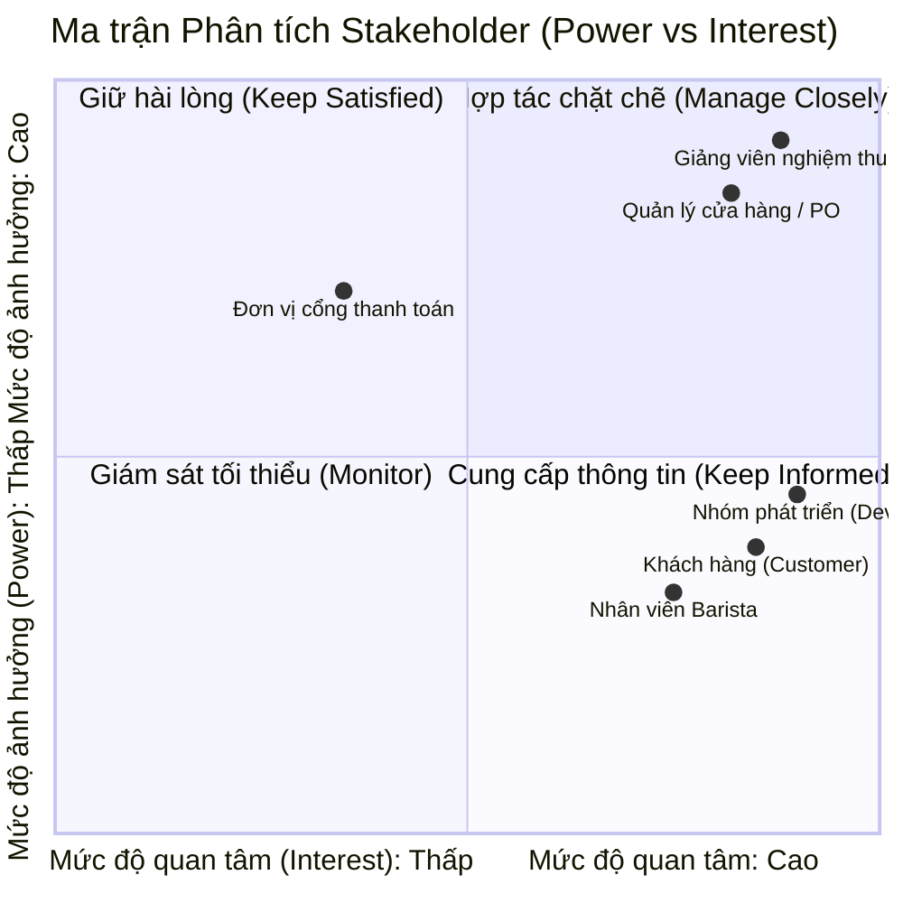
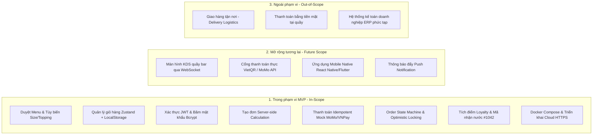

# 📑 TÀI LIỆU BỐI CẢNH, STAKEHOLDER VÀ PHẠM VI HỆ THỐNG (CONTEXT & SCOPE)
## Dự án: BrewLite — Hệ thống đặt đồ uống không dùng tiền mặt (Cashless Coffee Ordering System)

---

> **Cơ sở đào tạo:** Trường Đại học Sài Gòn — Khoa Công nghệ Thông tin  
> **Môn học:** Công nghệ Phần mềm (Software Engineering)  
> **Học kỳ:** I — Năm học 2026–2027  
> **Hạng mục:** Assignment 2 — Task 1.1: Bối cảnh, Stakeholder và Phạm vi  
> **Phiên bản:** v1.0  
> **Tác giả:** Nhóm phát triển BrewLite  

---

## 1. BỐI CẢNH DỰ ÁN & VẤN ĐỀ NGHIỆP VỤ (BUSINESS CONTEXT & PROBLEM STATEMENT)

### 1.1. Bối cảnh thực tế (Business Context)
Trong mô hình vận hành của các chuỗi đồ uống, quán cà phê hiện đại tại các khu vực trường đại học, tòa nhà văn phòng và trung tâm thương mại, lượng khách hàng thường tập trung đột biến vào các khung giờ cao điểm (sáng sớm từ 7:30 - 9:00 và giờ nghỉ trưa từ 11:30 - 13:00). 

Phương thức vận hành truyền thống dựa trên việc khách hàng xếp hàng tại quầy thu ngân, gọi món trực tiếp bằng miệng và thanh toán bằng tiền mặt/quẹt thẻ POS tại chỗ đang bộc lộ những hạn chế nghiêm trọng.

### 1.2. Ba nút thắt cổ chai cốt lõi (Core Bottlenecks)

1. **Nút thắt 1: Thời gian xếp hàng kéo dài (Queue Bottleneck):**
   * Khách hàng phải mất từ 10 đến 20 phút chỉ để di chuyển theo hàng đợi, gọi món và chờ in hóa đơn.
   * Tỷ lệ khách hàng quyết định bỏ đi (churn rate) vào giờ cao điểm ước tính lên đến 15% - 25% do không kịp giờ làm việc/học tập.
2. **Nút thắt 2: Sai sót thông tin đơn đồ uống (Order Inaccuracy):**
   * Đồ uống hiện đại có mức độ cá nhân hóa rất cao (kích cỡ S/M/L, lựa chọn lượng đường, đá, và nhiều loại topping kèm theo).
   * Việc giao tiếp bằng miệng trong không gian ồn ào giờ cao điểm dễ dẫn đến nhầm lẫn khi thu ngân gõ lại vào máy POS, gây lãng phí nguyên liệu pha chế lại và trải nghiệm tiêu cực cho khách hàng.
3. **Nút thắt 3: Nghẽn thanh toán & Rủi ro dòng tiền mặt (Cash Handling Inefficiency):**
   * Việc kiểm đếm tiền mặt, trả lại tiền thối gây tiêu tốn trung bình từ 45 - 90 giây cho mỗi giao dịch tại quầy.
   * Quản lý tiền mặt tại quầy tạo áp lực đối soát cuối ca và nguy cơ thất thoát doanh thu.

### 1.3. Mục tiêu giải pháp & Chỉ số kỳ vọng (Business Goals & KPIs)
Hệ thống **BrewLite** ra đời với sứ mệnh số hóa toàn bộ trải nghiệm đặt món và thanh toán của khách hàng:

* **Mục tiêu 1:** Rút ngắn thời gian từ lúc chọn món đến khi hoàn tất thanh toán xuống **dưới 60 giây**.
* **Mục tiêu 2:** Triệt tiêu **100% sai sót** trong việc truyền đạt thông tin kích cỡ và danh sách topping nhờ vào giao diện trực quan và dữ liệu số hóa trực tiếp.
* **Mục tiêu 3:** Chuyển đổi **100% giao dịch sang hình thức không tiền mặt (Cashless)** thông qua Ví điện tử, thẻ nội địa/quốc tế và tài khoản thành viên.
* **Mục tiêu 4:** Tối ưu hóa năng suất quầy Barista thông qua mã nhận đồ uống điện tử đồng bộ tức thì khi đơn hàng được thanh toán thành công.

---

## 2. PHÂN TÍCH CÁC BÊN LIÊN QUAN (STAKEHOLDER MATRIX)

Hệ thống BrewLite tương tác và phục vụ 6 nhóm đối tượng liên quan trọng yếu:

| STT | Nhóm Stakeholder | Phân loại | Vai trò trong hệ thống | Mục tiêu & Kỳ vọng cốt lõi |
| :---: | :--- | :--- | :--- | :--- |
| **1** | **Khách hàng (Customer / Member)** | Tác nhân chính (Primary Actor) | Người dùng trực tiếp truy cập ứng dụng web trên điện thoại/máy tính, duyệt menu, tùy biến đồ uống, thanh toán và nhận nước. | - Giao diện trực quan, tải nhanh trên di động. - Tùy biến size/topping dễ dàng, tính tiền realtime. - Thanh toán tức thì, an toàn không bị trừ tiền 2 lần. - Có mã nhận nước rõ ràng và được tích điểm thưởng. |
| **2** | **Nhân viên quầy (Barista / Staff)** | Tác nhân nghiệp vụ (Secondary Actor) | Tiếp nhận các đơn hàng đã thanh toán (`PAID`), thực hiện pha chế theo đúng công thức topping/size và bàn giao cho khách. | - Thông tin đơn hàng hiển thị chuẩn xác, không bị nhầm lẫn topping. - Thao tác cập nhật trạng thái đơn tinh gọn (`PREPARING` $\rightarrow$ `READY` $\rightarrow$ `COMPLETED`). - Không phải xử lý tiền mặt tại quầy pha chế. |
| **3** | **Quản lý cửa hàng (Store Manager / PO)** | Tác nhân quản trị (Management Actor) | Theo dõi tình hình kinh doanh, quản lý danh mục món, cấu hình tồn kho nguyên liệu và giám sát chất lượng dịch vụ. | - Nắm bắt dữ liệu đơn hàng và doanh thu theo thời gian thực. - Cập nhật giá và trạng thái còn/hết món tức thì. - Giảm thiểu thất thoát doanh thu và tối ưu nhân sự quầy. |
| **4** | **Giảng viên hướng dẫn & Nghiệm thu** | Tác nhân học thuật (Assessor Actor) | Đánh giá tính chuẩn mực về quy trình Công nghệ Phần mềm, kiến trúc hệ thống và chất lượng sản phẩm bàn giao. | - Tuân thủ quy trình Agile Scrum có bằng chứng rõ ràng. - Đặc tả SRS chuẩn, mô hình hóa UML (Activity, Sequence, Class, Deployment) chính xác. - Code sạch (Clean Code), **tuyệt đối không có comment rác** trong mã nguồn. - CI/CD tự động và triển khai Production thực tế. |
| **5** | **Nhóm phát triển (Development Team)** | Tác nhân kỹ thuật (Technical Actor) | Phân tích, thiết kế kiến trúc, lập trình fullstack, kiểm thử tự động và vận hành hạ tầng đám mây. | - Cấu trúc Monorepo thống nhất, phân tách rõ Frontend/Backend. - Sử dụng công nghệ hiện đại (Next.js, NestJS, Prisma, PostgreSQL). - Cơ chế kiểm soát đồng thời (Optimistic Locking) và Idempotency vững chắc. - Pipeline CI/CD tự động kiểm soát chất lượng code. |
| **6** | **Đơn vị cổng thanh toán (Payment Provider / Mock)** | Tác nhân hệ thống ngoài (System Actor) | Dịch vụ giả lập cổng thanh toán trực tuyến (MoMo, VNPay, Thẻ ngân hàng) tiếp nhận và xử lý giao dịch. | - Xử lý an toàn với `Idempotency-Key` (bất biến lặp). - Phản hồi mã trạng thái rõ ràng (`SUCCESS` / `FAILED`). - Độ trễ phản hồi thấp (< 500ms). |

### Ma trận Quyền hạn & Mức độ quan tâm (Power / Interest Grid)

---

## 3. PHÂN ĐỊNH PHẠM VI HỆ THỐNG (SYSTEM SCOPE)

Để đảm bảo dự án hoàn thành đúng tiến độ và đạt chất lượng cao nhất trong khuôn khổ **Assignment 2 (10 điểm)**, phạm vi hệ thống được phân định minh bạch thành 3 phân vùng:

### 3.1. Bảng phạm vi trong MVP (In-Scope Table — Nghiệm thu Assignment 2)

Hệ thống hiện thực đầy đủ **luồng nghiệp vụ tối thiểu (Core Business Flow)** xuyên suốt:
$$\text{Xem menu} \longrightarrow \text{Chọn tùy chọn (Size/Topping)} \longrightarrow \text{Giỏ hàng} \longrightarrow \text{Đặt đơn} \longrightarrow \text{Thanh toán} \longrightarrow \text{Theo dõi đơn}$$

| STT | Phân hệ / Thành phần | Tính năng trong MVP (In-Scope) | Luồng nghiệp vụ liên quan | Tiêu chí nghiệm thu MVP (Acceptance Criteria) |
| :---: | :--- | :--- | :---: | :--- |
| **1** | **Frontend Web** (Next.js Mobile-first / PWA) | - Duyệt danh mục đồ uống dạng Tabs (Cà phê Việt Nam, Cà phê Pha Máy, Trà \& Trái Cây, Đá Xay \& Thức Uống Đá). - Modal tùy biến món: chọn Size (S/M/L) và Topping, tính giá realtime. - Giỏ hàng client (Zustand + `localStorage`), tăng/giảm số lượng, xóa món. - Đăng ký / Đăng nhập tài khoản thành viên bảo mật. - Màn hình xác nhận đơn hiển thị mã nhận nước `#xxxxxx`. - Tra cứu lịch sử đơn hàng cá nhân (`GET /orders/me`). | `Xem menu` `Chọn tùy chọn` `Giỏ hàng` `Theo dõi đơn` | - Giao diện responsive tối ưu trên điện thoại di động. - Đầy đủ 3 trạng thái UX: Loading skeleton, Empty state, Error state có nút Retry. - Hiển thị đúng đơn vị tiền tệ VND (`35.000đ`). - Lưu trữ giỏ hàng bền vững qua reload. |
| **2** | **Backend API** (NestJS Modular REST API) | - `GET /products`: Danh sách đồ uống có lọc danh mục. - `GET /products/:id`: Chi tiết đồ uống kèm options. - `POST /auth/register` & `POST /auth/login`: Xác thực JWT. - `POST /orders`: Tạo đơn hàng mới, trạng thái `PENDING`. - `POST /payments`: Xử lý giao dịch thanh toán đơn hàng. - `GET /orders/me`: Lấy lịch sử đơn hàng của người dùng. | `Xem menu` `Đặt đơn` `Thanh toán` `Theo dõi đơn` | - Cấu trúc phân tầng rõ ràng (Controller, Service, DTO, Entity). - Validation đầu vào chặt chẽ qua `ValidationPipe`. - Server-side price calculation: tự tính lại 100% tiền từ CSDL, không tin giá client gửi lên. - Endpoint giám sát sức khỏe `GET /health` trả về `200 OK`. |
| **3** | **Cơ sở dữ liệu** (PostgreSQL + Prisma ORM) | - Thiết kế quan hệ chuẩn hóa cho các thực thể cốt lõi: `User`, `Category`, `Product`, `SizeOption`, `Topping`, `Order`, `OrderItem`, `Payment`, `Voucher`. - Cơ chế Migration tự động và file seed dữ liệu mẫu phong phú. | Toàn bộ luồng nghiệp vụ | - CSDL có thể tái tạo hoàn chỉnh chỉ bằng một lệnh migration & seed. - Dữ liệu tham chiếu có tính toàn vẹn khóa ngoại (Foreign Keys). |
| **4** | **Nghiệp vụ chuyên sâu** (Core Engine) | - **Order State Machine:** Kiểm soát chu trình sống đơn hàng (`PENDING` $\rightarrow$ `PAID` $\rightarrow$ `PREPARING` $\rightarrow$ `READY` $\rightarrow$ `COMPLETED`). - **Optimistic Locking:** Kiểm soát đồng thời tồn kho với trường `version` trong bảng `Product`. - **Idempotent Payment:** Chống trừ tiền trùng lặp bằng `Idempotency-Key` UUIDv4 trong header. - **Loyalty Program:** Tự động tích lũy điểm thưởng thành viên khi đơn hàng chuyển sang `PAID`. | `Đặt đơn` `Thanh toán` `Theo dõi đơn` | - Không cho phép nhảy cóc trạng thái đơn hàng (ném lỗi `400 Bad Request`). - Không bao giờ xảy ra bán âm tồn kho khi nhiều request tranh chấp cùng lúc. - Nhận request trùng `Idempotency-Key` trả về ngay kết quả đã lưu mà không trừ tiền lần 2. |
| **5** | **Hạ tầng & Đóng gói** (DevOps & Delivery) | - File `docker-compose.yml` & `docker-compose.prod.yml` khởi chạy trọn vẹn cả 3 service (Frontend, Backend, PostgreSQL). - Pipeline CI/CD tự động trên GitHub Actions. - Triển khai chạy thực tế trên **AWS EC2 Ubuntu** (`https://nphat-brewlite.duckdns.org`) với Nginx Reverse Proxy và SSL HTTPS. | Toàn bộ hệ thống | - Người dùng bên ngoài có thể truy cập hệ thống qua URL Internet an toàn HTTPS. - Database không public trực tiếp cổng ra ngoài. - Bí mật/Secrets được quản lý an toàn, không lộ file `.env`. |

### 3.2. Bảng phạm vi mở rộng trong tương lai (Future Scope Table — Giai đoạn 2)

| STT | Tính năng mở rộng | Mô tả chi tiết | Mục tiêu nâng cao |
| :---: | :--- | :--- | :--- |
| **1** | **Màn hình KDS Quầy Bar (Kitchen Display System)** | Ứng dụng web hiển thị chuyên dụng cho Barista tại quầy pha chế, đồng bộ đơn hàng theo thời gian thực (Realtime) thông qua giao thức WebSocket hoặc Server-Sent Events (SSE). | Tự động hóa hoàn toàn quy trình nhận đơn của nhân viên quầy, hiển thị thông báo âm thanh khi có đơn mới thanh toán thành công. |
| **2** | **Cổng thanh toán thực tế (Live Payment Integration)** | Tích hợp trực tiếp với API của MoMo Open Platform, ZaloPay Merchant hoặc VietQR Dynamic sinh mã QR kèm số tiền và nội dung chuyển khoản tự động. | Cho phép giao dịch dòng tiền thực tế của ngân hàng thay cho dịch vụ Mock Payment. |
| **3** | **Ứng dụng Native Mobile App** | Xây dựng ứng dụng di động đa nền tảng bằng React Native hoặc Flutter phát hành lên Google Play và Apple App Store. | Hỗ trợ tính năng thông báo đẩy (Push Notification) khi đồ uống đã pha chế xong sẵn sàng nhận món. |
| **4** | **Phân tích hành vi & Khuyến mãi nâng cao (AI Recommendation)** | Gợi ý món uống kèm thông minh (Cross-selling/Up-selling) dựa trên lịch sử đặt món của khách hàng và phân tích xu hướng bán chạy theo khung giờ. | Tăng giá trị trung bình trên mỗi đơn hàng (Average Order Value - AOV) cho cửa hàng. |

### 3.3. Bảng nội dung không thực hiện (Out-of-Scope Table)

| STT | Nội dung loại trừ (Out-of-Scope) | Lý do loại trừ trong khuôn khổ đề tài BrewLite |
| :---: | :--- | :--- |
| **1** | **Giao hàng tận nhà (Delivery Logistics)** | BrewLite định vị cốt lõi là giải pháp **Click & Collect (Đặt trước - Tự đến lấy tại quầy)** nhằm giải quyết dứt điểm vấn đề xếp hàng giờ cao điểm tại quán. Hệ thống không bao gồm quản lý tài xế, tính phí giao hàng (ship fee), bản đồ lộ trình vận chuyển hay theo dõi GPS shipper. |
| **2** | **Thu / Thối tiền mặt tại quầy** | Đề tài tập trung 100% vào mô hình **Cashless (Không dùng tiền mặt)** để xóa bỏ thời gian chết kiểm đếm tiền thối (45-90s/khách) và rủi ro thất thoát doanh thu. Mọi giao dịch bắt buộc thực hiện qua phương thức thanh toán điện tử. |
| **3** | **Kế toán doanh nghiệp & Tính lương (Enterprise ERP)** | Dự án tập trung vào trải nghiệm đặt hàng của khách hàng và xử lý nghiệp vụ đơn tại cửa hàng. Các phân hệ phức tạp như tính lương nhân viên, hạch toán khấu hao tài sản cố định, xuất hóa đơn đỏ GTGT cho cơ quan thuế thuộc về hệ thống ERP doanh nghiệp riêng biệt. |
| **4** | **Đặt giữ bàn trước (Table Reservation)** | Mô hình vận hành của quán là phục vụ đồ uống mang đi (Takeaway) và ngồi uống tự do tại chỗ; không cung cấp tính năng đặt sơ đồ bàn trước theo khung giờ. |

---

## 4. BẢNG GIẢ ĐỊNH & RÀNG BUỘC (ASSUMPTIONS & CONSTRAINTS)

### 4.1. Bảng giả định (Assumptions)
| Mã | Giả định | Mô tả chi tiết |
| :---: | :--- | :--- |
| **ASM-01** | Thiết bị người dùng | Khách hàng sở hữu thiết bị thông minh (Smartphone, Laptop, Tablet) có trình duyệt web hiện đại (Chrome, Safari, Edge) và kết nối Internet ổn định. |
| **ASM-02** | Phương thức thanh toán | Khách hàng có khả năng sử dụng các phương thức không tiền mặt (Ví điện tử MoMo, ZaloPay, Thẻ ngân hàng có Internet Banking). |
| **ASM-03** | Khung giờ hoạt động quầy | Quán cà phê duy trì kết nối mạng ổn định tại quầy Barista trong toàn bộ thời gian mở cửa để tiếp nhận thông tin đơn hàng. |
| **ASM-04** | Hạ tầng Cloud | Các nhà cung cấp đám mây miễn phí/sinh viên (Vercel, Render, Neon PostgreSQL) duy trì uptime đủ để phục vụ quá trình chấm bài và demo. |

### 4.2. Bảng ràng buộc (Constraints)
| Mã | Phân loại | Ràng buộc cụ thể |
| :---: | :--- | :--- |
| **CST-01** | Công nghệ Frontend | Sử dụng Next.js (App Router), TypeScript và Tailwind CSS. Tuân thủ thiết kế Mobile-first responsive. |
| **CST-02** | Công nghệ Backend | Sử dụng NestJS Framework (TypeScript), tuân thủ kiến trúc phân tầng (Controller - Service - Module - DTO - Entity). |
| **CST-03** | Cơ sở dữ liệu | Sử dụng hệ quản trị CSDL quan hệ PostgreSQL, truy xuất dữ liệu thông qua Prisma ORM có cơ chế Migration. |
| **CST-04** | Quy định viết mã nguồn | **Tuyệt đối không viết bất kỳ comment giải thích nào trong các file mã nguồn** (`.ts`, `.tsx`, `.js`, `.css`). Code phải tự tường minh (Self-documenting code). |
| **CST-05** | Quy chuẩn Git & Bàn giao | Làm xong task nào phải commit chuẩn Conventional Commits và thực thi `git push` lên repository ngay lập tức. |
| **CST-06** | Môi trường triển khai | Cung cấp file cấu hình `docker-compose.yml` để chạy cục bộ và triển khai ít nhất 1 phiên bản chạy thực tế trên Cloud hỗ trợ giao thức HTTPS. |
| **CST-07** | Quy tắc thực hiện tuần tự | Năm task lớn của Assignment 2 phải hoàn thành đúng thứ tự (Task 1 $\rightarrow$ Task 2 $\rightarrow$ Task 3 $\rightarrow$ Task 4 $\rightarrow$ Task 5). Task sau chỉ được nghiệm thu khi tạo phẩm bắt buộc của task trước đã có đầy đủ trên kho GitHub. |

---

## 5. MA TRẬN RỦI RO BAN ĐẦU & BIỆN PHÁP GIẢM THIỂU (RISK ASSESSMENT & MITIGATION)

| Mã | Tên rủi ro | Mức độ | Khả năng | Biện pháp kỹ thuật giảm thiểu (Mitigation Strategy) |
| :---: | :--- | :---: | :---: | :--- |
| **RSK-01** | **Bán âm tồn kho (Stock Overselling)** Nhiều khách hàng cùng bấm đặt món cuối cùng tại cùng một thời điểm. | `Nghiêm trọng` | `Trung bình` | Áp dụng kỹ thuật **Optimistic Locking** thông qua trường `version` trong bảng `Product`. Kết hợp mệnh đề kiểm tra điều kiện `stock >= quantity` trong một Database Transaction duy nhất. Nếu xảy ra xung đột phiên bản, hệ thống rollback và trả về `409 Conflict`. |
| **RSK-02** | **Trừ tiền trùng lặp (Double Charging)** Khách bấm nút thanh toán nhiều lần do mạng chập chờn. | `Nghiêm trọng` | `Cao` | Bắt buộc client sinh chuỗi ngẫu nhiên duy nhất `Idempotency-Key` (UUIDv4) gửi trong HTTP Header. Backend lưu khóa này cùng kết quả giao dịch; nếu nhận lại key trùng lặp, trả về ngay kết quả đã lưu mà không gọi trừ tiền lần hai. |
| **RSK-03** | **Gian lận đơn giá từ Client (Price Tampering)** Người dùng cố tình sửa giá tiền trong payload gửi lên API. | `Nghiêm trọng` | `Thấp` | **Server-side Calculation:** Backend hoàn toàn không tin tưởng đơn giá hay tổng tiền từ client gửi lên. API chỉ nhận `productId`, `sizeOptionId` và `toppingIds`, sau đó tự truy vấn CSDL để tính toán lại 100% tổng tiền hợp lệ. |
| **RSK-04** | **Database Cold-Start Timeout** Cơ sở dữ liệu miễn phí trên Cloud rơi vào trạng thái ngủ đông (Sleep mode). | `Trung bình` | `Cao` | Client cài đặt cơ chế tự động thử lại (Retry logic) với thuật toán Exponential Backoff khi gặp mã lỗi 500/503. Backend cấu hình Connection Pooling tối ưu qua Prisma Direct URL. |
| **RSK-05** | **Nhảy cóc trạng thái đơn (Invalid State Transition)** Đơn hàng chưa thanh toán bị chuyển nhầm sang pha chế hoặc hoàn tất. | `Cao` | `Trung bình` | Xây dựng cỗ máy trạng thái hữu hạn (Order State Machine) được đóng gói trong hàm `assertTransition`. Mọi hành động chuyển trạng thái vi phạm đồ thị hợp lệ sẽ bị ném lỗi `400 Bad Request` ngay lập tức. |
| **RSK-06** | **Mất điểm truy vết do thiếu tạo phẩm tuần tự (Traceability Dependency Risk)** Đề bài quy định task sau không được tính điểm truy vết nếu thiếu tạo phẩm task trước. | `Cao` | `Thấp` | Duy trì file [docs/traceability-matrix.md](file:///c:/Study/HK1Nam3/CNPM/Project/docs/traceability-matrix.md) liên kết 5 cột liên tục qua từng task, kiểm tra chéo theo checklist 9.1 trước khi bắt đầu task kế tiếp. |

---

*Tài liệu này là căn cứ pháp lý và kỹ thuật chính thức cho Task 1.1 của Dự án BrewLite.*
