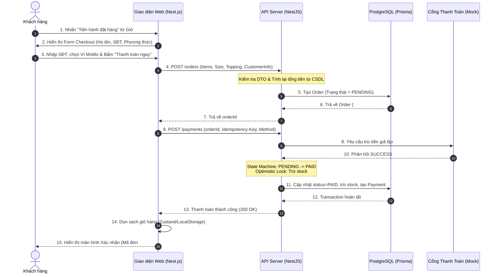

# 📌 ĐẶC TẢ USE CASE TRỌNG TÂM — DỰ ÁN BREWLITE (TASK 1.3)
## Core Use Case Specification: Đặt Hàng & Thanh Toán Không Tiền Mặt (Cashless Checkout)

---

> **Cơ sở đào tạo:** Trường Đại học Sài Gòn — Khoa Công nghệ Thông tin  
> **Môn học:** Công nghệ Phần mềm (Software Engineering)  
> **Hạng mục:** Assignment 2 — Task 1.3: Đặc tả một use-case trọng tâm  
> **Phiên bản:** v1.0  
> **Use Case lựa chọn:** `UC05 - Đặt hàng` & `UC06 - Thanh toán trực tuyến không tiền mặt`  

---

## 1. PHẠM VI & SƠ ĐỒ USE CASE TRỌNG TÂM (FOCUS SCOPE DIAGRAM)

Use case **"Đặt hàng và Thanh toán không tiền mặt"** là mạch máu nghiệp vụ cốt lõi nhất của BrewLite, giải quyết bài toán: *Khách hàng không phải xếp hàng chờ thanh toán tiền mặt tại quầy, mà có thể hoàn tất chọn món, áp voucher, thanh toán qua Ví điện tử và nhận mã lấy nước trong vài chạm.*

* **Mã nguồn sơ đồ:** [`Mermaid`](../diagrams/use-case/use-case-checkout.mmd) | [`PlantUML`](../diagrams/use-case/use-case-checkout.puml)

```mermaid
flowchart LR
    Customer[Khách hàng]
    Member[Khách thành viên]
    PaymentGW[Cổng thanh toán MoMo / VNPay]

    Member -.->|Kế thừa| Customer

    subgraph CheckoutBoundary [PHẠM VI TRỌNG TÂM: ĐẶT HÀNG & THANH TOÁN (BREWLITE)]
        UC04([UC04: Quản lý giỏ hàng])
        UC05([UC05: Đặt hàng - Checkout])
        UC05_1([UC05.1: Áp dụng mã Voucher])
        
        UC06([UC06: Thanh toán không tiền mặt])
        UC06_1([UC06.1: Chọn phương thức Ví / Thẻ])
        UC06_2([UC06.2: Xử lý Idempotent & Trừ tiền])
        
        UC08([UC08: Nhận mã nước & Theo dõi đơn])
        UC09([UC09: Tích lũy điểm thưởng])
    end

    Customer --- UC04
    Customer --- UC05
    Customer --- UC08

    UC05 -.->|include| UC06
    UC05_1 -.->|extend| UC05
    
    UC06 -.->|include| UC06_1
    UC06 -.->|include| UC06_2
    UC06_2 --- PaymentGW

    UC05 -.->|include| UC08
    UC09 -.->|extend| UC05
    Member --- UC09
```

---

## 2. BẢNG ĐẶC TẢ CHI TIẾT USE CASE TRỌNG TÂM (USE CASE SPECIFICATION)

| Thuộc tính | Chi tiết đặc tả kỹ thuật |
| :--- | :--- |
| **Tên Use Case** | **UC-CORE: Đặt Hàng & Thanh Toán Trực Tuyến (Cashless Order & Checkout)** |
| **Mã định danh** | `UC05: Đặt hàng - Checkout` & `UC06: Thanh toán không tiền mặt` (phân rã `UC06.1: Chọn phương thức`, `UC06.2: Xử lý Idempotent`, `UC05.1: Voucher`, `UC08: Nhận mã nước`, `UC09: Điểm thưởng`) |
| **Tác nhân chính (Primary Actor)** | **Khách hàng (Customer)** / **Khách thành viên (Member)** |
| **Tác nhân hỗ trợ (Supporting Actor)** | **Cổng thanh toán điện tử (Mock Payment Gateway)** (MoMo, VNPay, Thẻ ngân hàng) |
| **Sự kiện kích hoạt (Trigger)** | Khách hàng nhấn nút **"Tiến hành đặt hàng"** từ Giỏ hàng (Cart Drawer) hoặc nút **"Thanh toán ngay"** trên màn hình Checkout. |
| **Tiền điều kiện (Pre-conditions)** | 1. Giỏ hàng của khách hàng có ít nhất 1 sản phẩm (`cartCount > 0`).<br/>2. Các món trong giỏ hàng ở trạng thái khả dụng kinh doanh (`isAvailable = true`) và còn tồn kho (`stock > 0`).<br/>3. Máy khách (Client) duy trì kết nối Internet và gọi được REST API Backend (`/health` trả về `200 OK`). |
| **Hậu điều kiện thành công (Post-conditions - Success)** | 1. Đơn hàng được tạo thành công trong CSDL với trạng thái chuyển từ `PENDING` $\rightarrow$ `PAID`.<br/>2. Số lượng tồn kho (`stock`) của các món được trừ an toàn bằng cơ chế Khóa lạc quan (**Optimistic Locking**).<br/>3. Giao dịch thanh toán được ghi nhận kèm mã `Idempotency-Key` và `transactionId`.<br/>4. Khách hàng nhận được Mã đơn hàng to rõ (ví dụ: `#1042`) kèm thông báo: *"Mời bạn đến quầy nhận nước sau 5-7 phút"*.<br/>5. Giỏ hàng phía Client được xóa sạch (`cartItems = []`).<br/>6. Nếu là Khách thành viên (Member), hệ thống tự động tích lũy điểm thưởng tương ứng (10.000đ = 1 điểm). |
| **Hậu điều kiện thất bại (Post-conditions - Failure)** | 1. Đơn hàng chuyển sang trạng thái `PAYMENT_FAILED` hoặc `CANCELLED`.<br/>2. Số lượng tồn kho không bị trừ (hoặc được hoàn lại trong Transaction).<br/>3. Giỏ hàng của khách hàng được giữ nguyên vẹn để khách không phải chọn món lại từ đầu.<br/>4. Khách hàng nhận được thông báo lỗi rõ ràng kèm lý do (ví dụ: *Tài khoản không đủ số dư*, *Món vừa hết hàng*). |

---

## 3. CÁC LUỒNG SỰ KIỆN CHI TIẾT (FLOW OF EVENTS)



### 3.1. Luồng sự kiện chính (Normal / Main Flow)

1. **Khách hàng** duyệt giỏ hàng và nhấn nút **"Tiến hành đặt hàng"**.
2. **Hệ thống** hiển thị màn hình Đặt hàng (Checkout) bao gồm:
   * Danh sách tóm tắt các món (Tên, Size, Topping, Ghi chú, Số lượng, Đơn giá).
   * Bảng kê tài chính: Tạm tính, Chiết khấu voucher (nếu có), Phí dịch vụ, Tổng tiền thanh toán.
   * Form thông tin người nhận: Ô nhập **Họ và tên**, ô nhập **Số điện thoại**.
   * Lựa chọn phương thức thanh toán: Ví điện tử MoMo, ZaloPay, VNPay, hoặc Thẻ ngân hàng.
3. **Khách hàng** nhập đầy đủ Họ tên, Số điện thoại hợp lệ và chọn phương thức thanh toán là **Ví điện tử MoMo**.
4. **Khách hàng** nhấn nút **"Xác nhận thanh toán • [Tổng tiền]"**.
5. **Giao diện Client** gửi yêu cầu `POST /orders` kèm theo payload DTO chứa danh sách món, tùy chọn size/topping và thông tin người đặt lên Backend.
6. **Backend NestJS** thực hiện các bước kiểm tra nghiệp vụ:
   * `ValidationPipe` thẩm định tính hợp lệ của kiểu dữ liệu đầu vào.
   * Truy vấn CSDL để lấy đơn giá gốc, phụ thu size, giá topping và **tự động tính toán lại tổng tiền trên Server** (chống gian lận sửa giá từ Client).
   * Khởi tạo bản ghi `Order` trong CSDL với trạng thái khởi đầu là `PENDING` và sinh mã đơn hiển thị (ví dụ: `#1042`).
   * Trả về thông tin đơn hàng vừa tạo (`orderId`) cho Client.
7. **Client** nhận `orderId`, tự động sinh chuỗi mã khóa duy nhất `Idempotency-Key` (chuỗi UUIDv4) và gửi yêu cầu `POST /payments` lên Backend.
8. **Backend** chuyển tiếp yêu cầu trừ tiền đến **Cổng thanh toán điện tử (Mock Payment Gateway)**.
9. **Cổng thanh toán** xử lý trừ tiền và phản hồi kết quả giao dịch thành công (`status: SUCCESS`, `transactionId: "TXN_..."`).
10. **Backend** thực thi khối lệnh `prisma.$transaction` đảm bảo tính toàn vẹn dữ liệu:
    * Kích hoạt cỗ máy trạng thái (Order State Machine) chuyển trạng thái đơn hàng từ `PENDING` $\rightarrow$ `PAID`.
    * Áp dụng Khóa lạc quan (**Optimistic Locking**) kiểm tra trường `version` và trừ số lượng tồn kho (`stock = stock - qty`) của từng món.
    * Ghi nhận bản ghi thanh toán vào bảng `Payment` với trạng thái `PAID`.
    * Nếu khách hàng là Thành viên (`Role.CUSTOMER` đã đăng nhập), tính và cộng dồn điểm tích lũy vào tài khoản (`loyaltyPoints = loyaltyPoints + (total / 10000)`).
11. **Backend** phản hồi mã `200 OK` kèm dữ liệu đơn hàng đã thanh toán thành công về Client.
12. **Client** thực hiện dọn sạch giỏ hàng trong bộ nhớ `Zustand` và `localStorage`.
13. **Hệ thống** điều hướng người dùng đến **Màn hình Xác nhận Đơn hàng (Order Success Screen)** hiển thị mã đơn `#1042` to rõ, trạng thái `ĐÃ THANH TOÁN` kèm thông điệp: *"Mời bạn đến quầy nhận nước sau 5-7 phút"*.

---

### 3.2. Các luồng thay thế (Alternative Flows)

* **A1. Khách hàng đã đăng nhập tài khoản thành viên (Member Flow):**
  * Tại bước 2, hệ thống tự động điền sẵn Họ tên và Số điện thoại từ hồ sơ cá nhân.
  * Hệ thống hiển thị số điểm thưởng hiện có và cho phép khách tích chọn *"Dùng điểm thưởng giảm giá"* (ví dụ: 50 điểm = giảm 50.000đ).
  * Tổng tiền thanh toán được cập nhật tương ứng trước khi tiến hành thanh toán.
* **A2. Khách hàng áp dụng mã Voucher ưu đãi (Voucher Flow):**
  * Tại bước 2, khách hàng nhập mã khuyến mãi (ví dụ: `BREWNEW20`) vào ô voucher và nhấn *"Áp dụng"*.
  * Hệ thống gọi `POST /vouchers/validate` để kiểm tra tính hợp lệ: hạn dùng, số lượt còn lại, giá trị đơn hàng tối thiểu.
  * Nếu hợp lệ, hệ thống trừ số tiền chiết khấu vào mục `Giảm giá Voucher` và tính lại tổng tiền.
* **A3. Xử lý yêu cầu gửi lặp lại do mạng gián đoạn (Idempotent Flow):**
  * Nếu khách hàng vô tình bấm nút *"Thanh toán"* 2 lần liên tiếp hoặc đường truyền mạng bị ngắt quãng khiến Client gửi lại request `POST /payments` có cùng `Idempotency-Key`.
  * Bộ chặn `IdempotencyInterceptor` tại Backend phát hiện khóa này đã được xử lý thành công trước đó.
  * Backend **không trừ tiền lần thứ hai**, mà trả về ngay lập tức kết quả giao dịch đã lưu trước đó kèm mã `200 OK`.

---

### 3.3. Các luồng ngoại lệ & Xử lý sự cố (Exception Flows)

* **E1. Món ăn bị người khác mua hết trước khi thanh toán (Concurrency / Out of Stock):**
  * **Xảy ra tại:** Bước 6 (khi tạo đơn) hoặc Bước 10 (khi trừ tồn kho).
  * **Xử lý:** Backend phát hiện `stock < quantity` hoặc tranh chấp phiên bản Optimistic Lock (`version` không khớp). Transaction tự động bị Rollback, ném ngoại lệ `409 Conflict`.
  * **Phản hồi UI:** Hệ thống hiển thị thông báo: *"Rất tiếc! Món [Tên món] vừa hết hàng do có nhiều người cùng đặt. Vui lòng kiểm tra lại giỏ hàng."*, giỏ hàng được giữ nguyên để khách hàng đổi món khác.
* **E2. Dữ liệu thông tin đặt hàng không hợp lệ (Validation Error):**
  * **Xảy ra tại:** Bước 5 (Client gửi payload sai/thiếu).
  * **Xử lý:** Bộ lọc `ValidationPipe` phát hiện Số điện thoại không đúng 10 chữ số hoặc danh sách món bị rỗng. Backend trả về `400 Bad Request`.
  * **Phản hồi UI:** Form Checkout bôi đỏ trường nhập liệu bị sai và hiển thị thông báo lỗi cụ thể (ví dụ: *"Số điện thoại phải gồm 10 chữ số hợp lệ"*).
* **E3. Giao dịch thanh toán bị từ chối hoặc người dùng hủy thanh toán (Payment Failed):**
  * **Xảy ra tại:** Bước 9 (Cổng thanh toán phản hồi).
  * **Xử lý:** Cổng thanh toán trả về `status: FAILED` (do tài khoản không đủ số dư, nhập sai mã OTP, hoặc người dùng hủy giao dịch).
  * **State Machine:** Backend chuyển trạng thái đơn hàng sang `PAYMENT_FAILED`.
  * **Phản hồi UI:** Hệ thống hiển thị Modal cảnh báo lỗi thanh toán, **tuyệt đối không xóa giỏ hàng**, đồng thời cung cấp nút *"Thử lại"* hoặc *"Chọn phương thức thanh toán khác"*.
* **E4. Mất kết nối Cổng thanh toán (Gateway Timeout / Network Error):**
  * **Xảy ra tại:** Bước 8 (Gọi sang Gateway nhưng không nhận được phản hồi sau 10 giây).
  * **Xử lý:** Backend ghi nhận log cảnh báo sự cố kết nối, giữ nguyên đơn hàng ở trạng thái `PENDING` và trả về `504 Gateway Timeout`.
  * **Phản hồi UI:** Hệ thống báo lỗi đường truyền và hướng dẫn khách kiểm tra lại lịch sử đơn hàng hoặc liên hệ nhân viên quầy để đối soát.
* **E5. Vi phạm quy tắc chuyển đổi trạng thái (State Machine Violation):**
  * **Xảy ra khi:** Có request cố tình chuyển đơn hàng từ trạng thái không hợp lệ (ví dụ: từ `CANCELLED` mà đòi sang `PAID`).
  * **Xử lý:** Hàm kiểm soát nghiệp vụ `assertTransition` ném lỗi `BadRequestException`: *"Không thể chuyển trạng thái đơn hàng từ CANCELLED sang PAID"*.

---

## 4. BẢNG TIÊU CHÍ CHẤP NHẬN (ACCEPTANCE CRITERIA - AC) ĐỂ VIẾT TEST

Bảng này cung cấp các kịch bản kiểm thử theo cấu trúc chuẩn `Given - When - Then`, trực tiếp phục vụ cho việc viết **Unit Test, Integration Test và E2E Test** ở Task 5.2:

```
┌────────────────────────────────────────────────────────────────────────┐
│                              TEST SUITE                                │
├───────────────┬────────────────────────────────────────────────────────┤
│ TC-CORE-01    │ Luồng thanh toán MoMo thành công (Happy Path)          │
│ TC-CORE-02    │ Kiểm soát trừ tiền lặp lại (Idempotency Key)           │
│ TC-CORE-03    │ Xử lý thanh toán thất bại (Payment Failed)             │
│ TC-CORE-04    │ Tranh chấp tồn kho đồng thời (Optimistic Locking)       │
│ TC-CORE-05    │ Tự động tính giá phía Server chống can thiệp Client    │
└───────────────┴────────────────────────────────────────────────────────┘
```

| Mã kịch bản | Tên kịch bản kiểm thử | Given (Tiền đề) | When (Hành động) | Then (Kết quả kỳ vọng) |
| :---: | :--- | :--- | :--- | :--- |
| **AC-CORE-01** | **Đặt hàng & Thanh toán thành công (Happy Path)** | Khách hàng có 2 món trong giỏ, điền đủ Tên và SĐT hợp lệ. | Nhấn *"Xác nhận thanh toán"* qua cổng Ví MoMo giả lập. | - Đơn hàng chuyển sang `PAID`.<br/>- Tồn kho các món giảm tương ứng.<br/>- Giỏ hàng rỗng.<br/>- Trả về mã đơn `#1042` kèm thời gian chờ 5-7 phút. |
| **AC-CORE-02** | **Bảo vệ tính lũy thừa (Idempotency)** | Một đơn hàng `orderId` đang ở trạng thái `PENDING` và đã gửi request thanh toán có `Idempotency-Key: KEY-123`. | Client gửi tiếp request thứ hai có cùng `Idempotency-Key: KEY-123`. | - Hệ thống phát hiện khóa trùng lặp.<br/>- Chỉ thực hiện trừ tiền đúng 1 lần duy nhất.<br/>- Cả 2 request đều nhận được kết quả `200 OK`. |
| **AC-CORE-03** | **Thanh toán thất bại giữ nguyên giỏ hàng** | Khách hàng thực hiện thanh toán với tài khoản giả lập không đủ số dư. | Cổng thanh toán phản hồi `status: FAILED`. | - Đơn hàng chuyển sang `PAYMENT_FAILED`.<br/>- Tồn kho không bị trừ.<br/>- Giỏ hàng của khách hàng trên giao diện **được giữ nguyên** để chọn lại phương thức. |
| **AC-CORE-04** | **Kiểm soát bán âm tồn kho (Concurrency)** | Món Trà đào chỉ còn `stock = 1`, `version = 1`. Hai khách hàng A và B cùng bấm thanh toán cùng một phần nghìn giây. | Cả hai request gọi cập nhật tồn kho đồng thời trong transaction. | - Khách hàng A thành công: `stock = 0`, `version = 2`.<br/>- Khách hàng B thất bại do không khớp `version`: nhận lỗi `409 Conflict`, không bị trừ tiền oan. |
| **AC-CORE-05** | **Bảo mật tính giá trên Server (Tamper-proof)** | Kẻ gian can thiệp mã nguồn Client sửa giá ly cà phê từ `35.000đ` thành `1.000đ`. | Gửi payload gian lận `POST /orders` lên Backend. | - Backend bỏ qua giá gửi lên từ Client.<br/>- Backend tự truy vấn giá gốc từ CSDL và tính đúng `35.000đ`.<br/>- Số tiền trong hóa đơn thanh toán là `35.000đ`. |

---

## 5. MA TRẬN LIÊN KẾT TRUY VẾT YÊU CẦU (TRACEABILITY MAPPING)

Use case trọng tâm này kết nối trực tiếp với các mã định danh yêu cầu trong tài liệu [system-requirements-matrix.md](system-requirements-matrix.md):

| Nhóm yêu cầu | Mã định danh | Tên yêu cầu cụ thể | Thành phần hiện thực trong dự án |
| :--- | :--- | :--- | :--- |
| **Chức năng (FR)** | `FR-02` | Tùy biến đồ uống (Size, Topping, Ghi chú) | `ProductDetailModal.tsx` |
| | `FR-03` | Quản lý giỏ hàng phía Client | `useCartStore` (Zustand), `localStorage` |
| | `FR-04` | Xác thực tài khoản thành viên (JWT) | `POST /auth/login`, `JwtAuthGuard` |
| | `FR-05` | Khởi tạo đơn hàng (Server Calculation) | `POST /orders`, `OrdersService.createOrder` |
| | `FR-06` | Thanh toán không tiền mặt Idempotent | `POST /payments`, `PaymentsService.processPayment`, `IdempotencyInterceptor` |
| | `FR-07` | Cỗ máy trạng thái đơn hàng | `assertTransition`, `OrderStatus` (`PENDING` $\rightarrow$ `PAID`) |
| | `FR-08` | Kiểm soát tồn kho tranh chấp | `Optimistic Locking` (`version` column), Prisma Transaction |
| | `FR-09` | Tích lũy điểm thưởng thành viên | `LoyaltyService.awardPoints` |
| | `FR-10` | Mã nhận nước & Lịch sử đơn hàng | `OrderSuccessModal.tsx`, `GET /orders/me` |
| | `FR-11` | Áp dụng mã Voucher giảm giá | `POST /vouchers/apply` |
| **Phi chức năng (NFR)** | `NFR-01` | Hiệu năng phản hồi API $\le 500\text{ ms}$ | Prisma Connection Pooling, Stateless REST API |
| | `NFR-02` | Bảo mật giao dịch & Idempotent Header | HTTPS/TLS, JWT Guard, UUIDv4 Idempotency Key |
| | `NFR-03` | Trải nghiệm Mobile-first & Skeleton | Tailwind CSS v4, Lucide React Icons |
| | `NFR-04` | Toàn vẹn dữ liệu ACID & Server Calculation | PostgreSQL Transaction, Optimistic Concurrency Control |
| | `NFR-06` | CI/CD Quality Gate kiểm thử tự động | GitHub Actions (`.github/workflows/ci.yml`) |
| | `NFR-07` | Mã nguồn sạch, không viết comment giải thích | Tuân thủ tuyệt đối [AGENTS.md](../../AGENTS.md) |
