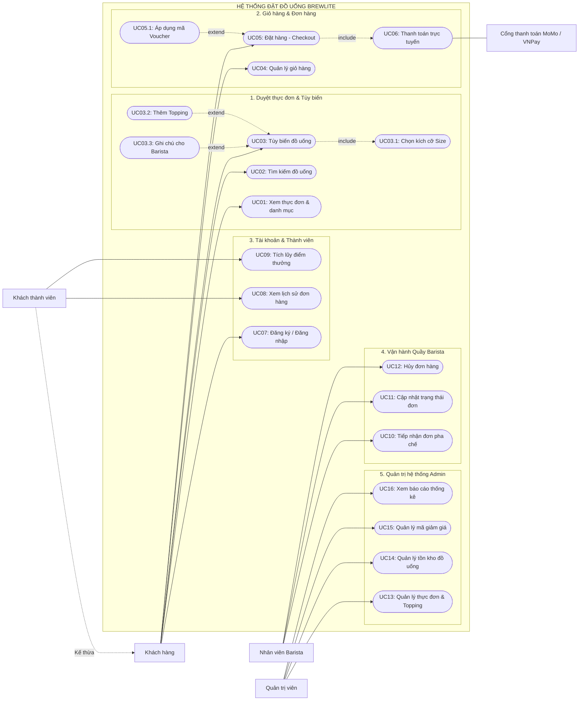
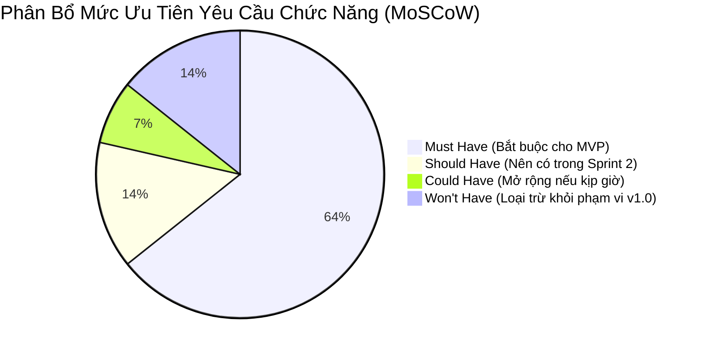

# 📋 BẢNG DANH MỤC YÊU CẦU HỆ THỐNG & ÁNH XẠ MÔ HÌNH HÓA (SRS RÚT GỌN)
## Dự án: BrewLite — Hệ thống đặt đồ uống không dùng tiền mặt (Cashless Coffee Ordering System)

---

> **Cơ sở đào tạo:** Trường Đại học Sài Gòn — Khoa Công nghệ Thông tin  
> **Môn học:** Công nghệ Phần mềm (Software Engineering)  
> **Hạng mục:** Assignment 2 — Task 1.2: Yêu cầu chức năng và phi chức năng (SRS rút gọn)  
> **Phiên bản:** v1.0  
> **Quy chuẩn thực hiện:** Theo chỉ đạo của Giảng viên, thay thế tài liệu User Story văn bản dài dòng bằng **Sơ đồ mô hình hóa UML trực quan** kết hợp **Bảng danh mục mã định danh FR/NFR** để làm đầu vào cho Ma trận truy vết (Traceability Matrix).  

---

## 1. SƠ ĐỒ USE CASE TỔNG QUÁT TOÀN HỆ THỐNG (OVERALL USE CASE MODEL)

Sơ đồ Use Case tổng quát thể hiện toàn bộ các chức năng của hệ thống BrewLite, phân định ranh giới giữa 5 phân hệ và mối quan hệ với 5 nhóm tác nhân (Khách hàng, Khách thành viên, Barista, Admin, Cổng thanh toán).

* **Hình ảnh sơ đồ trực quan:** [`docs/diagrams/use-case/use-case-system.png`](../diagrams/use-case/use-case-system.png)
* **Mã nguồn Mermaid:** [`docs/diagrams/use-case/use-case-system.mmd`](../diagrams/use-case/use-case-system.mmd)

---

## 2. BẢNG DANH MỤC YÊU CẦU CHỨC NĂNG (FUNCTIONAL REQUIREMENTS - FR)

Mỗi yêu cầu chức năng được chuẩn hóa mã định danh `FR-xx`, phân loại mức độ ưu tiên theo chuẩn **MoSCoW** (*Must have, Should have, Could have, Won't have*), tiêu chí chấp nhận có thể kiểm chứng, và được ánh xạ trực tiếp sang các Sơ đồ UML phụ trách:

| Mã FR | Tên yêu cầu chức năng | Phân hệ & Tác nhân | MoSCoW | Tiêu chí chấp nhận có thể kiểm chứng (AC) | Sơ đồ UML phụ trách | Hiện thực API / Code |
| :---: | :--- | :--- | :---: | :--- | :--- | :--- |
| **FR-01** | **Duyệt menu & Lọc danh mục** | Menu *(Customer)* | **Must** | - Hiển thị danh sách đồ uống phân theo Tabs danh mục (Cà phê, Trà, Đá xay, Bánh). - Cho phép lọc sản phẩm theo danh mục (`GET /products?category=...`). - Hiển thị đầy đủ: ảnh, tên, mô tả, giá gốc định dạng VND (`35.000đ`). - Xử lý trạng thái Skeleton Loading và Empty State. | - Use Case: `UC01` - Activity: `activity-flow.puml` - Class: `Product`, `Category` | - API: `GET /products`, `GET /products/categories` - UI: `page.tsx`, `CategoryFilter.tsx`, `ProductCard.tsx` |
| **FR-02** | **Tùy biến Size & Topping** | Menu / Cart *(Customer)* | **Must** | - Nhấn vào món hiển thị Modal chi tiết tùy biến. - Cho phép chọn Size (S: +0đ, M: +5.000đ, L: +10.000đ). - Cho phép chọn đa Topping (Trân châu, Kem Cheese, Sương sáo). - Tổng giá tạm tính trên nút thêm giỏ hàng tự động cập nhật realtime khi click. | - Use Case: `UC03` - Activity: `activity-flow.puml` - Class: `Product`, `SizeOption`, `Topping` | - API: `GET /products/:id` - UI: `ProductDetailModal.tsx` |
| **FR-03** | **Quản lý Giỏ hàng (Client Store)** | Giỏ hàng *(Customer)* | **Must** | - Thêm món cùng Size & Topping tự tăng số lượng `quantity`. - Cho phép tăng (`+`), giảm (`-`), hoặc xóa món khỏi giỏ hàng. - Tự động tính Tạm tính, Giảm giá và Tổng tiền thanh toán. - Dữ liệu giỏ hàng lưu vào `localStorage`, không mất khi F5 trang. | - Use Case: `UC04` - Activity: `activity-flow.puml` - Class: `Order`, `OrderItem` | - Client Store: `useCartStore.ts` (Zustand) - UI: `CartDrawer.tsx` |
| **FR-04** | **Xác thực người dùng bằng JWT** | Tài khoản *(Customer / Member)* | **Must** | - `POST /auth/register`: Đăng ký tài khoản, mật khẩu băm bằng `bcrypt` (salt rounds = 10). - `POST /auth/login`: Xác thực tài khoản, phản hồi chuỗi `accessToken` (JWT). - Sử dụng `JwtAuthGuard` bảo vệ các endpoint yêu cầu quyền cá nhân (`GET /orders/me`). | - Use Case: `UC07` - Sequence: `sequence-checkout.puml` - Class: `User`, `Role` | - API: `POST /auth/login`, `POST /auth/register` - Backend: `AuthService`, `JwtStrategy`, `JwtAuthGuard` |
| **FR-05** | **Khởi tạo đơn hàng (Server Calculation)** | Đơn hàng *(Customer / System)* | **Must** | - `POST /orders` tiếp nhận DTO chứa danh sách món, số lượng, size, toppings. - Backend **tự truy vấn CSDL để tính lại tổng tiền**, chống gian lận giá từ Client. - Tạo bản ghi `Order` ở trạng thái ban đầu là `PENDING`. - Sinh mã đơn hiển thị thân thiện (ví dụ: `#1042`). | - Use Case: `UC05` - Sequence: `sequence-checkout.puml` - Class: `Order`, `OrderItem` | - API: `POST /orders` - Backend: `OrdersController`, `OrdersService.createOrder` |
| **FR-06** | **Thanh toán không tiền mặt Idempotent** | Thanh toán *(Customer / Gateway)* | **Must** | - Hỗ trợ chọn: Ví MoMo, VNPay, Thẻ ngân hàng, hoặc Ví BrewLite. - Client gửi kèm header `Idempotency-Key` (UUIDv4). Gửi lặp request cùng key chỉ xử lý trừ tiền 1 lần. - Thành công: chuyển đơn sang `PAID`, dọn sạch giỏ hàng. - Thất bại: chuyển đơn sang `PAYMENT_FAILED`, giữ nguyên giỏ hàng. | - Use Case: `UC06` - Sequence: `sequence-checkout.puml` - Class: `Payment`, `PaymentStatus` | - API: `POST /payments` - Backend: `PaymentsService.processPayment`, `IdempotencyInterceptor` |
| **FR-07** | **Cỗ máy trạng thái đơn (State Machine)** | Vòng đời đơn *(System / Barista)* | **Must** | - Kiểm soát chuyển đổi trạng thái nghiêm ngặt qua hàm `assertTransition`:   `PENDING` $\rightarrow$ `PAID` $\rightarrow$ `PREPARING` $\rightarrow$ `READY` $\rightarrow$ `COMPLETED`   `PENDING` $\rightarrow$ `PAYMENT_FAILED` $\rightarrow$ `PAID`   `PENDING` / `PAID` $\rightarrow$ `CANCELLED` - Chuyển trạng thái vi phạm (nhảy cóc) bị chặn và trả về lỗi `400 Bad Request`. | - Use Case: `UC11` - Sequence: `sequence-checkout.puml` - Class: `Order`, `OrderStatus` | - Backend: `OrdersService.updateStatus`, `assertTransition` helper |
| **FR-08** | **Kiểm soát tồn kho tranh chấp (Concurrency)** | Tồn kho *(System)* | **Must** | - Sử dụng kỹ thuật Khóa lạc quan (**Optimistic Locking**) với trường `version` trong bảng `Product`. - Thực thi trừ tồn kho trong Database Transaction: `WHERE id = :id AND version = :version AND stock >= :qty`. - Nếu hết hàng hoặc tranh chấp phiên bản, ném lỗi `409 Conflict`. | - Use Case: `UC14` - Sequence: `sequence-checkout.puml` - Class: `Product` | - Backend: `PrismaService.$transaction`, `StockService.decrementStock` |
| **FR-09** | **Tích lũy điểm thưởng thành viên** | Thành viên *(Member)* | **Should** | - Tự động cộng điểm thưởng cho khách hàng thành viên khi đơn đạt trạng thái `PAID` (công thức: mỗi 10.000đ tích lũy 1 điểm). - Khách vãng lai (không đăng nhập) thì bỏ qua tích điểm. - Lưu lịch sử biến động điểm trong bảng `LoyaltyTransaction`. | - Use Case: `UC09` - Sequence: `sequence-checkout.puml` - Class: `User`, `LoyaltyTransaction` | - Backend: `LoyaltyService.awardPoints` |
| **FR-10** | **Mã nhận nước & Lịch sử đơn hàng** | Khách hàng *(Customer / Member)* | **Must** | - Màn hình Order Success hiển thị mã nhận nước to rõ (`#1042`) kèm hướng dẫn nhận nước tại quầy sau 5–7 phút. - Trang Lịch sử đơn hàng (`GET /orders/me`) hiển thị danh sách các đơn đã đặt, thời gian, tổng tiền và trạng thái hiện tại. | - Use Case: `UC08` - Activity: `activity-flow.puml` - Class: `Order` | - API: `GET /orders/me` - UI: `OrderSuccessModal.tsx`, `app/orders/page.tsx` |
| **FR-11** | **Áp dụng mã Voucher giảm giá** | Khuyến mãi *(Customer)* | **Should** | - Khách hàng nhập mã Voucher (ví dụ: `BREWNEW20`). - Kiểm tra điều kiện đơn hàng tối thiểu và hạn sử dụng. - Trừ tiền chiết khấu tự động vào `discountAmount` của đơn hàng. | - Use Case: `UC05.1` - Class: `Voucher`, `Promotion` | - API: `POST /vouchers/apply` - Backend: `VoucherService` |
| **FR-12** | **Quầy tiếp nhận pha chế Barista** | Vận hành *(Barista)* | **Could** | - Màn hình danh sách đơn theo cột trạng thái (`PAID`, `PREPARING`, `READY`). - Nút bấm chuyển trạng thái pha chế nhanh phục vụ quầy Barista. | - Use Case: `UC10`, `UC11` - Activity: `activity-flow.puml` | - UI: `app/barista/page.tsx` *(Phạm vi mở rộng)* |
| **FR-W01** | **Giao hàng tận nhà (Delivery Logistics)** | Giao vận | **Won't** | - Hệ thống không điều phối tài xế giao hàng, không tính phí ship, không theo dõi lộ trình shipper trên bản đồ. Toàn bộ đơn hàng là hình thức khách tự đến lấy tại quầy (Takeaway). | - Ngoài phạm vi MVP (Out-of-Scope) | - Loại trừ khỏi phiên bản v1.0 |
| **FR-W02** | **Thu / Thối tiền mặt tại quầy** | Thu ngân | **Won't** | - Hệ thống không hỗ trợ giao dịch tiền giấy/tiền xu, không in hóa đơn đối soát tiền mặt. Mọi đơn hàng bắt buộc hoàn tất thanh toán trực tuyến không tiền mặt. | - Ngoài phạm vi MVP (Out-of-Scope) | - Loại trừ khỏi phiên bản v1.0 |

### 2.1. Bảng đối chiếu độ phủ 12 nhóm yêu cầu tối thiểu theo đề bài gốc

Theo Mục 3.2 của tệp đề bài gốc [`docs/DE_BAI_ASSIGNMENT_2_GOC.md`](../DE_BAI_ASSIGNMENT_2_GOC.md), tài liệu SRS bắt buộc phải bao quát tối thiểu 12 nhóm yêu cầu:

| STT | Nhóm yêu cầu tối thiểu (Đề bài) | Phân loại | Mã định danh phụ trách | Trạng thái đáp ứng |
| :---: | :--- | :---: | :---: | :---: |
| **1** | **Menu** | Chức năng (FR) | `FR-01` | ✅ Đã đặc tả (Tabs danh mục, lọc món, VND) |
| **2** | **Chi tiết sản phẩm** | Chức năng (FR) | `FR-02` | ✅ Đã đặc tả (Modal Size S/M/L, chọn Topping) |
| **3** | **Giỏ hàng** | Chức năng (FR) | `FR-03` | ✅ Đã đặc tả (Zustand client store, localStorage) |
| **4** | **Xác thực** | Chức năng (FR) | `FR-04` | ✅ Đã đặc tả (Đăng ký, Đăng nhập, JWT, Bcrypt) |
| **5** | **Đặt đơn** | Chức năng (FR) | `FR-05` | ✅ Đã đặc tả (`POST /orders`, tính giá server-side) |
| **6** | **Thanh toán** | Chức năng (FR) | `FR-06` | ✅ Đã đặc tả (Mock Ví/Thẻ, `Idempotency-Key`) |
| **7** | **Lịch sử đơn** | Chức năng (FR) | `FR-10` | ✅ Đã đặc tả (Mã nhận nước `#1042`, `GET /orders/me`) |
| **8** | **Quản lý trạng thái đơn** | Chức năng (FR) | `FR-07` | ✅ Đã đặc tả (State Machine, `assertTransition`) |
| **9** | **Hiệu năng** | Phi chức năng (NFR) | `NFR-01` | ✅ Đã đặc tả ($p95 \le 500\text{ms}$, FCP $\le 1.8\text{s}$) |
| **10** | **Bảo mật** | Phi chức năng (NFR) | `NFR-02` | ✅ Đã đặc tả (Bcrypt $\ge 10$, HTTPS/TLS 1.3, JWT) |
| **11** | **Tính khả dụng** | Phi chức năng (NFR) | `NFR-03` | ✅ Đã đặc tả (Mobile-first, Skeleton, Empty, Error) |
| **12** | **Khả năng triển khai** | Phi chức năng (NFR) | `NFR-05` | ✅ Đã đặc tả (Docker Compose, Cloud HTTPS) |

---

## 3. BẢNG DANH MỤC YÊU CẦU PHI CHỨC NĂNG (NON-FUNCTIONAL REQUIREMENTS - NFR)

Các yêu cầu phi chức năng được thiết kế đảm bảo hệ thống đạt độ tin cậy cao, bảo mật, vận hành mượt mà trên môi trường Production Cloud:

| Mã NFR | Nhóm chất lượng | Tiêu chuẩn kỹ thuật định lượng & Kiểm chứng | MoSCoW | Giải pháp kiến trúc / Công nghệ áp dụng |
| :---: | :--- | :--- | :---: | :--- |
| **NFR-01** | **Hiệu năng (Performance)** | - Thời gian phản hồi API (`Response Time`): $\le 500\text{ ms}$ cho 95% request duyệt menu (`p95`). - Thời gian tải trang ban đầu (First Contentful Paint): $\le 1.8\text{ s}$ trên mạng di động 4G. - Kích thước Bundle JavaScript tải về client $\le 250\text{ KB}$. | **Must** | - Next.js Server-Side Rendering (SSR) kết hợp Client-Side Caching. - Tối ưu truy vấn Prisma với Connection Pooling. - Tailwind CSS tự động purge loại bỏ CSS thừa. |
| **NFR-02** | **Bảo mật (Security)** | - Mật khẩu người dùng bắt buộc được băm bằng thuật toán `bcrypt` với Salt Rounds $\ge 10$, tuyệt đối không lưu plaintext. - Chuỗi JWT Token có thời hạn sử dụng (`expiresIn: 1d`) và ký bằng Secret Key an toàn. - Toàn bộ giao dịch truyền thông trên Production bắt buộc qua giao thức mã hóa **HTTPS/TLS 1.3**. - Header `Idempotency-Key` ngăn chặn hoàn toàn tấn công lặp giao dịch (Replay attacks). | **Must** | - NestJS `Passport-JWT`, `@nestjs/jwt`, `bcrypt`. - Chứng chỉ SSL tự động từ Cloud Provider (Vercel / Render). - Bộ chặn `ValidationPipe` loại bỏ dữ liệu độc hại (XSS, Injection). |
| **NFR-03** | **Tính khả dụng (Usability & UX)** | - Giao diện thiết kế theo triết lý **Mobile-first**, tối ưu hóa cho màn hình cảm ứng di động. - Phục vụ trọn vẹn 3 trạng thái UX: Đang tải (**Skeleton Loading**), Không tìm thấy (**Empty State**) và Báo lỗi (**Error State** có nút Thử lại tự động). - Định dạng tiền tệ VND chuẩn mực (`35.000đ`). Tên món hiển thị cân đối tối đa 2 dòng (`text-balance`). | **Must** | - Tailwind CSS v4 Utility Classes. - Component `ProductSkeleton`, `EmptyState`, `ProductDetailModal`. - Thư viện icon Lucide React sắc nét. |
| **NFR-04** | **Toàn vẹn dữ liệu (Data Integrity)** | - Không bao giờ tin tưởng dữ liệu giá tiền từ Client; Backend tự động truy vấn CSDL để tính toán lại tổng tiền (**Server-side Price Calculation**). - Sử dụng Database Transaction đảm bảo tính chất **ACID** khi khởi tạo đơn hàng và trừ tồn kho nguyên liệu. - Cơ chế **Optimistic Locking** ngăn chặn triệt để tình trạng bán âm tồn kho. | **Must** | - Prisma Transaction API (`prisma.$transaction`). - PostgreSQL ACID Compliance. - Ràng buộc khóa ngoại Foreign Keys và Unique Index trên CSDL. |
| **NFR-05** | **Khả năng triển khai (Deployability)** | - Hệ thống có thể khởi tạo toàn bộ môi trường local bao gồm Frontend, Backend và CSDL PostgreSQL chỉ bằng **1 lệnh duy nhất** (`docker-compose up`). - Có kịch bản chạy Migration và Seed dữ liệu mẫu tự động. - Triển khai thành công lên nền tảng Cloud thực tế (Vercel + Render + Neon PostgreSQL) có URL truy cập công khai. | **Must** | - `docker-compose.yml` đa tầng (Multi-container). - Prisma Migrate & Prisma Seed. - Nền tảng Cloud Managed Hosting. |
| **NFR-06** | **Tự động hóa CI/CD (Automation)** | - Tự động kích hoạt kiểm tra khi mở Pull Request hoặc Push code lên nhánh chính. - Pipeline CI thực hiện tuần tự: `Install Dependencies` $\rightarrow$ `Lint Code` $\rightarrow$ `Run Unit Test` $\rightarrow$ `Build Frontend & Backend`. - Không cho phép merge mã nguồn nếu bất kỳ bước kiểm tra nào bị thất bại (Quality Gate). | **Must** | - GitHub Actions Workflows (`.github/workflows/ci.yml`). - ESLint, TypeScript Compiler (`tsc --noEmit`). |
| **NFR-07** | **Chuẩn mực mã nguồn (Clean Code)** | - **Tuyệt đối không có bất kỳ comment giải thích, ghi chú nào trong các file mã nguồn** (`.ts`, `.tsx`, `.js`, `.css`). Mã nguồn phải tự tường minh (Self-documenting code). - Không để lại code thừa bị comment. - Đặt tên biến, hàm, class chuẩn tiếng Anh chuyên ngành. | **Must** | - Tuân thủ quy định [AGENTS.md](file:///c:/Study/HK1Nam3/CNPM/Project/AGENTS.md). - Quy chuẩn Git Conventional Commits (`feat:`, `fix:`, `docs:`, `chore:`). |
| **NFR-08** | **Khả năng mở rộng (Scalability)** | - Kiến trúc Backend thiết kế dạng module hóa cao (NestJS Modules: `ProductsModule`, `OrdersModule`, `PaymentsModule`, `AuthModule`), dễ dàng tách thành Microservices khi cần. - Hỗ trợ khôi phục tự động khi cơ sở dữ liệu Serverless bị Cold-Start (cơ chế Retry trên Client). | **Should** | - NestJS Modular Architecture. - Cơ chế kết nối Neon Direct URL / Pooled URL. |
| **NFR-09** | **Giám sát sức khỏe hệ thống (Health Check)** | - Cung cấp endpoint `GET /health` phản hồi mã HTTP `200 OK` kèm uptime, memory usage và tình trạng kết nối CSDL PostgreSQL. - Sử dụng bởi nền tảng Cloud (Render / Vercel) để tự động restart container khi gặp sự cố. | **Must** | - NestJS Terminus / Health Controller. - Cloud Container Health Check probe. |

---

## 4. TỔNG HỢP PHÂN BỔ MỨC ƯU TIÊN THEO PHƯƠNG PHÁP MoSCoW

* **Must Have (9/14 yêu cầu chức năng):** Bắt buộc phải có để tạo nên sản phẩm khả dụng tối thiểu (MVP) có thể demo trọn vẹn luồng từ duyệt menu đến thanh toán và nhận đồ uống tại quầy (`FR-01` đến `FR-08`, `FR-10`).
* **Should Have (2/14 yêu cầu chức năng):** Tích điểm thưởng thành viên (`FR-09`) và Áp dụng mã Voucher (`FR-11`) nhằm tăng giá trị giữ chân khách hàng trong Sprint 2.
* **Could Have (1/14 yêu cầu chức năng):** Màn hình Barista KDS chuyên dụng tại quầy (`FR-12`).
* **Won't Have (2/14 yêu cầu chức năng):** Giao hàng tận nhà (`FR-W01`) và Thu tiền mặt tại quầy (`FR-W02`) nhằm giữ đúng định vị không tiền mặt và đặt lấy tại quầy.

---

## 5. KẾT NỐI SANG MA TRẬN TRUY VẾT (TRACEABILITY READINESS)

Tài liệu danh mục `FR` và `NFR` này đóng vai trò là **cột mốc gốc (Source of Truth)** để liên kết xuyên suốt hệ thống theo yêu cầu Mục 8.1 của Assignment 2:

$$\text{Yêu cầu (FR-xx)} \iff \text{Sơ đồ UML (Use Case / Activity / Sequence / Class)} \iff \text{Mã nguồn API / UI} \iff \text{Mã Kiểm thử (Test ID)}$$

Toàn bộ ma trận truy vết chi tiết 4 chiều sẽ được lưu trữ chính thức tại [`docs/traceability-matrix.md`](file:///c:/Study/HK1Nam3/CNPM/Project/docs/traceability-matrix.md).

---
* **Tài liệu bàn giao Task 1:**
  * 📋 **Task 1.1:** [Bối cảnh, Stakeholder & Phạm vi](context-and-scope.md)
  * 📋 **Task 1.2:** [Danh mục yêu cầu FR/NFR & Sơ đồ Use Case tổng quát](system-requirements-matrix.md)
  * 📋 **Task 1.3:** [Đặc tả Use Case trọng tâm: Đặt & Thanh toán không tiền mặt](core-use-case-specification.md)

