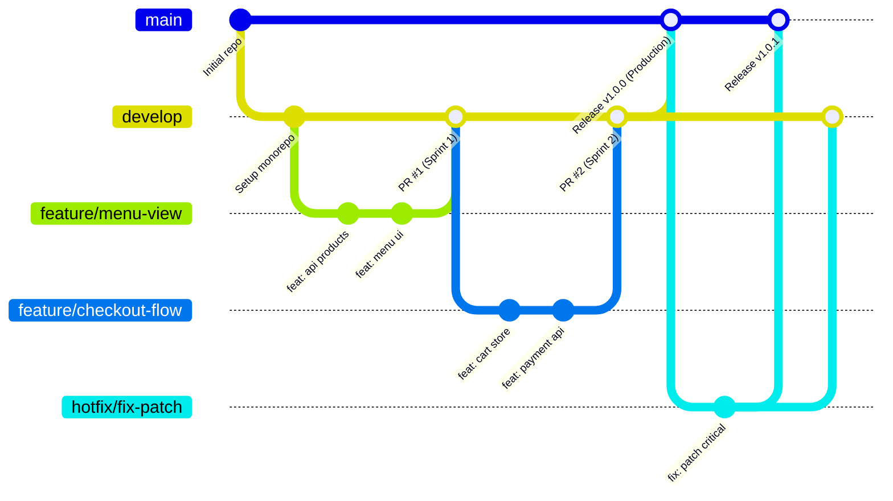

# 🌿 CHIẾN LƯỢC PHÂN NHÁNH VÀ QUY TRÌNH PULL REQUEST (GIT BRANCHING STRATEGY)

> **Dự án:** BrewLite — Hệ thống đặt đồ uống không dùng tiền mặt  
> **Căn cứ đề bài:** Mục 6.1 (Task 4.1) trong tệp đặc tả gốc [`docs/DE_BAI_ASSIGNMENT_2_GOC.md`](../DE_BAI_ASSIGNMENT_2_GOC.md).  
> **Kho mã nguồn:** [https://github.com/nphat-code/swe-project](https://github.com/nphat-code/swe-project)

---

## 1. MÔ HÌNH PHÂN NHÁNH (BRANCHING MODEL)

Dự án áp dụng mô hình **GitFlow tinh gọn (Lightweight GitFlow)** kết hợp với kiểm thử tự động CI trên GitHub Actions:



### 1.1 Các nhánh chính (Long-lived Branches)

| Nhánh | Mục đích | Ràng buộc bảo vệ |
| :--- | :--- | :--- |
| **`main`** | Nhánh Production / Release chính thức. Mã nguồn trên nhánh này luôn ở trạng thái sẵn sàng triển khai thực tế. | Bắt buộc thông qua Pull Request từ `develop`; yêu cầu toàn bộ CI checks pass; không push trực tiếp. |
| **`develop`** | Nhánh tích hợp (Integration branch). Mọi tính năng sau khi hoàn thành sẽ được hợp nhất vào đây để kiểm thử tích hợp. | Bắt buộc thông qua PR từ `feature/*`; CI tự động chạy kiểm thử trước khi merge. |

### 1.2 Các nhánh phụ (Temporary Branches)

| Tiền tố | Cú pháp đặt tên | Nhánh gốc | Nhánh đích | Mục đích |
| :--- | :--- | :---: | :---: | :--- |
| **`feature/`** | `feature/<tên-tính-năng>` | `develop` | `develop` | Phát triển các tính năng theo Yêu cầu chức năng (FR) trong Sprint (ví dụ: `feature/menu-api`, `feature/cart-checkout`). |
| **`bugfix/`** | `bugfix/<mô-tả-lỗi>` | `develop` | `develop` | Sửa chữa các lỗi phát hiện trong quá trình kiểm thử nội bộ Sprint. |
| **`hotfix/`** | `hotfix/<phiên-bản-lỗi>` | `main` | `main` & `develop` | Xử lý khẩn cấp lỗi nghiêm trọng phát sinh trên môi trường Production. |

---

## 2. QUY CHUẨN COMMIT (CONVENTIONAL COMMITS)

Mọi commit bắt buộc tuân thủ chuẩn **Conventional Commits 1.0.0**:

$$\text{<type>(\text{scope}): <mô tả ngắn bằng chữ thường, không dấu chấm cuối>}$$

### 2.1 Các Type hợp lệ:
* **`feat`:** Thêm một tính năng mới cho ứng dụng (Yêu cầu chức năng FR).
* **`fix`:** Sửa lỗi mã nguồn hoặc logic nghiệp vụ.
* **`docs`:** Thêm mới hoặc chỉnh sửa tài liệu (`README.md`, tài liệu `docs/`, LaTeX report).
* **`style`:** Thay đổi định dạng mã không làm thay đổi ngữ nghĩa code (Prettier, khoảng trắng, dấu phẩy).
* **`refactor`:** Tái cấu trúc mã nguồn không thêm tính năng mới cũng không sửa lỗi.
* **`test`:** Bổ sung hoặc chỉnh sửa các bài kiểm thử tự động (Unit, Integration, E2E).
* **`chore`:** Cập nhật công việc bảo trì, cấu hình build, `.gitignore`, dependencies.

### 2.2 Ví dụ mẫu chuẩn:
* `feat(backend): implement GET /products and GET /products/:id with category filtering`
* `feat(frontend): add mobile-first menu page with skeleton loading and category tabs`
* `test(backend): add unit tests for ProductsService and ProductsController`
* `ci(workflow): setup automated GitHub Actions workflow for lint, test, and build`
* `docs(report): update LaTeX report with final activity diagram and compile PDF`

---

## 3. QUY TRÌNH PULL REQUEST (PR WORKFLOW)

Mọi đóng góp mã nguồn từ thành viên đều bắt buộc thông qua quy trình Pull Request:

```
[Lập trình viên: feature branch]
               │
               ▼
   [Tạo Pull Request vào develop]
               │
               ▼
[Tự động kích hoạt GitHub Actions CI]
  ├── Step 1: Install Dependencies
  ├── Step 2: ESLint & Prettier Format Check
  ├── Step 3: TypeScript Static Type Checking
  ├── Step 4: Run Automated Unit Tests (Jest)
  └── Step 5: Docker / Production Build Check
               │
      ┌────────┴────────┐
      ▼                 ▼
   [CI FAIL]        [CI PASS]
      │                 │
  (Sửa lỗi &            ▼
   push tiếp)     [Peer Code Review]
                        ├── Kiểm tra nguyên tắc Zero Comment (AGENTS.md)
                        ├── Kiểm tra bám sát SRS và Ma trận truy vết
                        └── Phê duyệt (Approval)
                                │
                                ▼
                      [Squash and Merge]
```

### 3.1 Tiêu chí hợp nhất (Merge Criteria):
1. **CI 100% Xanh (Green):** Tất cả các jobs trong `.github/workflows/ci.yml` phải hoàn thành thành công.
2. **Quy định không comment trong code ([`AGENTS.md`](../../AGENTS.md)):** Mã nguồn tuyệt đối không chứa comment giải thích thừa thãi; mã phải tự tường minh.
3. **Phê duyệt Code Review:** Ít nhất 1 thành viên khác trong nhóm kiểm tra và Approve PR.
4. **Không có xung đột (No Merge Conflicts):** Branch phải được rebase hoặc merge cập nhật mới nhất từ `develop`.
