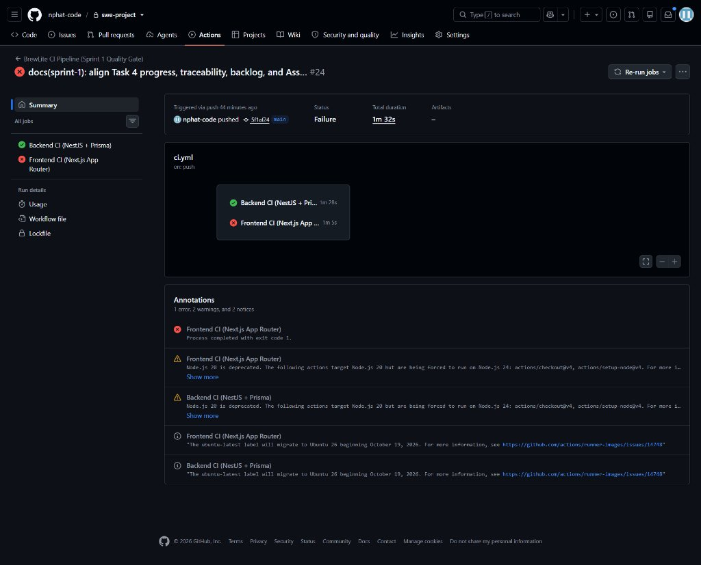
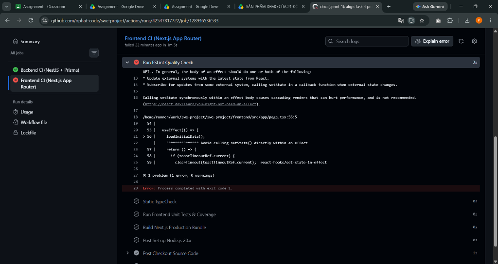
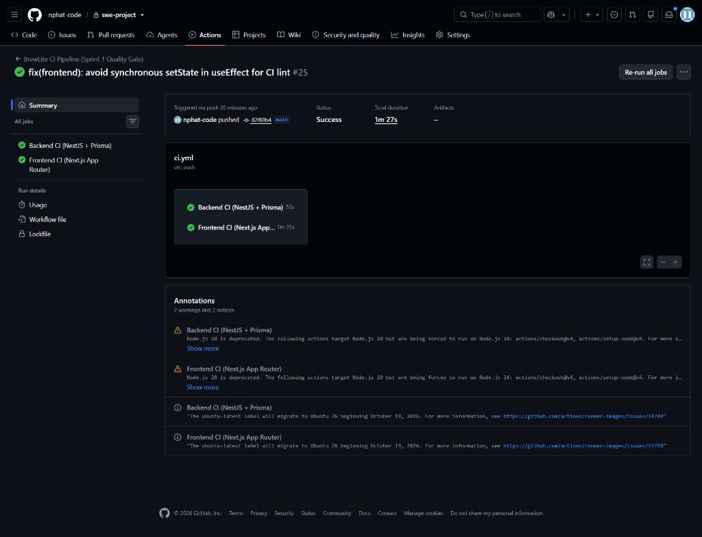

# 🛡️ MINH CHỨNG CONTINUOUS INTEGRATION (TASK 4.4)

> **Căn cứ đề bài:** Mục 6.4 (Task 4.4 – Continuous Integration) trong [`docs/DE_BAI_ASSIGNMENT_2_GOC.md`](../../DE_BAI_ASSIGNMENT_2_GOC.md).  
> **Workflow:** [`.github/workflows/ci.yml`](../../../.github/workflows/ci.yml) (`Install -> Lint -> TypeCheck -> Unit Test -> Build`)  
> **Kho mã nguồn:** [nphat-code/swe-project](https://github.com/nphat-code/swe-project)

---

## 1. LẦN CHẠY PHÁT HIỆN LỖI (CI FAILURE — RUN `#24`)

* **Commit:** `5f1af24` (`docs(sprint-1): align Task 4 progress, traceability, backlog, and Assignment 1 spec`)
* **Trạng thái:** `Failure` (`1m 32s`) — `Backend CI` pass, `Frontend CI` dừng pipeline ở bước `Run ESLint Quality Check` (exit code `1`).
* **Lỗi được bắt tự động:** Rule `react-hooks/set-state-in-effect` tại `frontend/src/app/page.tsx:56` (`loadInitialData()` gọi `setState` đồng bộ trong `useEffect`).

---

## 2. LẦN CHẠY THÀNH CÔNG (CI PASS — RUN `#25`)

* **Commit:** `82f60b4` (`fix(frontend): avoid synchronous setState in useEffect for CI lint`)
* **Trạng thái:** `Success` (`1m 27s`) — Cả hai job `Backend CI (NestJS + Prisma)` (`53s`) và `Frontend CI (Next.js App Router)` (`1m 23s`) vượt qua toàn bộ các chặng `npm ci` $\rightarrow$ `Lint` $\rightarrow$ `TypeCheck` $\rightarrow$ `Unit Test & Coverage` $\rightarrow$ `Build`.

