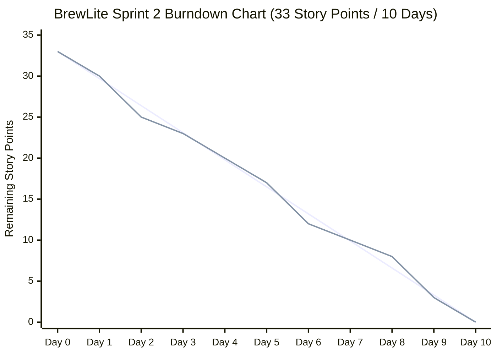

# 🏃 SPRINT 2 BACKLOG, BURNDOWN CHART, REVIEW & RETROSPECTIVE

> **Dự án:** BrewLite — Hệ thống đặt đồ uống không dùng tiền mặt  
> **Căn cứ đề bài:** Mục 2.4, 8, 9, 11 ([`docs/DE_BAI_ASSIGNMENT_1_GOC.md`](../DE_BAI_ASSIGNMENT_1_GOC.md)) & Mục 7 ([`docs/DE_BAI_ASSIGNMENT_2_GOC.md`](../DE_BAI_ASSIGNMENT_2_GOC.md))  
> **Sprint Goal:** *"Hoàn thành luồng đặt và thanh toán không dùng tiền mặt end-to-end (giỏ hàng, JWT, State Machine, thanh toán idempotent, tồn kho đồng thời, lịch sử đơn), đóng gói Docker Compose 3 services và tự động hóa kiểm thử + CI/CD."*  
> **Thời gian Sprint 2:** 2 tuần (10 ngày làm việc — Học kỳ I Năm học 2026–2027)  
> **Tổng Story Points cam kết:** 33 SP (`33 / 33 SP` hoàn thành — Đạt 100%)

---

## 1. BẢNG KANBAN SPRINT 2 (SPRINT 2 BACKLOG ITEMS)

| Mã Task | Mã PBI | Hạng mục kỹ thuật / Story | Nhóm | SP | Trạng thái | Mã FR / NFR |
| :---: | :---: | :--- | :---: | :---: | :---: | :---: |
| **SP2-01** | `PBI-06` | Giỏ hàng Client Zustand + `localStorage` (`CartDrawer`, đồng bộ Header badge, áp mã Voucher) | Frontend | 5 | 🟢 **DONE** | `FR-03`, `FR-11` |
| **SP2-02** | `PBI-08` | Xác thực JWT (`POST /auth/register`, `POST /auth/login`, `GET /auth/me`, `JwtAuthGuard`, `AuthModal`) | Fullstack | 3 | 🟢 **DONE** | `FR-04`, `NFR-02` |
| **SP2-03** | `PBI-09` | API Tạo đơn hàng (`POST /orders`, `GET /vouchers/validate`, server-side calculation, check tồn kho gộp) | Backend | 5 | 🟢 **DONE** | `FR-05`, `FR-11`, `NFR-04` |
| **SP2-04** | `PBI-11` | Order State Machine `assertTransition` (7x7 matrix) + `PATCH /orders/:id/status` + RBAC + hoàn kho `PAID` | Backend | 3 | 🟢 **DONE** | `FR-07`, `NFR-04` |
| **SP2-05** | `PBI-10` | Thanh toán không tiền mặt Idempotent (`POST /payments`, `Idempotency-Key`) + Optimistic Locking (`version`) | Backend | 5 | 🟢 **DONE** | `FR-06`, `FR-08`, `NFR-04` |
| **SP2-06** | `PBI-12` | Tích lũy điểm thưởng Loyalty (`Math.floor(finalAmount / 10000)` khi `PAID`) | Fullstack | 2 | 🟢 **DONE** | `FR-09` |
| **SP2-07** | `PBI-13` | UI Thanh toán (`CheckoutModal`), Xác nhận đơn (`OrderConfirmationModal`), Lịch sử (`OrderHistoryModal`, `GET /orders/me`) | Fullstack | 2 | 🟢 **DONE** | `FR-06`, `FR-10` |
| **SP2-08** | `PBI-15` | Bộ kiểm thử 3 tầng (Unit, Integration đồng thời `(a)(b)(c)`, Supertest HTTP E2E) & Health probe (`GET /health` + DB) | QA / BE | 5 | 🟢 **DONE** | `NFR-04`, `NFR-09` |
| **SP2-09** | `PBI-14` | Multi-stage Dockerfiles (`backend`, `frontend`), `docker-compose.yml` 3 services, CD workflow (`.github/workflows/cd.yml`) & Tài liệu bàn giao | DevOps | 3 | 🟢 **DONE** | `NFR-05`, `NFR-06`, `NFR-08` |

---

## 2. SPRINT 2 BURNDOWN CHART (MỤC 2.4 ASSIGNMENT 1)

* **Tổng cam kết đầu Sprint:** `33 Story Points` trong `10` ngày làm việc (`3.3 SP/ngày` theo đường lý tưởng).
* **Nhật ký cập nhật Story Points còn lại cuối mỗi ngày (Daily Scrum Tracking):**

| Ngày làm việc | Hạng mục hoàn thành (Increment trong ngày) | Ideal Remaining (SP) | Actual Remaining (SP) | Trạng thái tiến độ |
| :---: | :--- | :---: | :---: | :--- |
| **Day 0** | Sprint 2 Planning & chuẩn hóa Prisma schema (`Payment` + migration `0001_init`) | `33.0` | `33` | Khởi động Sprint |
| **Day 1** | Hoàn thành `SP2-02` (`PBI-08`: Auth JWT BE + unit tests) | `29.7` | `30` | Vượt nhẹ / Sát lý tưởng |
| **Day 2** | Hoàn thành `SP2-01` (`PBI-06`: Zustand Cart + `CartDrawer` + `AuthModal`) | `26.4` | `25` | Nhanh hơn kế hoạch |
| **Day 3** | Triển khai `SP2-03` phần Voucher & CreateOrder DTO validation | `23.1` | `23` | Sát kế hoạch |
| **Day 4** | Hoàn thành `SP2-03` (`PBI-09`: `POST /orders`, `GET /orders/me`, server price calc) | `19.8` | `20` | Sát kế hoạch |
| **Day 5** | Hoàn thành `SP2-04` (`PBI-11`: `order-state-machine.ts` 7x7 + `PATCH /orders/:id/status`) | `16.5` | `17` | Chậm nhẹ 0.5 SP |
| **Day 6** | Triển khai `SP2-05` & `SP2-06` (`POST /payments`, Idempotency & Optimistic Lock) | `13.2` | `12` | Vượt lại tiến độ |
| **Day 7** | Hoàn thành `SP2-05`/`SP2-06` & Bộ test chứng minh `(a)(b)(c)` | `9.9` | `10` | Sát lý tưởng |
| **Day 8** | Hoàn thành `SP2-07` (`CheckoutModal`, `OrderConfirmationModal`, `OrderHistoryModal`) | `6.6` | `8` | Tập trung test UI |
| **Day 9** | Hoàn thành `SP2-08` (HTTP E2E Supertest suite + `GET /health` check PostgreSQL) | `3.3` | `3` | Đạt 91% khối lượng |
| **Day 10** | Hoàn thành `SP2-09` (Multi-stage Docker, `docker-compose.yml` 3 services, `.github/workflows/cd.yml`, Docs) | `0.0` | `0` | **Hoàn tất 33/33 SP (100%)** |

---

## 3. SPRINT REVIEW & DEMO CHECKLIST (MỤC 11 ASSIGNMENT 1 & MỤC 7.4 ASSIGNMENT 2)

Biên bản nghiệm thu luồng End-to-End tại cuối Sprint 2:

| # | Kịch bản trình diễn (Demo Scenario) | Kết quả thực tế | Bằng chứng kiểm chứng |
| :-: | :--- | :---: | :--- |
| 1 | Mở trang Menu (`GET /products`, `GET /products/categories`), lọc danh mục, tìm kiếm, xử lý Skeleton/Empty/Error | 🟢 Pass | `frontend/src/app/page.test.tsx` |
| 2 | Chọn món $\rightarrow$ Chọn Size (`S`/`M`/`L`), đa Topping, ghi chú $\rightarrow$ Thêm vào giỏ hàng Zustand | 🟢 Pass | `ProductDetailModal.test.tsx`, `useCartStore.test.ts` |
| 3 | Xem `CartDrawer`, điều chỉnh số lượng, nhập voucher (`BREWLITEFIRST` / `COFFEELOVER`) | 🟢 Pass | `CartDrawer.test.tsx`, `vouchers.service.spec.ts` |
| 4 | Đăng ký / Đăng nhập tài khoản mẫu `customer@brewlite.vn` (`JWT` + `bcrypt`) | 🟢 Pass | `AuthModal.test.tsx`, `auth.service.spec.ts` |
| 5 | Mở `CheckoutModal` $\rightarrow$ Thử thanh toán thất bại (`PAYMENT_FAILED`): giỏ hàng giữ nguyên; thử lại thành công $\rightarrow$ `PAID`, tích điểm Loyalty | 🟢 Pass | `CheckoutModal.test.tsx`, `payments.service.spec.ts`, `checkout-flow.e2e-spec.ts` |
| 6 | Hiện `OrderConfirmationModal` (mã đơn `#xxxxxx`, `PAID`, điểm tích lũy) $\rightarrow$ Xem `OrderHistoryModal` (`GET /orders/me`), hủy đơn / thanh toán lại | 🟢 Pass | `OrderConfirmationModal.test.tsx`, `OrderHistoryModal.test.tsx` |
| 7 | Kiểm chứng 3 tiêu chí Task 10: `(a)` State Machine `assertTransition`, `(b)` Idempotent `Idempotency-Key` 5 luồng song song, `(c)` Optimistic Lock `version` 8 khách tranh tồn kho `stock = 3` | 🟢 Pass | `order-state-machine.spec.ts`, `concurrency-inventory.spec.ts` |
| 8 | Khởi chạy đồng thời 3 services (`postgres`, `backend`, `frontend`) qua Docker Compose & kiểm tra `GET /health` trả về DB latency `up` | 🟢 Pass (CI/Compose) | `docker-compose.yml`, `backend/Dockerfile`, `frontend/Dockerfile`, `app.controller.spec.ts` |

---

## 4. SPRINT RETROSPECTIVE (MỤC 11 ASSIGNMENT 1 & MỤC 7.4 ASSIGNMENT 2)

### 4.1 Những điểm làm tốt (What went well)
* **An toàn giao dịch ngay từ thiết kế:** Giá tiền được tính lại hoàn toàn ở phía Backend (`OrdersService`), tồn kho dùng `updateMany` kèm khóa lạc quan `version` trong `prisma.$transaction`, và `Idempotency-Key` được xử lý nhất quán cả ở cấp HTTP Header lẫn DB unique constraint (`payments.idempotencyKey`).
* **Quy trình Quality Gate chặt chẽ:** Tách nhỏ theo từng bước, luôn chạy `lint`, `typecheck`, `test`, `build` và smoke test HTTP trên Neon PostgreSQL trước khi push; đảm bảo quy tắc zero-comment trong mã nguồn qua kiểm tra AST TypeScript.
* **Kiểm thử đầy đủ 3 tầng:** Đạt độ phủ kiểm thử ở cả Backend Unit/Integration (`17 suites / 89 tests`), Backend Supertest HTTP E2E (`checkout-flow.e2e-spec.ts`), và Frontend Component/Store/Page (`14 suites / 53 tests`).

### 4.2 Thách thức & Bài học kinh nghiệm (Challenges & Lessons Learned)
* **Đường dẫn biên dịch NestJS (`dist/src/main.js` vs `dist/main.js`):** Do `tsconfig.json` bao gồm cả `src/**/*` và `prisma/**/*`, `nest build` xuất đầu ra tại `dist/src/main.js`. Đã phát hiện khi smoke test production build, kịp thời sửa `"start:prod"` trong `backend/package.json` và dùng đúng entrypoint trong `backend/Dockerfile` & `docker-compose.yml`.
* **Khởi tạo Next.js standalone trong Docker context:** Cấu hình `turbopack.root` dùng `..` để trỏ về monorepo root sẽ trỏ nhầm về `/` bên trong container Docker độc lập `/app`. Giải pháp dùng cờ `DOCKER_BUILD=true` để tự động bật `output: 'standalone'` và `turbopack.root = __dirname` cho môi trường container mà không ảnh hưởng phát triển local.
* **Chống xóa dữ liệu khi container khởi động lại:** Script `prisma/seed.ts` mặc định xóa dữ liệu cũ để reset môi trường demo. Đã bổ sung biến `SEED_IF_EMPTY=true` trong Docker Compose để chỉ nạp dữ liệu mẫu khi database rỗng, bảo toàn toàn bộ đơn hàng thật khi container restart.

### 4.3 Kế hoạch hành động & Backlog cho phiên bản v1.1 (Action Items & Next Backlog)
1. **Triển khai chính thức Production Cloud (Task 5.4):** Cấu hình biến secret trên GitHub Actions (`GHCR`, `DEPLOY_HOOK_URL`, `PRODUCTION_API_URL`) để kích hoạt auto-deploy lên máy chủ AWS EC2 / Render / Vercel và xác nhận URL HTTPS công khai.
2. **Mở rộng Barista Kitchen Display System (KDS — `FR-12` nâng cao):** Bổ sung giao diện cho nhân viên quầy cập nhật thời gian thực `PAID -> PREPARING -> READY -> COMPLETED` qua WebSocket / SSE.
3. **Playwright Cross-Browser E2E:** Mở rộng thêm kiểm thử trình duyệt thật trên Chromium/WebKit đối với luồng PWA offline và responsive 375px.

